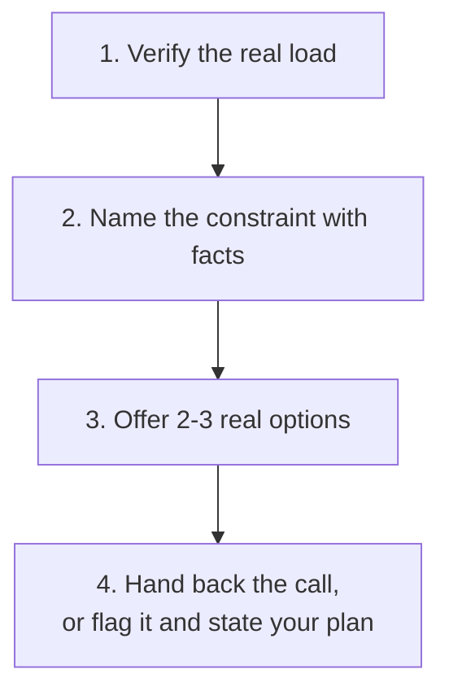

import LevelIntro from "../../../components/LevelIntro.astro";
import Checkpoint from "../../../components/Checkpoint.astro";
import PracticeCheck from "../../../components/PracticeCheck.astro";

export const unit = {
  track: "business-communication",
  unitSlug: "pushback-frameworks",
};

L1 showed that a flat "no" and a silent "yes" both hide the real trade-off,
and introduced trade-off pushback as the third option. L2 explains why each
easy answer hurts trust at a different moment, gives pushback a repeatable
four-step shape, and says who should make the final call.

<LevelIntro
  items={[
    "When each easy answer does its damage",
    "The four steps and four kinds of trade",
    "Why the requester makes the call",
  ]}
/>

## When does each easy answer do its damage?

**If Maya's "no" is honest, why does it still sour things?** It is honest about
the conclusion but not about the reasoning. Sam cannot tell whether it means
"I checked and there is truly no room" or "I don't feel like it", so it reads
as a closed door, and he cannot offer to move anything because he does not
know what the limit is.

**If "yes" keeps things smooth, why is it worse?** Because the cost does not
disappear. It moves to whoever absorbs it later. If Maya says yes to both
Saturday plans, her sister's painting goes unfinished or Sam's move runs
without her, and the person affected only learns this afterward. It reads as a
broken promise, not a trade they agreed to.

| Easy answer  | When the damage appears | How it looks to the other person             |
| ------------ | ----------------------- | -------------------------------------------- |
| Flat "no"    | Immediately             | A closed door, no way to work with it        |
| Silent "yes" | Later                   | A broken commitment they never weighed in on |

<Checkpoint question="A flat 'no' and a silent 'yes' both damage trust, but at different moments. Why does the silent yes often do the worse harm even though it felt friendlier?">

The flat no fails visibly at once, which at least leaves time to react: Sam
can ask someone else, or ask Maya what is going on. The silent yes fails
after the other person has already built plans on it. By the time the hidden
cost surfaces, there is little room left to adjust, and because they never
saw the trade-off, the miss reads as a broken promise instead of a choice
anyone made. Friendliness in the moment bought a bigger problem later.

</Checkpoint>

<PracticeCheck
  track={unit.track}
  unitSlug={unit.unitSlug}
  topicId="damage-timing"
/>

## What are the four steps?

1. Verify the real load: what is already promised, and by when.
2. Name the constraint with facts, not mood: "two tasks are due Friday", not
   "I'm busy".
3. Offer real options the requester can choose between.
4. Ask the requester for the priority call. When the power gap is large, flag
   the trade-off and state your default plan instead.

**Why start by verifying?** Because naming a constraint from memory or mood can
produce one that turns out false, and a false constraint costs trust.

At work the same steps look like this: a sprint has five days of capacity, four
are committed, and a new two-day request arrives. The interactive demo on this level
lets you drag the request size and the capacity to see exactly when a real
trade-off appears, and when there is none.

<PracticeCheck
  track={unit.track}
  unitSlug={unit.unitSlug}
  topicId="four-step-structure"
/>

## What kinds of trade can you offer?

**What does an "option" actually change?** Almost always one of four things:

| Trade-off type | Changes           | Example phrase                                                |
| -------------- | ----------------- | ------------------------------------------------------------- |
| Time           | When it is done   | "I can do it, but it ships Tuesday instead of Friday."        |
| Scope          | How much is done  | "I can make the basic version by Friday, without the extras." |
| Priority       | What else yields  | "I can do it if we move the migration to next week."          |
| Person         | Who does the work | "I can do it if someone else takes the deploy task."          |

Each option must be one you can really deliver. Offering to move a deadline
you do not control is just another hidden promise. Offering two or three
options turns a demand into a choice.

<PracticeCheck
  track={unit.track}
  unitSlug={unit.unitSlug}
  topicId="tradeoff-types"
/>

## Who should make the final call?

**Why not simply pick the best trade-off yourself?** Because the requester
usually knows something you cannot see: whether Friday is a hard date set by a
customer's flight, or just a hopeful guess. Handing back the decision, with the
real cost visible, keeps the call with the person it belongs to. Deciding for
them "to save the trouble" means guessing at their priorities, and either
guessing wrong or silently absorbing the cost yourself, which is a silent yes
again.

If the requester replies "you decide", state which option you are choosing and
what it costs, so the trade-off is still visible.

| Response           | What is communicated             | What happens to the trade-off                   |
| ------------------ | -------------------------------- | ----------------------------------------------- |
| Flat "no"          | A conclusion, no reasoning       | Hidden: the requester cannot evaluate it        |
| Silent "yes"       | Full availability                | Hidden: surfaces later as a missed commitment   |
| Trade-off pushback | The real constraint plus options | Visible: the requester makes an informed choice |

<Checkpoint question="Why does pushback end with the requester choosing, instead of the responder picking the trade-off they think is best?">

The requester is usually the only one who knows which trade is acceptable from
their side, for reasons the responder cannot see from where they sit. If the
responder picks for them, they are guessing at someone else's priorities and
will sometimes guess wrong. Worse, a responder who wants to avoid guessing
tends to absorb the cost quietly, which is the silent yes again. Showing the
cost and handing the choice back keeps the decision with its rightful owner.

</Checkpoint>

<PracticeCheck
  track={unit.track}
  unitSlug={unit.unitSlug}
  topicId="hand-back-decision"
/>

If the same words would land differently with another audience, connect this
with `business-communication/audience-awareness`: the trade-off can stay the
same while the framing changes.
