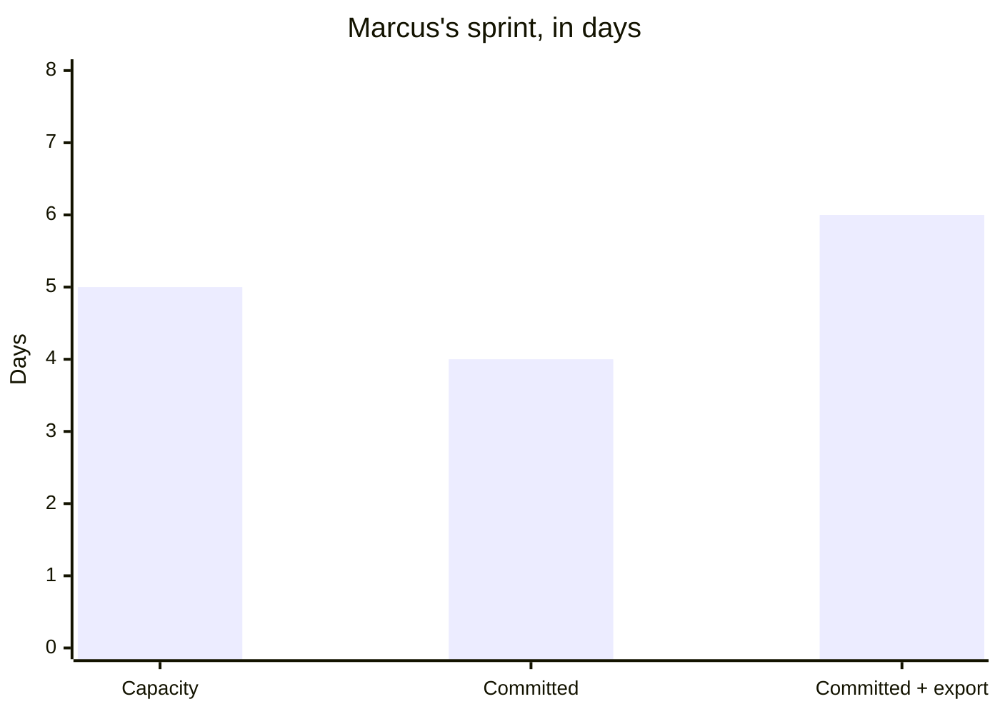
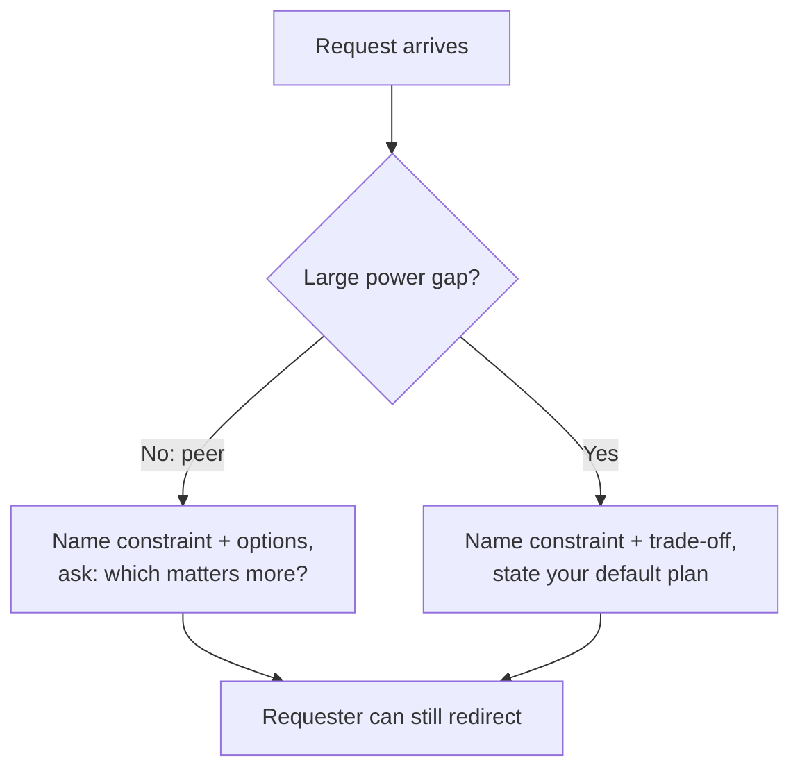

import Scenario from "../../../components/Scenario.astro";
import LevelIntro from "../../../components/LevelIntro.astro";
import Checkpoint from "../../../components/Checkpoint.astro";
import PracticeCheck from "../../../components/PracticeCheck.astro";

export const unit = {
  track: "business-communication",
  unitSlug: "pushback-frameworks",
};

<Scenario label="The actual request, in full">
  <Fragment slot="facts">
    

      
👤 <strong>Who</strong> — Dana, a product manager, asking Marcus, a backend engineer

      
📅 <strong>Ask</strong> — a new export feature (about 2 days of work) by Friday, for a customer demo

      
📊 <strong>Marcus's load</strong> — a billing bug fix and a migration, about 2 days each, against 5 days of capacity

    

  </Fragment>

**Before reading the three replies, predict: of the two bad options, flat
refusal and silent overcommitment, which one tends to damage a working
relationship faster over repeated instances, and why might it not be the more
obviously rude one?**

</Scenario>

<LevelIntro
  items={[
    "One request answered three ways",
    "How the framing shifts with a power gap",
    "What to say when there is no trade-off",
  ]}
/>

The load behind the request is simple arithmetic, and it is the reason a real
trade-off exists:

Four days committed plus a two-day request is six days against five, so one
day has to give. Everything below is about how Marcus says so.

## How do three different replies play out?

**Version 1: flat refusal.**

> "No, I can't take that on right now, the sprint's full."

Dana cannot evaluate this. Is the sprint truly at capacity, or is Marcus not
prioritizing it? She cannot offer to move something, because she does not know
what "full" consists of. Repeated, she starts to read Marcus as uncooperative
whether or not the constraint was real.

**Version 2: silent overcommitment.**

> "Sure, I'll get it in by Friday."

Dana walks away happy, but Marcus now has six days of work in a five-day
sprint with no plan for which part slips. Most likely the billing fix is late
and discovered only when overdue, or the export is rushed and buggy at the
demo. The cost of the yes shows up as a broken commitment Dana never agreed to.

**Version 3: trade-off pushback.**

> "I can take this on, but the sprint is already committed to the billing bug
> fix and the migration, both due this week. If the export is the priority, I
> can ship it Friday and push the migration to early next week. Or, if the
> migration date is firm, I can get the export out the following Tuesday.
> Which matters more for the demo?"

This names the constraint as two specific commitments, offers two concrete
trades (priority and time), and hands the call to Dana, who is the only one who
knows whether the demo date or the migration date matters more.

A reusable template: "I can do **X**, but **Y** is already committed. If **X**
is the priority, then **Z** moves. Another option is **A**. Which trade-off
should we take?"

| Element                    | Version 1                        | Version 2                                 | Version 3                        |
| -------------------------- | -------------------------------- | ----------------------------------------- | -------------------------------- |
| Constraint named?          | Vaguely ("the sprint's full")    | Not at all                                | Yes: two specific commitments    |
| Options offered?           | None                             | None (implicitly: everything)             | Two concrete, named trade-offs   |
| Who decides the trade-off? | Nobody; the request is declined  | Nobody; the cost surfaces later, unchosen | Dana, with the real cost visible |
| Where does the cost land?  | On the relationship, ambiguously | On whichever commitment breaks first      | Agreed explicitly in advance     |

<Checkpoint question="Version 1 names a constraint too ('the sprint's full'), and so does Version 3. Why does Version 1 still fail where Version 3 works?">

Version 1's constraint is vague and unverifiable. "The sprint's full" gives
Dana no facts to evaluate, so she cannot tell a genuine limit from reluctance
and has nothing concrete to trade against. Version 3 names two specific,
checkable commitments and pairs them with options she can choose between. The
difference is not whether a constraint is mentioned at all, but whether it is
concrete enough, and paired with real options, for the requester to act on it.

</Checkpoint>

<PracticeCheck
  track={unit.track}
  unitSlug={unit.unitSlug}
  topicId="version-comparison"
/>

## What changes when the requester outranks you?

**Everything above assumed Dana and Marcus are peers who can negotiate openly.
What if the requester is an executive several levels up, someone Marcus cannot
simply hand a question back to?** The structure stays; the delivery shifts.
"Which do you want me to prioritize?" can read as pushing a decision upward
that is not really theirs to make. Instead Marcus states it as information: "I
want to flag the trade-off before I confirm: taking this on means the migration
slips to next week. That is my plan unless you tell me otherwise."

| Relationship           | Better framing                                   | Why it works                                         |
| ---------------------- | ------------------------------------------------ | ---------------------------------------------------- |
| Peer / shared decision | "Which matters more for the demo?"               | The other person can openly choose the trade-off     |
| Executive / power gap  | "I want to flag the trade-off before I confirm." | Visibility without sounding like refusal-by-question |

<Checkpoint question="With an executive, why does 'I want to flag the trade-off before I confirm' work better than the peer framing, when the information is exactly the same?">

The facts are the same, but an open question to someone with far more
positional power can read as handing them your prioritizing, which can land as
deflecting rather than informing. Stating the trade-off as visibility given
before you commit, plus the plan you will follow by default, keeps the
commitment in your hands while still showing the real cost. The executive gets
the same facts without being asked to do your prioritizing, and can still
redirect you if the plan is wrong.

</Checkpoint>

<PracticeCheck
  track={unit.track}
  unitSlug={unit.unitSlug}
  topicId="power-gap"
/>

For the incentive side of this, connect the pattern with
`business-communication/reading-stakeholder-incentives`. If neither person can
decide the trade-off cleanly, the next step starts to look like
`business-communication/conflict-resolution`.

## What if there is genuinely no trade-off?

**Every example above assumed a real constraint. What should Marcus say if,
after checking, the sprint has slack and the request fits at no cost?** Say so
plainly: "I checked my week and this fits without anything else slipping." That
is itself informative, and it spares Dana wondering whether a cost is being
hidden. The framework is not about inventing a constraint to seem
appropriately cautious. It is about surfacing whatever the real trade-off is,
including none.

| Failure mode                                           | What it gets wrong                                                                |
| ------------------------------------------------------ | --------------------------------------------------------------------------------- |
| Refusing without naming the actual constraint          | The requester cannot evaluate or negotiate what they cannot see                   |
| Accepting without surfacing the real cost              | The trade still happens, but later and unagreed-to                                |
| Offering vague flexibility ("I'll try my best")        | Gives the requester nothing specific to decide between                            |
| Posing an open question to someone with far more power | Can read as pushing the decision back up; better as information plus a plan       |
| Inventing a constraint to seem busy                    | Erodes trust once discovered, and the method depends on the constraint being true |

<PracticeCheck
  track={unit.track}
  unitSlug={unit.unitSlug}
  topicId="no-real-tradeoff"
/>

## This worked example is a case, not the whole territory

Marcus and Dana are one pairing, with one deadline and one clean arithmetic
gap. Try extending it yourself:

- **What if the request came from three people at once**, each with a "top
  priority" and none aware of the others? Who is the owner of the priority
  call, and what would you hand back to whom?
- **What if the news were worse**: the request cannot be done by any date
  without dropping something that a customer is already relying on? Which of
  the four kinds of trade is still available, and which are not?
- **What if Marcus were new and Dana were the long-standing owner of the
  roadmap**, or the reverse? How much of the constraint would you spell out,
  and would your hand-back sound different?
