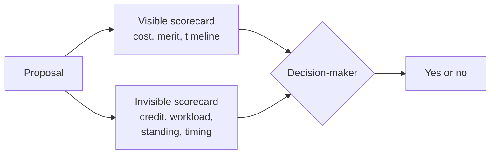

import Scenario from "../../../components/Scenario.astro";
import LevelIntro from "../../../components/LevelIntro.astro";
import PracticeCheck from "../../../components/PracticeCheck.astro";

export const unit = {
  track: "business-communication",
  unitSlug: "reading-stakeholder-incentives",
};

<Scenario label="A cost-saving proposal that should have been an easy yes">
  <Fragment slot="facts">
    

      
💰 <strong>The proposal</strong> — merge two overlapping internal tools into one, cutting maintenance work

      
📊 <strong>The case</strong> — clean numbers, a clear technical win, no downside anyone can name

      
❌ <strong>The result</strong> — rejected by the lead of the team that owns the tool being retired

    

    

      

        
Visible

        Cost savings, technical merit, timeline
      

      

        
Invisible until too late

        The other lead built that tool last year; retiring it now reads as "that was wasted work" right before their review
      

    

  </Fragment>

An employee proposes merging two overlapping internal tools into one: simpler to
run, less upkeep, no downside anyone can point to. It is rejected. Not with a
counter-argument about the numbers, just a firm "not right now" from the lead of
the team that owns the tool being retired. **The proposal was, by every
technical measure, obviously right. So why did it die in one meeting?**

The tool being retired was that lead's own team's flagship project from the
previous year. Approving the merge, right before performance review season,
would read as an admission that a year of their team's work was redundant.
**The proposal was judged on its merits and rejected anyway, because merit was
never the only criterion the decision was being made against.**

</Scenario>

The same shape shows up far from offices. Suggest replacing the family's shared
chore chart with a new app, and the sibling who designed the chart last year
may say "not now" without ever discussing the app's features. The suggestion
was fine; what it _meant_ for that person was the issue.

<LevelIntro
  items={[
    "Visible versus invisible scorecard",
    "A rejection as information, not an obstacle",
    "Why incentives are not malice",
  ]}
/>

## Why can a correct proposal still lose?

**If the numbers were right, what else was being decided?** Every decision has
two scorecards. The **visible scorecard** is what the proposal is argued on:
cost, quality, timeline. The **invisible scorecard** is what saying yes or no
does to the specific person who must decide: their credit, their workload,
their reputation, their timing.

| Scorecard | Who can see it            | Did the original pitch address it? |
| --------- | ------------------------- | ---------------------------------- |
| Visible   | Everyone in the room      | Yes, thoroughly                    |
| Invisible | Mostly the decision-maker | No, not at all                     |

An **incentive** is what makes saying yes or no feel beneficial or costly for a
specific person. A **stakeholder** is anyone whose approval or cooperation the
proposal needs.

<PracticeCheck
  track={unit.track}
  unitSlug={unit.unitSlug}
  topicId="two-scorecards"
/>

## Is a rejection without a counter-argument just noise?

**When nobody disputes your numbers but the answer is still no, what is the no
telling you?** That something outside the visible facts is deciding. A
rejection without a real counter-argument is data: it points at a competing
incentive, a timing conflict, or a risk to someone's standing. Repeating the
same pitch louder ignores that data.

<PracticeCheck
  track={unit.track}
  unitSlug={unit.unitSlug}
  topicId="rejection-as-information"
/>

## Was the team lead being unreasonable?

**Does an invisible scorecard mean the lead was selfish or acting in bad faith?**
No. From their position, protecting a year of their team's work right before a
review is a perfectly rational priority. Incentives describe what a position
rewards and punishes; they say nothing about the person's character. Assuming
malice is also a diagnostic error: it replaces "what is blocking this?" with
"who is the villain?", and the second question has no useful next step.

| Reading of the rejection          | What it leads to                       |
| --------------------------------- | -------------------------------------- |
| "They are being irrational"       | Argue harder, resent them, same result |
| "They are acting in bad faith"    | Escalate or avoid them, trust erodes   |
| "Their position makes yes costly" | Find the cost and address it directly  |

<PracticeCheck
  track={unit.track}
  unitSlug={unit.unitSlug}
  topicId="rational-not-malicious"
/>

## What the next levels cover

L2 turns the invisible scorecard into a simple map of four questions you can
fill in before a pitch, and names two levers for a second attempt. L3 works a
full second pitch, shows what stayed the same and what changed, and tests the
map where the usual levers are unavailable.
