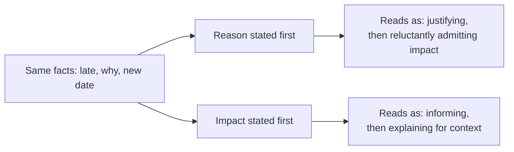

import Scenario from "../../../components/Scenario.astro";
import LevelIntro from "../../../components/LevelIntro.astro";
import PracticeCheck from "../../../components/PracticeCheck.astro";

export const unit = {
  track: "business-communication",
  unitSlug: "status-updates-build-trust",
};

<Scenario>
  <Fragment slot="facts">
    

      

        Day 14
        of a 14-day estimate
      

      

        

      

      
Due today. Not finished.

    

    

      
🔌 An outside service you depend on limits requests differently than its instructions say

      
🔁 Your plan for handling refused requests has to be redone

    

    
Two honest drafts

    

      
🌫️ Draft A: "almost there," no date

      
🎯 Draft B: new date, named reason, explicit ask

    

  </Fragment>

You estimated a piece of work at two weeks. It is now day 14, the original due
date, and it is not finishing today, because an outside service you depend on
limits requests differently than its own instructions promise. Your plan for
handling refused requests has to be redone. You must send today's status
update, and both drafts below are completely honest:

| Draft | What it says                                                                                                                                                                                                                                     |
| ----- | ------------------------------------------------------------------------------------------------------------------------------------------------------------------------------------------------------------------------------------------------ |
| A     | "Almost there. Running into some issues with the outside service, should be wrapped up in the next couple days."                                                                                                                                 |
| B     | "This will miss the original estimate. The outside service limits requests differently than documented, so I'm redoing how we handle refusals. New estimate: one more week. I'll flag immediately if that changes; nothing needed from you now." |

**Before reading on: both are true today. If next week's estimate also has to move, which draft do you predict is still believed, and which one just spent trust it can't get back?**

</Scenario>

<LevelIntro
  items={[
    "The two jobs every status update has",
    "Impact first, reason second",
    "The parts of an update that can be checked later",
  ]}
/>

## If both drafts are true, what is Draft A failing at?

Neither draft lied. So the difference cannot be about facts. A status update
does **two jobs at once**: it conveys accurate information, and it shapes how
much the reader will believe your _next_ update. Draft A does the first job and
quietly fails the second.

| Job | Question it answers                      | Fails when                                       |
| --- | ---------------------------------------- | ------------------------------------------------ |
| 1   | Are the facts right?                     | A claim turns out to be false                    |
| 2   | Will the reader believe the next update? | Delivery is vague, badly ordered, or goes silent |

The failure this unit is really about is not lying. It is **optimism bias
reported as fact**: saying "should be done Friday" without flagging real
uncertainty, then letting Friday quietly turn into the next Friday. Each update
felt honest when written. The pattern, read back later, reads as unreliable.

<PracticeCheck track={unit.track} unitSlug={unit.unitSlug} topicId="two-jobs" />

## Why does the order of two true sentences matter?

When something is late, the natural impulse is to explain _why_ first and state
the impact after. It backfires: the reader has to judge whether your excuse is
good enough before they even know what it costs them, so even a legitimate
reason sounds like pleading. **BLUF** ("bottom line up front") fixes this by
stating the status and impact first (what is late, by how much, what it
affects), then the reason as context.

<PracticeCheck
  track={unit.track}
  unitSlug={unit.unitSlug}
  topicId="impact-first"
/>

## What does a believable update contain that a vague one lacks?

**If "soon" is the honest best guess, why is it not good enough?** Because the
reader cannot check it. A trust-building update reliably carries three things a
trust-eroding one usually lacks: a **specific** new estimate, a stated reason
this estimate is **more reliable** than the last one, and an explicit statement
of what, if anything, is needed from the reader.

| Draft A reads as                                             | Draft B reads as                                                     |
| ------------------------------------------------------------ | -------------------------------------------------------------------- |
| Vague, no falsifiable claim, so it can't be checked later    | A specific claim: the new date either holds or it doesn't            |
| No reason this guess is better than the last one             | Names what changed (the redo is now scoped around the real behavior) |
| No explicit ask, so the reader doesn't know whether to worry | Explicit: nothing needed right now, plus a promise to flag changes   |

A usable delay update can be this small:

> Status: this will miss today's date. Impact: one-week delay, nothing needed
> from you right now. Cause: the outside service behaves differently than its
> instructions say. New estimate: next Friday, because the redo is now scoped
> around the real behavior. Ask: I'll flag immediately if that changes.

Vocabulary used above:

| Term          | Plain meaning                                                        |
| ------------- | -------------------------------------------------------------------- |
| BLUF          | "Bottom line up front": say the most important status first          |
| Falsifiable   | Specific enough that a later reader can check whether it held        |
| Optimism bias | Reporting the hopeful version as if it were already the likely truth |

Frequency matters too. A delay surfaced early and in small steps tends to cost
less trust than the same delay announced once, on the due date, as a surprise.
L2 explains why.

<PracticeCheck
  track={unit.track}
  unitSlug={unit.unitSlug}
  topicId="update-components"
/>

## What the next levels cover

L2 explains the mechanism behind each choice: why order changes the reading
experience, how to separate what is known from what is estimated, and why
update frequency is its own trust variable. L3 follows one delay reported two
ways across several weeks and names the failure modes that undo good
intentions.
