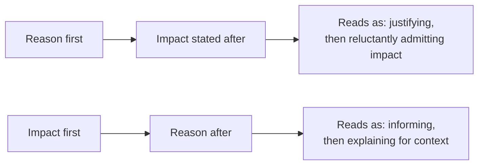
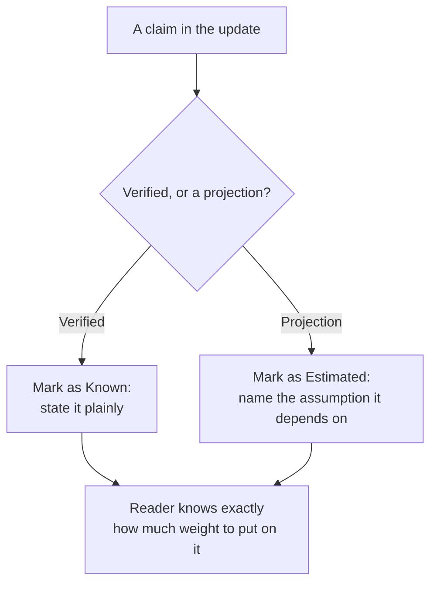
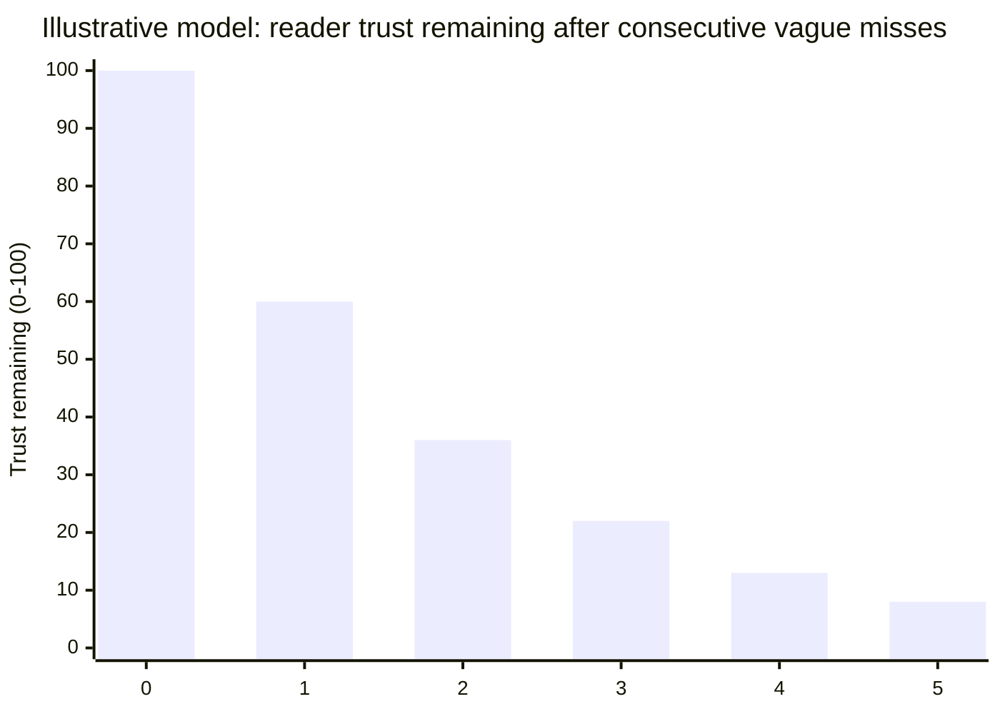

import LevelIntro from "../../../components/LevelIntro.astro";
import Checkpoint from "../../../components/Checkpoint.astro";
import PracticeCheck from "../../../components/PracticeCheck.astro";

export const unit = {
  track: "business-communication",
  unitSlug: "status-updates-build-trust",
};

L1 showed two honest drafts of the same delay and asked which one survives a second miss. L2 explains the mechanism behind that difference, not just the outcome: what the reader is doing while they read, what makes a claim checkable, and what silence does.

<LevelIntro
  items={[
    "What a reader does while waiting for the impact",
    "Known versus estimated claims",
    "Frequency as its own trust variable",
  ]}
/>

## Same facts, two reading experiences

If a reader has to sit through your explanation before finding out how late something is, what are they doing with their attention while they wait?

They are not absorbing your reasoning calmly. They are bracing, because they do not yet know how bad the news is. That is the whole mechanism behind why order matters even when nothing else about the message changes:

Both paths can carry the exact same facts: same delay, same cause, same new date. What differs is what the reader must sit through before getting the information they actually need. Leading with the reason forces them to judge whether the excuse is good enough _before_ they know what it costs them. Leading with the impact lets them assess what matters to them immediately, with the reason available as context rather than a prerequisite.

<Checkpoint question="Two updates carry identical facts (same delay, same cause, same new date) and differ only in which sentence comes first. Why does the reader end up with a different impression of the two senders?">

Because the reader cannot evaluate the facts until they have received them, and until then they are bracing rather than absorbing. Leading with the reason makes them sit through an unresolved justification before they know what it costs them, which reads as explaining away. Leading with the impact answers the only question they actually have first, what is late and by how much, so the reason that follows lands as context instead of pleading. The information is identical; only the order of relief changes.

</Checkpoint>

## What separates a believable update from an eroding one?

Two updates can both be true. What is the actual, checkable difference between the one that keeps a reader's confidence and the one that quietly spends it?

| Component                          | Trust-eroding version                                   | Trust-building version                                                                            |
| ---------------------------------- | ------------------------------------------------------- | ------------------------------------------------------------------------------------------------- |
| New estimate                       | "Should be done soon": vague, unfalsifiable             | "Finishing Thursday, based on the two remaining items": specific, checkable                       |
| Why this estimate is more reliable | Not addressed; same confidence as the last (missed) one | States what changed: "unlike last week, the blocking dependency is now resolved"                  |
| What is needed from the reader     | Left implicit, or absent entirely                       | Explicit: nothing, or a specific decision or input, named directly                                |
| Track record                       | Silent about the previous missed estimate               | Briefly acknowledges it if relevant; silence about a known miss reads as hoping it goes unnoticed |

The vague-estimate row is the most common failure precisely because it _feels_ honest in the moment. Nobody is lying; "soon" really is the best guess. But a string of "soon"s that do not hold up is indistinguishable, from the reader's side, from someone with no real handle on the situation, whether or not that is true.

In simpler words: a believable update gives the reader something they can check later, explains why the new guess is not just the old guess repeated, and says whether they need to do anything.

## Known versus estimated: keeping updates honest under uncertainty

If every sentence in an update was a good-faith guess at the time, how does a track record still end up reading as unreliable in hindsight? Almost always because "confirmed" and "projected" got blended into one undifferentiated stream of claims.

| Claim type | Work example                                                                  | School-event example                                                           |
| ---------- | ----------------------------------------------------------------------------- | ------------------------------------------------------------------------------ |
| Known      | "The supplier's fix is delivered and installed."                              | "The room is booked and the teacher approved the new date."                    |
| Estimated  | "Final testing should take about two more days, assuming no further changes." | "We should finish posters by Thursday, assuming the printer has ink tomorrow." |

The first row of each pair is already checked. The second is a reasonable guess that depends on a named condition. Marking it as an estimate and naming the assumption does two things a flat "should be done in two days" does not: it tells the reader how much weight to put on the number, and it gives everyone a specific, checkable reason if the assumption fails, instead of a vague sense that the estimate was "wrong somehow."

<Checkpoint question="A teammate writes: 'Final testing should take about two more days.' What is missing that would turn this from a vague guess into a properly labeled estimate?">

A named assumption. As written, the sentence does not say what the two-day number depends on, so if it turns out wrong there is no specific thing to point to; it just reads as "the estimate was off." Adding the condition it rests on, for example "...two more days, assuming no further changes," does two jobs at once. It tells the reader how much weight to put on the number today, and it gives everyone a concrete, checkable reason if that assumption fails later.

</Checkpoint>

<PracticeCheck
  track={unit.track}
  unitSlug={unit.unitSlug}
  topicId="known-vs-estimated"
/>

## Frequency as a trust variable, independent of content

If the facts at the end are identical either way, why would _how often_ you update change anything? Because the reader is not grading the final facts alone. They are also grading how long they were left to fill the gap themselves.

The same eventual delay, surfaced in three small updates as the picture became clearer, tends to read as a team on top of the situation. The identical delay, surfaced once as a surprise on the original due date, tends to read as a team that either did not see it coming or sat on the information, even though the facts at the end are the same. This is why "no news" during real uncertainty is itself a trust cost rather than a neutral default: silence gets filled in by the reader's own assumptions, which are rarely more generous than the truth.

The cost compounds when vagueness repeats. A single "should be done soon" is a normal hedge; the same phrase reused across several consecutive misses is what erodes trust, because each miss is judged against the ones before it. The numbers below are an illustrative model, not a measurement: each vague miss is assumed to remove 40% of whatever trust is left. They show a shape, not a statistic.

The shape is the lesson: trust does not fall off a cliff at any single miss, it compounds downward, which is why the third "almost there" does more damage than the first. (Play with this directly in the interactive demo below.)

<Checkpoint question="An update has nothing new in it, but you are sending it because 'it's Friday.' What does that habit cost you, and what is the better rule?">

It trains readers to skim. If every update looks the same whether or not anything changed, the one that finally carries news they must act on gets skimmed too. The better rule is not "always update" and not "only update when finished." It is: do not let the reader assume good news while you know the situation is uncertain. When there is real uncertainty, a short "still investigating, next specific estimate by Tuesday" beats silence. When nothing has changed and nothing is at risk, staying quiet is fine.

</Checkpoint>

<PracticeCheck
  track={unit.track}
  unitSlug={unit.unitSlug}
  topicId="frequency-and-silence"
/>

## The checklist behind all of this

One set of questions decides most of an update's structure before you write a single sentence. Which one matters most? The first, because every other answer depends on it.

1. **What is confirmed, and what is still a projection?** Label each explicitly; this is what keeps optimism from quietly becoming misinformation.
2. **What is the impact, stated first?** Lead with what is late and by how much; the reason is context, not a prerequisite.
3. **What changed since the last estimate that makes this one more reliable?** A repeat guess with the same confidence as a missed one earns no more trust than the miss did.
4. **What, if anything, do I need from the reader?** State it explicitly, even if the answer is "nothing yet."
5. **Is this update triggered by genuinely new information, or only by a schedule?** An update with nothing new trains readers to skim.

L3 uses this as the lens for two versions of the same delay: one skips questions 1, 3, and 5, the other answers all five every time.
