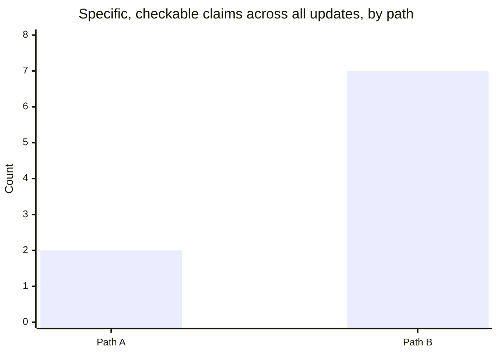

import Scenario from "../../../components/Scenario.astro";
import LevelIntro from "../../../components/LevelIntro.astro";
import Checkpoint from "../../../components/Checkpoint.astro";
import PracticeCheck from "../../../components/PracticeCheck.astro";

export const unit = {
  track: "business-communication",
  unitSlug: "status-updates-build-trust",
};

<Scenario label="The scenario">
  <Fragment slot="facts">
    

      
📅 Estimated: 2 weeks

      
⏱️ Finished in week 4 (Path A) or week 3 (Path B)

      
🔌 Cause: an outside service limits requests differently than documented

      
🔁 Fix: redo how refused requests are handled

    

    
Two paths, same root cause

    

      
🌫️ Path A: three consecutive "almost there"s

      
🎯 Path B: one named cause, one specific date, finished on that date

    

  </Fragment>

A piece of work was estimated at two weeks. Because an outside service limits requests differently than its own instructions promise, the plan for handling refused requests has to be redone. We will follow two versions of the same situation, reported weekly, and stipulate one thing to keep the comparison fair: the underlying difficulty is identical. The facts converge by the end in both paths, but the experience of reading them does not.

</Scenario>

<LevelIntro
  items={[
    "The same delay reported two structurally different ways",
    "Counting checkable claims, not word count",
    "Failure modes that undo good intentions",
  ]}
/>

In plain language: the work depends on a service someone else runs. That service did not behave the way its instructions promised, so the team had to redesign what their own system does when a request is slowed or refused.

## Path A: trust-eroding (technically honest, badly structured)

**Week 2 (original due date):** "Almost there. Running into some issues with the outside service, should be wrapped up in the next couple days."

**Week 3:** "Still working through some edge cases. Hoping to have it done by end of week."

**Week 4:** "This has taken longer than expected because the service limits requests differently than documented, which required a different approach than originally planned. Should be done by Friday."

Every individual sentence is arguably true when written. Read as a sequence, though, it is three consecutive "almost there"s, each wrong, with the real explanation showing up only in week 4. By then "should be done by Friday" carries the weight of two broken promises, whether or not this one is different.

<Checkpoint question="Every single sentence in Path A was arguably true when it was written. So what exactly is the reader reacting badly to, if not a lie?">

The reader is reacting to the pattern across three updates, not to any one sentence: the same vague, unfalsifiable phrase repeated at each miss, with the real cause surfacing only in week 4. Each update was locally honest, but the sequence reads as either not understanding the problem or not wanting to say so, because nothing in it let the reader check a claim against reality until it had already failed twice.

</Checkpoint>

## Path B: trust-building (identical facts, different structure and specificity)

**Week 2 (original due date):** "This will miss the original estimate. The outside service limits requests differently than documented, and I need to redo how we handle refusals. New estimate: one additional week, through week 3. I'll flag immediately if that changes; nothing needed from you right now."

**Week 3, midweek (new information arrived):** "Update: the redone handling is finished and tested against the service's real behavior, not just its documentation, so I'm more confident in this estimate than last week's. Finishing by end of week 3 as planned."

**Week 3 (on schedule):** "Done, as estimated last week."

Path B surfaces the same root cause immediately, gives a specific revised date instead of "wrapped up soon," and separates what is confirmed (the redo is finished and tested) from what is still a projection. In this constructed case it also finishes on time for its _second_ estimate, not because the work was easier, but because the first estimate absorbed the newly understood complexity instead of restating optimism.

The first Path B update has five parts:

| Part                        | Text doing that job                                       |
| --------------------------- | --------------------------------------------------------- |
| Impact first                | "This will miss the original estimate"                    |
| Cause                       | "The service limits requests differently than documented" |
| New estimate                | "One additional week, through week 3"                     |
| Why this estimate is earned | The redo is now scoped around the real behavior           |
| Ask                         | "Nothing needed from you right now"                       |

<PracticeCheck
  track={unit.track}
  unitSlug={unit.unitSlug}
  topicId="path-comparison"
/>

## What is identical, and what is different?

The technical problem and its real difficulty are the same in both paths. This is not a story about Path B's author being a better engineer. In this scenario, Path A keeps the first missed estimate alive for two more cycles, so the proper redo is scoped late and the work reaches week 4. Path B names the newly understood complexity at week 2 and sets a larger, realistic estimate immediately, so it can finish in week 3. The difference is update discipline: Path A repeated a vague, unfalsifiable projection three times without naming what was uncertain; Path B named the uncertainty once, gave a specific number, and updated again only when there was new information.

Counting only concrete, checkable claims per path (a specific date, a named cause, a stated "what changed," an explicit ask), because word count does not track this: Path A's week-4 message is actually the longest in either path.

The tally behind the chart. Path A has two: the cause and the "Friday" date, both in week 4; everything earlier was "some issues" and "edge cases," which cannot be checked against anything. Path B has seven: cause, date, and ask in week 2 (3); the confirmed-versus-projected label, the reason for more confidence, and the date in the midweek update (3); and the verified "done" at the end (1).

| &nbsp;                            | Path A                                                             | Path B                                                                          |
| --------------------------------- | ------------------------------------------------------------------ | ------------------------------------------------------------------------------- |
| **When the cause is named**       | Week 4, after two vague updates were already spent                 | Week 2, on the original due date                                                |
| **First specific date given**     | Week 4 ("Friday")                                                  | Week 2 ("one additional week, through week 3")                                  |
| **Known vs. estimated labeled**   | Never; every claim reads with the same confidence                  | Yes; the midweek update separates "finished and tested" from the projection     |
| **Updates triggered by**          | A fixed weekly schedule, regardless of new information             | New confirmed information (the midweek update exists because something changed) |
| **Reader's experience by week 4** | Third consecutive miss; this "Friday" inherits two broken promises | On-time delivery of the second estimate, which was itself accurate              |

<Checkpoint question="The underlying difficulty was identical in both paths, and Path B still finished a week earlier. If Path B's author was not a better engineer, what bought back that week in this scenario?">

Naming the real complexity at week 2 instead of week 4. Path A kept restating the original, too-optimistic estimate for two more cycles before finally scoping the redo properly, which is what pushed it out to week 4. Path B folded the newly understood complexity into a single, larger, honest estimate right away, so the actual work had a realistic target from the start instead of being squeezed against a date that was already wrong. Honest early scoping and honest early reporting are the same act here.

</Checkpoint>

## Failure modes

- **Treating "I don't want to alarm anyone" as a reason to stay vague.** Vagueness does not prevent alarm; it delays and compounds it, because the reader eventually gets the real news stacked on top of every soft update that did not hold up.
- **Re-explaining the same cause every week without new information.** Path B sent a midweek update only because something was genuinely confirmed. An update with no new fact, sent purely on a schedule, trains readers to skim.
- **Apologizing at length instead of stating the plan.** A brief, direct acknowledgment ("this will miss the original estimate") does the accountability work. A long apology first reads as managing the reader's feelings about the news and delays the part they need.
- **Confusing "no news" with "nothing to report."** During real uncertainty, silence is read as either "everything is fine" (setting up a bigger surprise) or "something is being hidden." A short "still investigating, more specific estimate by Tuesday" avoids both.

<PracticeCheck
  track={unit.track}
  unitSlug={unit.unitSlug}
  topicId="failure-modes"
/>

## Beyond this example

  🔌 This outside-service delay
  &rarr;
  
    📊 Any status you own: a move, a launch, a hiring search, a school project
  

This delay is one case, not the whole territory. Here are questions to test whether the discipline transferred, not just the dates above:

- What would Path B's week-2 update need to add if the news were genuinely worse, say the scope had to be cut rather than only delayed? Which of the three components (specific estimate, reliability reason, explicit ask) changes shape first when there is no confident new date yet?
- If the audience were a whole team instead of one manager, what would change about frequency? Would more readers argue for updating more often, less often, or does audience size not change the calculus at all?
- Path B's midweek update existed because something genuinely new was confirmed. What is the equivalent "genuinely new" event in a status you actually report, and how would you tell it apart from a scheduled check-in with a good excuse attached? Use `audience-awareness` when deciding how much detail each reader needs; the same delay should not read identically for a teammate debugging with you and for someone who only needs the launch risk.

Outside work, the same pattern holds for a late school report: "The report will miss today's draft deadline. The interviews took longer than planned, and two are now confirmed for Wednesday. New estimate: complete draft Friday evening; nothing needed unless you would rather I cut the interview section." Impact first, cause second, new estimate, ask.
