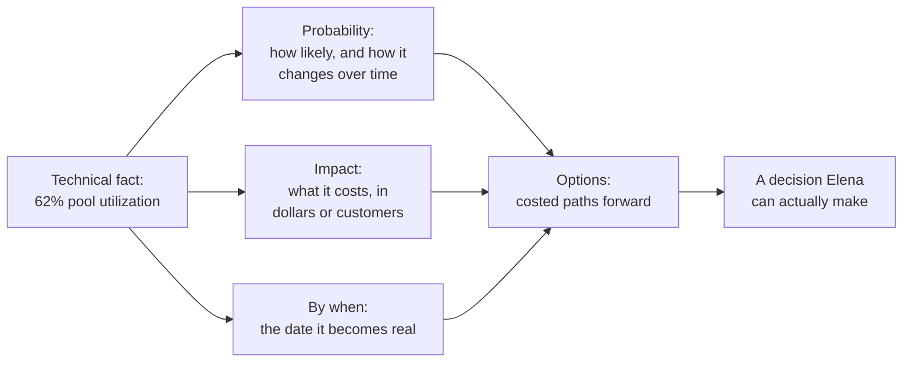

import Scenario from "../../../components/Scenario.astro";
import LevelIntro from "../../../components/LevelIntro.astro";
import PracticeCheck from "../../../components/PracticeCheck.astro";

export const unit = {
  track: "business-communication",
  unitSlug: "translating-technical-risk-business-risk",
};

<Scenario label="The COO nodded, said 'keep an eye on it,' and nothing changed.">
  <Fragment slot="facts">
    

      

        

          Checkout DB, normal traffic
          62% of connection pool used
        

        

          

        

      

      

        

          Checkout DB, Black Friday-level traffic (3x)
          186% — already over capacity
        

        

          

        

      

      

        Traffic growing ~8%/month. At that rate, normal-hour traffic alone
        crosses 100% of capacity in about 6 months.
      

    

  </Fragment>

Marcus, an engineer on the platform team of an online retailer, spends
fifteen minutes in a leadership sync explaining that the checkout
database's primary connection pool is running at 62% utilization under
normal load, that a recent query-plan regression is adding latency under
concurrent writes, and that without intervention they risk connection
exhaustion under peak load. Elena, the COO, listens, asks one clarifying
question about whether "this is like the outage from last year," and when
Marcus says "not exactly, it's more of a capacity ceiling issue," she says
"okay, sounds important — keep an eye on it and loop in the team if it gets
worse," and moves to the next agenda item. Nothing gets funded, staffed, or
scheduled.

**Marcus's technical facts were accurate. What did the explanation fail to
give Elena that she needed in order to actually make a decision?**

</Scenario>

Elena did not reject Marcus's request. She never received one she could act
on, and "keep an eye on it" is what a leader says when she has heard a fact
but not a decision to make.

<LevelIntro
  items={[
    "Technical risk versus business risk",
    "What a decision needs: probability, impact, by when",
    "Options instead of a verdict",
  ]}
/>

## Why did accurate facts produce no decision?

**If every sentence Marcus said was true, why did the meeting end with
nothing funded?** Because engineers describe risk the way they experience it,
mechanism first, while a leader allocating budget needs to know what it costs
and by when.

| What Marcus said (technical risk)                | The question Elena still has (business risk)       |
| ------------------------------------------------ | -------------------------------------------------- |
| "The pool is at 62% utilization."                | Is that fine or alarming, and what happens if not? |
| "A query-plan regression adds latency."          | Does this change what I should fund this quarter?  |
| "We risk connection exhaustion under peak load." | How much money, how many customers, and when?      |
| "It's more of a capacity ceiling issue."         | Is it bigger or smaller than last year's outage?   |

- **Technical risk** is a fact about how a system behaves under some
  condition, in engineering vocabulary: a percentage, a known vulnerability, a
  growth curve.
- **Business risk** is the same fact re-expressed as what the business stands
  to lose: revenue, customers, legal standing, trust, or future capacity.
- Translating changes how the fact is expressed. It never changes whether the
  fact is true, and it must not inflate it or shrink it.

<PracticeCheck
  track={unit.track}
  unitSlug={unit.unitSlug}
  topicId="translation-gap"
/>

## What does a decision-ready explanation contain?

**What would Elena need to hear in order to say "fund it" or "don't"?** Four
things, all in terms she already tracks:

| Term                        | Plain meaning in this scenario                                              |
| --------------------------- | --------------------------------------------------------------------------- |
| Probability                 | How likely the bad outcome is, and how that likelihood grows without action |
| Impact                      | What it costs if it happens, in units the listener already tracks           |
| Exposure window ("by when") | The concrete date or event after which the risk is no longer hypothetical   |
| Option                      | One path forward with its own cost and how much risk it removes             |
| Catastrophizing             | Stating the risk as more certain or severe than the evidence supports       |
| Minimizing                  | Stating the risk as less certain or severe than the evidence supports       |

The audience here is someone who allocates budget, staffing, or priority
without necessarily knowing the mechanism. Severity and urgency are technical
judgments that do not automatically map onto business ones, which is the
extra translation problem this unit adds on top of writing for a general
audience.

<PracticeCheck
  track={unit.track}
  unitSlug={unit.unitSlug}
  topicId="decision-ready-parts"
/>
