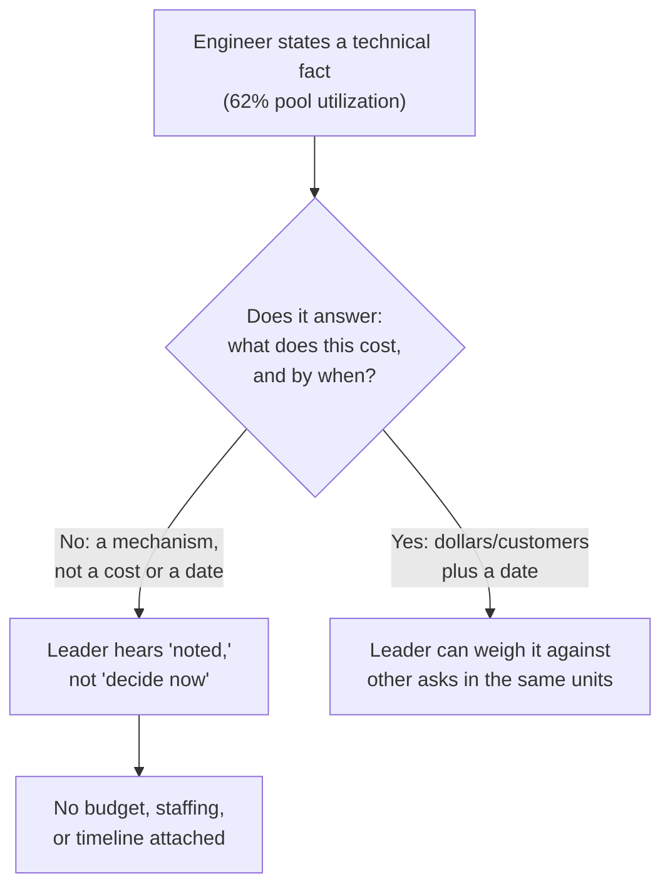
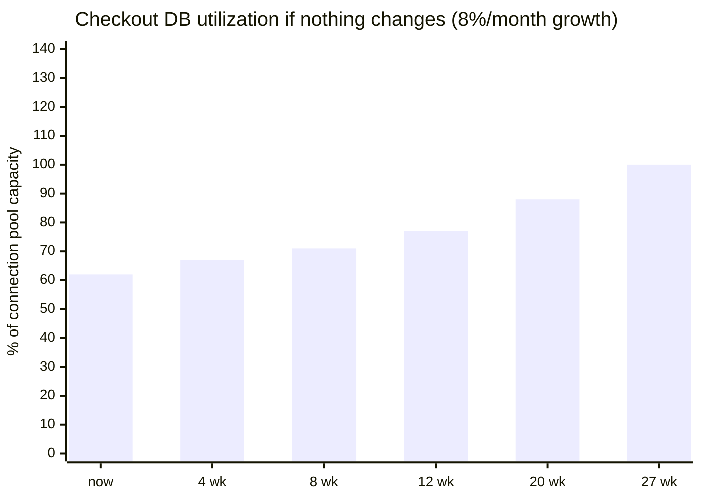
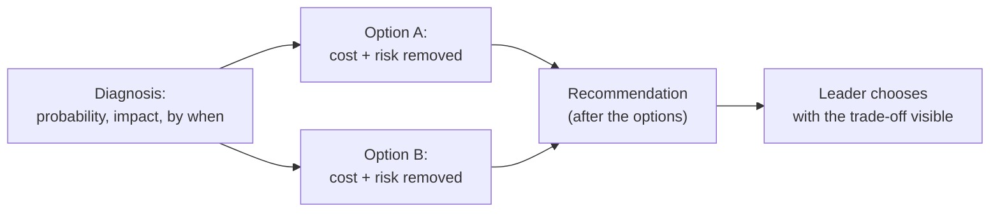

import LevelIntro from "../../../components/LevelIntro.astro";
import Checkpoint from "../../../components/Checkpoint.astro";
import PracticeCheck from "../../../components/PracticeCheck.astro";

export const unit = {
  track: "business-communication",
  unitSlug: "translating-technical-risk-business-risk",
};

L1 named the gap: Marcus's facts were accurate, but Elena could not turn them
into a decision. This level works through exactly what a technical fact is
missing when it lands as "keep an eye on it," and the translation that fixes
it.

<LevelIntro
  items={[
    "Why a percentage doesn't transfer as urgency",
    "Dated, costed, calibrated claims",
    "Ending with options, not a verdict",
  ]}
/>

## Why does "62% utilization" not move a decision?

**If 62% and "query-plan regression" are both true and both relevant, why did
neither register as urgent?** Because neither answers the two questions a
business decision runs on: what does this cost, and by when must I decide?

Elena compares this risk with a marketing campaign, a hiring plan, and another
team's proposal. Those arrive already denominated in dollars, dates, and
headcount. A connection-pool percentage is not in a unit she can weigh against
them, not because she cannot read a percentage but because it does not say
what happens if it is ignored.

<Checkpoint question="A teammate argues Marcus's mistake was using vocabulary Elena did not understand, so the fix is defining the terms better ('a connection pool is like...'). Is that the actual fix?">

Not quite. Elena never asked what a connection pool is. She asked whether this
was like last year's outage, which shows she was already trying to translate
the risk into a business comparison herself. The missing piece is not
vocabulary but the translation: a cost and a date. Marcus could explain
connection pools perfectly and Elena would still have nothing to act on.

</Checkpoint>

The translation maps each technical habit onto a business equivalent:

| Technical framing                         | Business framing                                                                                 |
| ----------------------------------------- | ------------------------------------------------------------------------------------------------ |
| Severity (critical / high / medium / low) | **Probability**: how likely, and how that likelihood changes as time passes without action       |
| "This could cause an outage"              | **Impact**: what an outage costs in lost revenue, affected customers, legal or trust exposure    |
| "This is urgent" / "this should be soon"  | **By when**: a specific date, milestone, or event after which the risk is no longer hypothetical |

**Why insist on a specific date instead of "soon"?** "Urgent" is a technical
judgment the listener cannot verify. A date can be checked against her own
calendar, such as a product launch, a seasonal peak, or a renewal deadline.
"If nothing changes, checkout starts failing under normal load around week 27"
is falsifiable and specific. "This is getting urgent" is neither.

The chart makes "by when" concrete: at 8% monthly growth, 62% reaches 100% in
about six months, around week 27. A second date is worse: at Black
Friday-level traffic (about 3x normal) the same pool is at 186%, so that
exposure is already here. Use the demo below to see how the date moves as
growth and the peak multiplier change.

<Checkpoint question="Marcus's original explanation said the issue 'could cause an outage.' A rewrite instead says checkout starts failing under normal load 'around week 27.' What changed, and why does it matter for Elena's decision?">

The claim went from possible-but-unspecified to concrete-and-dated. "Could
cause an outage" is true of almost any unaddressed technical issue eventually,
so it says nothing about timing. Elena cannot tell whether it means next week
or next year, so she cannot decide whether to act now. "Around week 27" gives
her a deadline to compare with other commitments on the calendar, which is
what turns "sounds important" into something schedulable.

</Checkpoint>

<PracticeCheck
  track={unit.track}
  unitSlug={unit.unitSlug}
  topicId="dated-claims"
/>

## How do you avoid both catastrophizing and minimizing?

**If specificity and urgency are good, why not always frame the worst case to
make sure it gets funded?** Because a leader sold an inflated risk once starts
discounting every later warning from that source, and a leader who had a real
risk downplayed once starts over-reacting to the next one. Both cost
credibility, in opposite directions.

| Framing         | What it does                                                         | What it costs                                                                          |
| --------------- | -------------------------------------------------------------------- | -------------------------------------------------------------------------------------- |
| Catastrophizing | States the risk as more certain or severe than the evidence supports | Leader discounts this and future warnings once the gap between claim and reality shows |
| Minimizing      | States the risk as less certain or severe than the evidence supports | Leader is under-informed for the decision, and finds out later                         |
| Calibrated      | States what is known: current trend, projected date, real cost       | Leader can trust the next warning too, whichever direction it points                   |

Calibrated does not mean hedging every sentence into mush. It means the
probability and impact numbers are the real ones, not rounded toward drama or
toward reassurance. "At current growth, we cross capacity around week 27" is
calibrated. "This could take down the whole platform any day now" is the same
fact catastrophized. "It's probably fine, we'll deal with it eventually" is the
same fact minimized.

<PracticeCheck
  track={unit.track}
  unitSlug={unit.unitSlug}
  topicId="calibration"
/>

## Why end with options instead of a verdict?

**Once probability, impact, and a date are on the table, is the translation
finished?** Not yet. A leader needs something to decide between, not only a
diagnosis. "This needs to be fixed" hands back the same unresolved statement
Marcus started with, just better supported.

The translation should end in **at least two concrete options**, each with its
own cost and how much risk it removes, so the decision is a real trade-off
rather than one recommendation dressed up as the only path. The recommendation
comes after the options, not instead of them.

Common ways this level goes wrong:

- **Dollars without a date.** "High severity, about $200K if it happens" still
  does not tell the listener whether to act this quarter or next year.
- **Picking an extreme framing to guarantee a reaction.** Both inflating and
  shrinking erode trust in every future warning.
- **Stopping at the diagnosis.** The leader is left to invent her own options.

<Checkpoint question="An engineer finishes a precise, calibrated, dated risk summary and then says 'so we need to fix this.' What is still missing, and what does the leader have to do about it?">

The options. The summary tells the leader what is at stake and when, but "we
need to fix this" is a conclusion, not a choice. Without costed alternatives
she must either approve whatever the engineer implies or invent alternatives
herself without the technical background to cost them. Two or more options,
each with a cost and how much risk it removes, let her trade money and time
against exposure, which is the actual decision she owns.

</Checkpoint>

<PracticeCheck
  track={unit.track}
  unitSlug={unit.unitSlug}
  topicId="options-not-verdict"
/>
