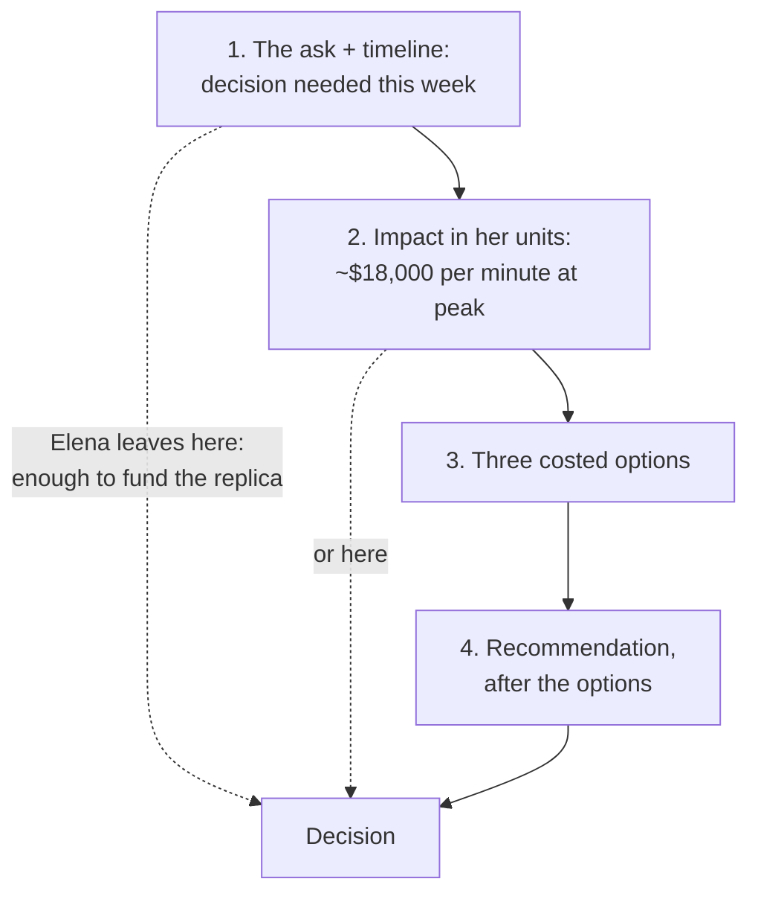

import Scenario from "../../../components/Scenario.astro";
import LevelIntro from "../../../components/LevelIntro.astro";
import Checkpoint from "../../../components/Checkpoint.astro";
import PracticeCheck from "../../../components/PracticeCheck.astro";

export const unit = {
  track: "business-communication",
  unitSlug: "translating-technical-risk-business-risk",
};

<Scenario label="The scenario">
  <Fragment slot="facts">
    

      
🧑‍💻 <strong>Marcus</strong> — platform engineer with accurate facts

      
🧑‍💼 <strong>Elena</strong> — COO, allocates budget, not a database expert

      
📈 62% pool use now, growing ~8% a month: full in ~6 months (week 27)

      
🛒 At 3x sale traffic the pool is at 186%: over the limit today

      
💸 About $18,000 in lost sales per minute of peak downtime

    

  </Fragment>

Marcus has four statements and fifteen minutes. Elena answers with "keep an
eye on it." Every sentence he said was true, and none of them contained a cost,
a date, or a choice.

**Before reading further, predict: if you could change only one thing about
Marcus's first four statements, which change would get Elena closest to a real
decision, and why?**

</Scenario>

<LevelIntro
  items={[
    "Marcus's original, statement by statement",
    "The same facts as probability, impact, options",
    "What generalizes, and what doesn't",
  ]}
/>

## The original explanation: what does Elena do with each statement?

**Reading it the way Elena would, as a leader deciding whether this needs
budget now, what can she actually do with each sentence?**

> **Statement 1.** "Our checkout database's primary connection pool is running
> at 62% utilization under normal load."
>
> **What Elena does with this:** She registers a number with no reference point.
> Is 62% fine or alarming? The sentence does not say, so it reads as a status
> update, not a decision point.

> **Statement 2.** "We've also got a query-plan regression adding latency under
> concurrent writes, which is compounding the pool pressure."
>
> **What Elena does with this:** She cannot evaluate "query-plan regression" or
> "pool pressure," and nothing tells her she needs to. It sounds like
> engineering detail the team will simply handle.

> **Statement 3.** "Without intervention, we risk connection exhaustion under
> peak load."
>
> **What Elena does with this:** "Risk" and "could" register as hedged and
> open-ended, with no date, no size of impact, and no comparison to anything she
> tracks. This is where she asks whether it is "like the outage from last year,"
> translating it herself.

> **Statement 4 (Marcus's reply).** "Not exactly, it's more of a capacity
> ceiling issue."
>
> **What Elena hears:** More technical framing, in answer to a question that was
> itself an attempt at a business comparison. No cost, date, or choice ever
> appears, so "keep an eye on it" is the only reasonable response.

| Statement | What it supplies        | What it leaves out                    |
| --------- | ----------------------- | ------------------------------------- |
| 1         | A number                | A reference point, a cost             |
| 2         | A cause                 | Any reason Elena should care          |
| 3         | A hedged outcome        | Size, date, comparison                |
| 4         | A technical distinction | The business comparison she asked for |

**Every statement was true. Together they never told Elena what this costs or
by when she needs to decide anything.**

<Checkpoint question="Elena's question, 'is this like the outage from last year?', was itself a request for a business-risk translation. What did Marcus's answer fail to give her, and why did the conversation stall there?">

Elena was asking Marcus to compare this risk to an outcome she already
understood, last year's outage, with its known cost and disruption. That was
his opening to answer in her terms: similar or different in cost and
likelihood, and why. Instead, "it's more of a capacity ceiling issue" stayed in
technical framing and handed the translation back to someone without the
background to do it. The conversation stalls there because it was the last
moment a translation could happen before the meeting moved on.

</Checkpoint>

<PracticeCheck
  track={unit.track}
  unitSlug={unit.unitSlug}
  topicId="original-diagnosis"
/>

## The rewrite: what do the same facts look like translated?

**What does the identical set of facts look like once framed as probability,
impact, a date, and options?** Nothing about the system changed, only the
framing.

> **Opening, the ask and the timeline:** "I need a decision this week on
> checkout database capacity. At current traffic growth, about 8% a month, the
> primary database crosses its practical capacity limit in roughly six months,
> around week 27. At Black Friday-level traffic, which has run about 3x normal
> load, we are already over that limit **today**, not in the future."
>
> **Impact, in terms Elena already tracks:** "If checkout fails under load, based
> on last year's partial outage we lose roughly $18,000 in sales per minute of
> downtime at peak, plus the visible failure during a big sale that shows up in
> customer complaints and press, not just that day's revenue."
>
> **Options, not a verdict:**

| Option                                         | Cost                | What it buys                                                                           |
| ---------------------------------------------- | ------------------- | -------------------------------------------------------------------------------------- |
| Quick mitigation (connection pooling config)   | ~1 engineer-week    | Roughly 2 extra months of runway; does not fix the sale-peak exposure                  |
| Add a read replica, offload read-heavy queries | ~3–4 engineer-weeks | Estimated 6–12 months of runway and enough relief to carry this year's sale peak       |
| Re-architect for horizontal scaling (sharding) | ~1 quarter          | Durable fix needed eventually regardless; too slow to help this year's sale on its own |

> **Recommendation, stated after the options:** "I'd recommend the read replica
> now, funded this week, with the sharding work queued for next quarter whatever
> we decide today. The quick mitigation alone doesn't cover the sale peak, and
> the full re-architecture won't finish in time to help this year."

**If Elena hears only the first two paragraphs and must leave for another
meeting, what does she already know?** That a decision is needed this week,
what waiting costs, and that the sale peak is already inside the danger zone.
That is enough to approve funding the read replica before the meeting ends.

<Checkpoint question="The rewrite states the sale-peak exposure ('over the limit today') right alongside the six-month projection for normal traffic and leads with the nearer, more concrete one. Why put the more alarming fact first rather than building up to it?">

Because Elena's real decision window is bounded by the sale, not by the slower
normal-traffic trend. The six-month figure is true and useful context, but the
fact that most affects whether this is funded this week is the one that is
already past the limit. Order the facts by what a reader who stops early needs
most, not by chronology or by how the engineer discovered them.

</Checkpoint>

<PracticeCheck
  track={unit.track}
  unitSlug={unit.unitSlug}
  topicId="rewrite-ordering"
/>

## Why isn't this just "add a dollar figure"?

**Could Marcus have kept the original and tacked "this could cost us money" on
the end?** No. A vague cost claim with no date and no options still gives Elena
nothing to compare against her calendar or choose between. The fix was
restructuring the whole explanation around what a business decision needs: a
specific "by when," an impact in units she already tracks, and at least two
costed paths. A dollar figure without the date or the options is a technical
statement with a number attached, not a translation.

## What generalizes, and what is only this case?

The pattern, probability with a "by when," impact in business units,
calibration rather than catastrophizing or minimizing, and options instead of a
verdict, applies to almost any technical risk raised to a non-technical
decision-maker. What is specific to Marcus's case is the anchor: capacity risk
projects forward from a growth rate and a known event.

This is one worked case, not the whole territory. Try extending it yourself.

**What if Marcus were reporting a newly disclosed vulnerability** in a
third-party authentication library, actively exploitable with no patch yet? Would
"at current growth, we cross capacity around week 27" still be the right kind
of "by when," or does this risk need a different anchor and a different impact
statement?

**What if the risk were a compliance gap** with an audit date nine weeks away?
What is the natural anchor then, and who in the company already tracks that
date?

**What if Elena were a former database engineer?** Which parts of the
translation would she still need, and which could Marcus safely drop?

A vulnerability's timeline is usually not a growth curve. It is driven by how
public the flaw is (time to exploit shrinks as it gets documented) and by
whether a vendor patch exists. The impact shifts too: regulatory exposure or
breach-notification costs may dominate over lost sales. It is still expressed
as probability, impact in dollars or legal terms, a "by when," and options, the
same structure with a different anchor.

| Failure mode                                                        | What it gets wrong                                                                       |
| ------------------------------------------------------------------- | ---------------------------------------------------------------------------------------- |
| Believing accurate technical detail is enough to produce a decision | Accuracy does not give decidability; a leader needs a cost and a date                    |
| Answering "is this like X?" with more technical framing             | Hands the translation back to a listener who cannot do it                                |
| Adding a dollar figure without a date or options                    | Still a technical statement with a number attached                                       |
| Leading with the more distant, less decision-relevant number        | Should order by what the listener's decision window needs first                          |
| Assuming every technical risk shares the same "by when" anchor      | Capacity projects from growth; a vulnerability or compliance gap has its own real driver |

<PracticeCheck
  track={unit.track}
  unitSlug={unit.unitSlug}
  topicId="other-risks"
/>
