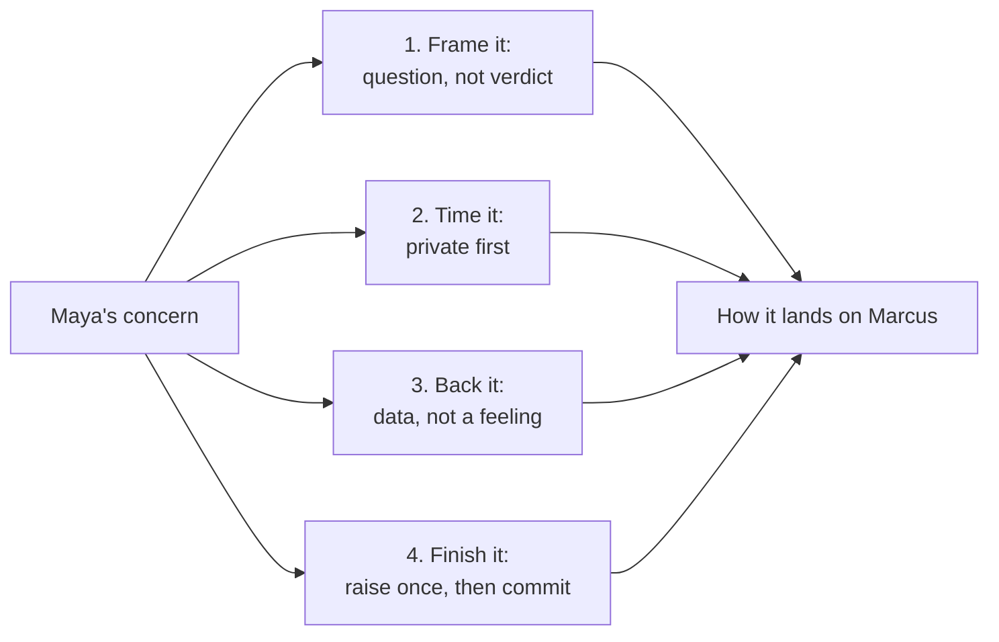

import Scenario from "../../../components/Scenario.astro";
import LevelIntro from "../../../components/LevelIntro.astro";
import PracticeCheck from "../../../components/PracticeCheck.astro";

export const unit = {
  track: "business-communication",
  unitSlug: "upward-disagreement",
};

<Scenario label="The problem">
  <Fragment slot="facts">
    

      

        7,200 per minute
        tested capacity, of 12,000 per minute needed
      

      

        

      

    

    

      
📅 Cutover date already announced to the board, 2 weeks out

      
🚫 Single "big bang" weekend cutover, no rollback path once it starts

      
🧑‍💼 The person who made the promise also owns the decision

    

  </Fragment>

Maya Torres is a backend engineer at Ledgerline, a payments company. Her
VP of Engineering, Marcus Chen, has promised the board that the entire
settlement system will switch to a new ledger service in one weekend, two
weeks from now, right before Black Friday, the company's busiest weekend.

Maya just finished load-testing the new service. It holds up cleanly at
normal volume. Once traffic passes about 60% of last year's Black Friday
peak, responses blow past the payment deadline and requests start timing
out. The plan has no rollback step once it begins.

**Marcus already told the board this date is locked. Maya has the data that
says it will break. What does she say to him, and how?**

</Scenario>

Saying nothing protects the relationship today and practically guarantees a
production incident in two weeks. Saying "this won't work" flatly, in the
wrong room, can get the message ignored anyway, or get Maya quietly filed
under "not a team player" before anyone looks at her data.

<LevelIntro
  items={[
    "Why a power gap changes the conversation",
    "Psychological safety as a testable question",
    "The four moves that get a concern heard",
  ]}
/>

## Why is telling the decision-maker different from pushing back on a peer?

**If Maya's data is right, why not just say it the same way she would to a
teammate?** Because the two situations carry different costs for the person
listening.

|                       | Lateral pushback (a peer) | Upward disagreement (someone with authority) |
| --------------------- | ------------------------- | -------------------------------------------- |
| Power gap             | None                      | Real: they decide, she doesn't               |
| Public record         | Rarely matters            | Often exists (a promise already made)        |
| Cost of being wrong   | Small and shared          | Their judgment and standing are on the line  |
| Likely first reaction | Weigh the argument        | Defend the plan                              |

- **Upward disagreement** means telling someone with more authority over the
  decision than you have that their plan, decision, or assumption has a
  problem.
- The power gap changes the physics: hearing "this will fail" in front of
  others puts the listener's judgment, and often a public commitment, on the
  line at once. A defensive reflex becomes likely however good the data is.

<PracticeCheck
  track={unit.track}
  unitSlug={unit.unitSlug}
  topicId="power-gap"
/>

## What does psychological safety have to do with it?

**Why would anyone stay silent about a problem they can see?** Because the
safe move for the individual is silence whenever speaking up might cost them.

- **Psychological safety** is a testable question: can someone raise a
  concern that turns out to be right, or wrong, without it costing them
  standing either way?
- Where the answer is no, people stop raising concerns early, and problems
  only surface once they are expensive.
- It runs in both directions. Maya needs to feel safe raising it, and Marcus
  needs to feel safe hearing that his promise may not hold.

<PracticeCheck
  track={unit.track}
  unitSlug={unit.unitSlug}
  topicId="psych-safety"
/>

## What are the four moves that get a concern heard?

1. **Frame it as a risk to explore, not a verdict.** A question invites
   Marcus to reason alongside Maya; a verdict asks him to admit he was wrong.
2. **Raise it privately before any group setting.** A one-on-one lets Marcus
   react, ask questions, and change course without an audience.
3. **Bring evidence, not a feeling.** "I'm worried" is easy to set aside; a
   chart showing the exact number where it breaks is hard to wave off.
4. **Know what "done" looks like.** Raise it clearly once; if the decision
   still goes ahead, that was his call with the risk now visible. New
   evidence, not repetition, justifies raising it again.

| Term                 | Simple meaning                                                          |
| -------------------- | ----------------------------------------------------------------------- |
| Upward disagreement  | Raising a concern with the person who has authority over the decision   |
| Psychological safety | Whether raising a concern, right or wrong, costs you standing           |
| Framing as inquiry   | Presenting a concern as a question to work through together             |
| Face                 | A person's standing in front of others; threatened by public correction |
| Disagree-and-commit  | Raising a concern once, then supporting the decision that gets made     |
| Escalating further   | Raising it again, with new evidence, after being overruled              |

Getting this right is not about winning. Maya can do all four moves well and
still watch Marcus proceed. The goal is that he decides with the real risk in
front of him.

<PracticeCheck
  track={unit.track}
  unitSlug={unit.unitSlug}
  topicId="four-moves"
/>
