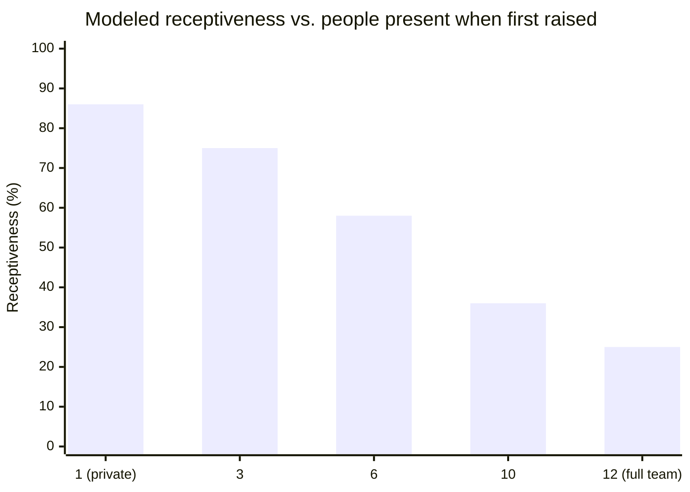
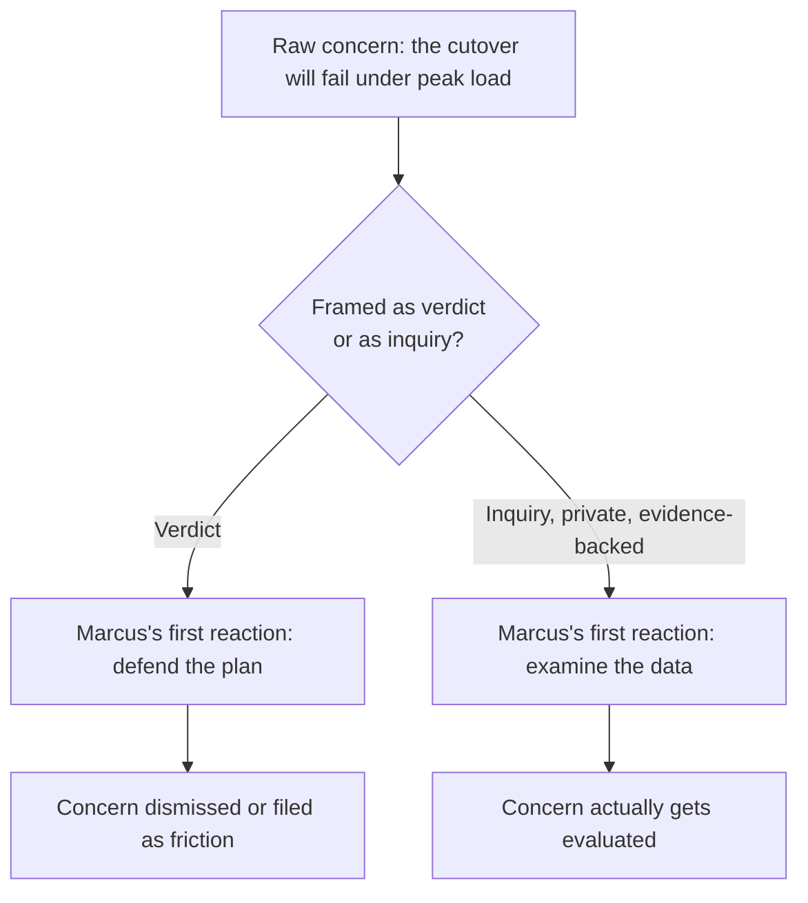
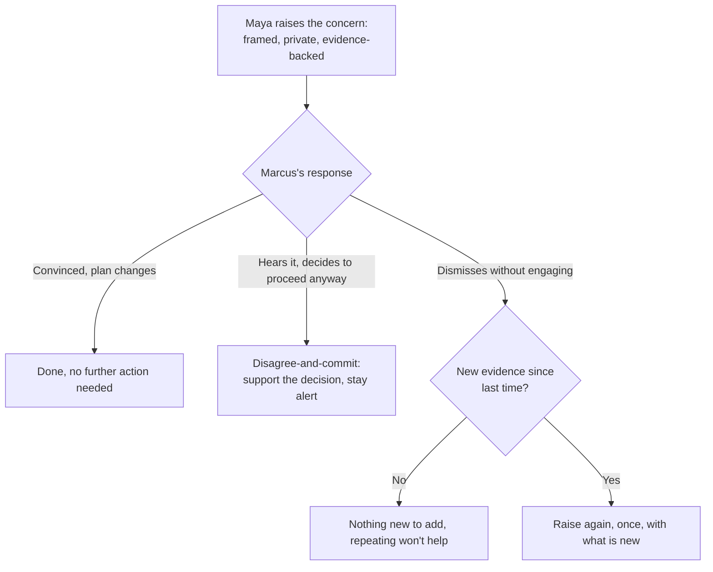

import LevelIntro from "../../../components/LevelIntro.astro";
import Checkpoint from "../../../components/Checkpoint.astro";
import PracticeCheck from "../../../components/PracticeCheck.astro";

export const unit = {
  track: "business-communication",
  unitSlug: "upward-disagreement",
};

L1 showed Maya holding real data (the new ledger service falls over once
traffic passes about 60% of last year's Black Friday peak) and a VP who has
already told the board the date is locked. L2 works out why the exact same
data can either open Marcus's thinking or trigger a defensive shutdown,
depending on how, when, and with what it is raised.

<LevelIntro
  items={[
    "Why a public promise raises the cost of hearing bad news",
    "What each of the four moves prevents",
    "Raise once, then commit or escalate",
  ]}
/>

## Why can a correct concern still get dismissed?

If Maya is right about the load test, shouldn't the facts speak for
themselves? **Before reading on: why might a technically correct concern
still get brushed aside?**

Because Marcus is not only evaluating the data. He is also evaluating what
accepting it costs him. He already told the board a date, so reversing it in
front of his own team looks like backing out of a public promise, not just
updating a plan. A concern that sounds like a verdict ("this won't work")
forces a choice between admitting he was wrong and defending a plan he may
already suspect is shaky. Defending is usually the path of least immediate
pain, even when it is the worse long-term choice.

| What Maya says                        | What Marcus hears         | His easiest response |
| ------------------------------------- | ------------------------- | -------------------- |
| "This plan will fail."                | A verdict on his judgment | Defend the plan      |
| "Can we look at one number together?" | A problem to solve        | Look at the number   |

<Checkpoint question="Marcus told the board a specific date. Why does that make Maya's choice of room matter more than it would for an ordinary disagreement about a plan?">

A public commitment turns "Marcus was wrong about the plan" into "Marcus
was wrong in front of people who watched him promise something." Raised
privately, he can absorb new information and change course without anyone
having seen him corrected, so the decision stays his to revise quietly.
Raised in a group, the same information carries a face cost on top of its
content, which makes a defensive reaction much more likely however good the
data is. The board promise is exactly what raises the stakes of getting the
room wrong.

</Checkpoint>

<PracticeCheck
  track={unit.track}
  unitSlug={unit.unitSlug}
  topicId="face-cost"
/>

## What does each of the four moves actually prevent?

Four separate failure modes are covered by four separate moves. Mixing them
up (good evidence delivered as a public verdict, say) still fails, just
differently. **What specific failure does each move prevent?**

| Move                          | What it prevents                                                        | What it looks like                                                                        |
| ----------------------------- | ----------------------------------------------------------------------- | ----------------------------------------------------------------------------------------- |
| Frame as inquiry, not verdict | Forcing Marcus to admit fault before he has processed anything          | "Can we look at what happens past 60% of peak together?" instead of "this plan will fail" |
| Raise it privately first      | Turning a correction into a face-threatening public one                 | A one-on-one or a written note before any meeting with an audience                        |
| Bring evidence, not a feeling | The concern being dismissed as opinion, nerves, or resistance to change | The load-test chart showing the exact number where responses break                        |
| Finish cleanly                | Either quietly giving up or nagging until trust runs out                | Raise it once, then commit or escalate only with something new                            |

None of these moves changes what is true. The load-test result is the same
number either way. What changes is whether Marcus's first reaction is
_defend_ or _think_, and only one of those actually processes the data.

The "private first" move also tracks a roughly predictable drop-off. As more
people are in the room when a concern is first raised, the face cost of
engaging honestly goes up:

This is a teaching model with strong evidence assumed, not a measurement of
Marcus. The direction is what matters: the first attempt at a concern like
this should almost always use the smallest room available, not the next
scheduled meeting where it happens to fit the agenda.

<PracticeCheck
  track={unit.track}
  unitSlug={unit.unitSlug}
  topicId="move-purpose"
/>

## Does leading with the shared goal water down the message?

**Doesn't "I want this to work as much as you do" soften a serious
warning?** No. It changes what Marcus thinks the conversation is _for_. An
opening that names the shared goal signals that Maya is trying to help the
cutover succeed. An opening that leads with the failure signals, even
unintentionally, that she is against the plan itself. The information is
identical either way; what differs is whether Marcus hears an ally raising a
solvable problem or an obstacle to get past.

<Checkpoint question="Maya could open with 'this cutover plan has a serious problem' or with 'I want this to succeed, and I found something in the load test I'd like to walk through with you.' Same concern. What is the mechanical difference in Marcus's first reaction?">

The first opener names a verdict before he has seen any evidence, so his
first job becomes protecting the plan rather than evaluating the data. The
second establishes shared intent first, which recasts what follows as a
problem to solve together instead of a challenge to his judgment, so when
the number arrives he is more likely to be thinking about the number than
about how to defend himself. The facts and the eventual conversation are the
same; the opener decides which mental mode Marcus is in when he hears them.

</Checkpoint>

<PracticeCheck
  track={unit.track}
  unitSlug={unit.unitSlug}
  topicId="shared-goal"
/>

## What happens after Maya raises it?

Raising the concern well does not guarantee Marcus changes the plan. It
guarantees he decides with the real risk visible. What Maya does next depends
on his response:

**Disagree-and-commit** means Maya raised the concern clearly, Marcus heard it
and chose to proceed, and Maya now supports the execution instead of
relitigating it in every meeting. The call was legitimately his, made with the
risk on the table. It differs from silent compliance: she is not pretending to
agree, only accepting that she was heard and overruled, which is not the same
as being ignored.

**Escalating further** (raising it again, possibly to someone above Marcus) is
justified by _new evidence_, not by having been right the first time. Without
anything new, repeating it reads as refusing to accept the answer, which
erodes the very trust that made the first conversation work. With something
genuinely new, such as a second test failing at an even lower threshold,
raising it again is doing the job, not undermining him.

| Signal                                          | What it means                          | Right move                        |
| ----------------------------------------------- | -------------------------------------- | --------------------------------- |
| Marcus engages and changes the plan             | The concern worked                     | Nothing further needed            |
| Marcus engages, proceeds anyway                 | He was heard; it is his call           | Disagree-and-commit               |
| Marcus dismisses, nothing new                   | Repetition adds no information         | Let it stand, for now             |
| Marcus dismisses, but new evidence has appeared | He is deciding on outdated information | Raise once more, with what is new |

The line between advocating for a real risk and being difficult is not how
many times you raise a concern. It is whether each time you bring something
he did not already have the last time.

<PracticeCheck
  track={unit.track}
  unitSlug={unit.unitSlug}
  topicId="commit-vs-escalate"
/>
