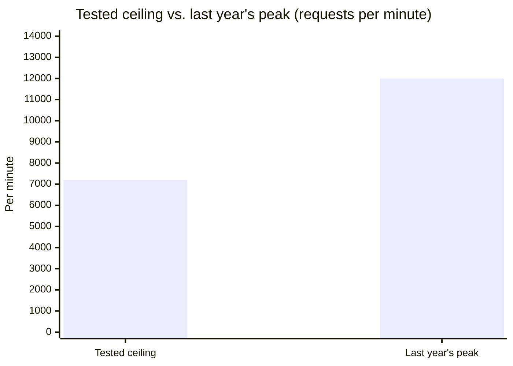

import Scenario from "../../../components/Scenario.astro";
import LevelIntro from "../../../components/LevelIntro.astro";
import Checkpoint from "../../../components/Checkpoint.astro";
import PracticeCheck from "../../../components/PracticeCheck.astro";

export const unit = {
  track: "business-communication",
  unitSlug: "upward-disagreement",
};

<Scenario label="The scenario">
  <Fragment slot="facts">
    

      
👩‍💻 <strong>Maya Torres</strong> — backend engineer, ran the load test

      
🧑‍💼 <strong>Marcus Chen</strong> — VP of Engineering, promised the date to the board

      
📊 New ledger service: fine up to 7,200 per minute, fails past it

      
🎯 Last year's Black Friday peak: 12,000 per minute (the tested ceiling is 60% of that)

      
🗓️ Cutover: single weekend, no rollback, 2 weeks out

    

  </Fragment>

Same facts as L1: Ledgerline's new settlement ledger holds up at normal
traffic, but Maya's load test shows responses breaking the payment deadline
past about 60% of last year's Black Friday peak. The cutover Marcus announced
to the board is a single weekend, starting in two weeks, with no rollback
once it begins.

**Before reading further, predict: which of the four moves (frame, time, back,
finish) will be hardest for Maya here, and why?**

</Scenario>

<LevelIntro
  items={[
    "Preparing the evidence and the private conversation",
    "What Maya does once Marcus decides to proceed",
    "What changes if the room or the news is different",
  ]}
/>

## Before the conversation: what does Maya need in hand?

Before she says anything, what must Maya have ready beyond a bad feeling
about the plan? A concern that arrives as a chart survives contact with a
busy VP; one that arrives as a feeling does not. She spends half a day
turning her load test into something Marcus can absorb in under two minutes:

1. **The number itself:** the exact throughput where responses cross the
   payment deadline (7,200 per minute), not "it struggles under load."
2. **The comparison that makes it matter:** last year's real peak (12,000
   per minute), so the gap is concrete.
3. **A concrete alternative, not just an objection:** a phased cutover that
   moves 20% of merchant traffic first, watches it for 48 hours, then ramps
   up, keeping the board date roughly intact.
4. **The ask, stated plainly:** she is not asking to cancel the migration,
   only for 15 minutes to walk through one number before the plan locks.

The alternative matters beyond politeness: it changes what Marcus is asked to
do. Without it, he must absorb bad news and invent a fix alone. With it, he
evaluates a specific choice, which is a smaller and less threatening ask.

<PracticeCheck
  track={unit.track}
  unitSlug={unit.unitSlug}
  topicId="evidence-prep"
/>

## The conversation itself: what is each sentence doing?

Maya messages Marcus directly: "Got 15 minutes today or tomorrow? Found
something in the load test I want to walk through with you before the cutover
plan locks further." The words "problem" and "risk" are left out of the
scheduling message on purpose, since they make people brace before they sit
down. They meet privately in Marcus's office.

**Maya:** "I want this cutover to hit the board date as much as you do. That's
why I wanted to grab you. I ran the full load test against last year's Black
Friday numbers and found something I think we should look at together."

**Marcus:** "Okay, what did you find?"

**Maya:** "The new service is solid at normal volume. But past about 7,200
requests a minute, responses blow through the deadline and settlements start
timing out. Last year's peak was 12,000, so on day one it would have to carry
about 1.7 times what it handled cleanly, with no rollback once we start."

**Marcus:** "The vendor benchmarks said it would handle our full volume."

**Maya:** "That's what I assumed too. This is our own test on our own traffic
pattern, not the vendor's synthetic one, so I trust the number, but I wanted
you to see it yourself. I've also sketched something that might keep the date:
move 20% of merchant traffic first, watch it for 48 hours under real load,
then ramp the rest. It costs a few days of buffer, but 80% of volume stays on
the old system as a safety net while we learn whether the ceiling is real."

| Sentence                             | What it does                                       |
| ------------------------------------ | -------------------------------------------------- |
| "As much as you do"                  | Establishes the shared goal before any bad news    |
| The number and the 12,000 comparison | Replaces a feeling with evidence he can check      |
| "Our own test, not the vendor's"     | Answers the obvious objection before he raises it  |
| The phased option                    | Turns "you have a problem" into "here is a choice" |

<Checkpoint question="Maya's first sentence is 'I want this cutover to hit the board date as much as you do.' What is that sentence doing, mechanically, before any data is mentioned?">

It establishes that Maya and Marcus want the same outcome before she
introduces information that could sound like an attack on his plan. Without
it, "the new system fails at 60% of peak" can land as "your plan is bad," a
challenge to defend against. With it, the same fact lands as "something
stands between us and the goal we both want," a problem to solve together.
It costs one sentence and changes the mode Marcus is in for the rest of the
conversation: defend, or think.

</Checkpoint>

<PracticeCheck
  track={unit.track}
  unitSlug={unit.unitSlug}
  topicId="conversation-moves"
/>

## What does Maya do after Marcus decides?

Marcus goes quiet, then asks to see the raw test output. He agrees the number
is concerning but pushes back: a phased cutover means telling the board the
date is not solid after he said it was. The next day he decides to proceed
with the single-weekend cutover, but asks infrastructure for extra capacity
headroom and an emergency rollback script as a manual last resort.

This is where upward disagreement is really tested: not the conversation
itself, but what Maya does right after being heard and overruled.

Marcus made his decision with the risk visible and added mitigations, which is
very different from never having heard the number. Maya's job is now
**disagree-and-commit**: she still thinks the plan carries real risk and
executes it at full effort anyway, because the call was legitimately his.

| What it is                               | What it is not                                     |
| ---------------------------------------- | -------------------------------------------------- |
| Executing the decision at full effort    | Slow-walking or quietly undermining it             |
| Accepting the call was his               | Pretending to agree, or privately hoping it fails  |
| Staying alert for new evidence           | Treating "I was overruled" as the end of the topic |
| Raising it again only with something new | Repeating it to feel vindicated                    |

<Checkpoint question="Marcus added extra capacity and a rollback script but kept the single-weekend cutover. Why does that still count as Maya's concern having worked?">

The goal was never to make Marcus cancel the migration. It was to make sure he
decided with the real risk visible instead of discovering it live during the
cutover. Before the conversation he was committing to a plan with an unknown
ceiling and no fallback; afterwards he is committing to the same core plan
with headroom provisioned and a rollback option built because of the number
Maya surfaced. The plan's shape did not change, but the information and
preparation behind it did. That is the achievable target of upward
disagreement: informed decisions, not won arguments.

</Checkpoint>

Four days before the cutover, a larger test run by infrastructure with this
year's higher projections shows the same service failing at about 55% of the
projected peak. That is new evidence Marcus does not have. Raising it again
now is doing the job: Maya messages him the same day, privately, with the same
structure (shared goal, the new number, a comparison, a specific ask to put
the phased option back on the table). She does not say "I told you so"; the
data speaks.

| Situation four days out                 | Right move                             | Why                                    |
| --------------------------------------- | -------------------------------------- | -------------------------------------- |
| New test shows a lower ceiling          | Raise again, once, with the new number | He is deciding on outdated information |
| Nothing new, Maya is still uneasy       | Hold, and support the plan as decided  | Repetition reads as not letting go     |
| Marcus asks Maya directly for an update | Give an honest, current read           | Answering a question is not escalating |

<PracticeCheck
  track={unit.track}
  unitSlug={unit.unitSlug}
  topicId="commit-in-practice"
/>

## Extend it: what changes if the room or the news is different?

Maya's conversation worked because she could get 15 private minutes, had clean
data, and Marcus was willing to engage once he saw it. This is one worked case,
not the whole territory. Try extending it yourself before moving on.

**What if Maya could not get Marcus alone**, and the only chance to raise it is
a planning review with a dozen people, an hour before the plan locks? The
private-timing move is gone, but framing and evidence still apply. What would
she change about how she words the question to protect Marcus's standing in the
room, and is there a version of "can we double-check one number together" that
works publicly where "this plan has a serious hole" would not?

**What if the news were worse**, and the system were already failing in
production rather than in a test? The timing trade-off flips: waiting for a
private moment now costs money and trust with every minute. Is there still a
version of disagree-and-commit during a live incident, or does an active
failure change what is owed to the decision-maker?

**What if the person with authority were not Marcus at all**, but someone who
had already shown they punish bad news? Which of the four moves still helps,
and what would Maya need to weigh before deciding whether to raise it at all?

None of these has a single correct answer. The four moves are a starting
shape for this problem, not a script that reproduces Maya's conversation in
every situation.

<PracticeCheck
  track={unit.track}
  unitSlug={unit.unitSlug}
  topicId="adapt-to-context"
/>
