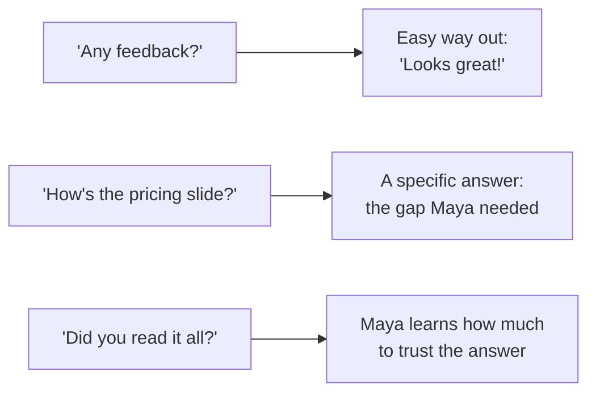

import Scenario from "../../../components/Scenario.astro";
import LevelIntro from "../../../components/LevelIntro.astro";
import PracticeCheck from "../../../components/PracticeCheck.astro";

export const unit = {
  track: "career-craft",
  unitSlug: "asking-feedback",
};

Office words in the scenario:

| Term                  | Read it as                                                                   |
| --------------------- | ---------------------------------------------------------------------------- |
| Pitch deck / deck     | A presentation meant to persuade someone                                     |
| Pricing slide         | The slide that explains cost and value                                       |
| Competitor comparison | Showing how this option compares with another option the client might choose |
| Client                | The person or company Maya is trying to convince                             |

<Scenario label="Same deck, same day, three different questions">
  <Fragment slot="facts">
    

      

        

          Ask 1: "any feedback?"
          0 checkable claims
        

        

          

        

      

      

        

          Ask 2: "how's the pricing slide?"
          1 checkable claim
        

        

          

        

      

      

        

          Ask 3: "did you read it all?"
          2 checkable claims
        

        

          

        

      

      
🙋 Jordan, who helped build the deck, gives every answer

    

  </Fragment>

Maya is finishing a client pitch deck due Friday. She asks Jordan, a coworker
who helped build it, for feedback three times, phrasing the ask differently
each time. Jordan's real opinion is the same each time. Only the question
changes.

| Ask                                                 | What she gets back                                                               |
| --------------------------------------------------- | -------------------------------------------------------------------------------- |
| "Could you take a look, any feedback?"              | "Looks great!" two days later                                                    |
| "How's the pricing slide specifically?"             | "The pricing's solid, but there's no competitor comparison. Is that on purpose?" |
| "Did you read the whole thing, or just that slide?" | "Just that slide, honestly. I didn't get to the rest yet."                       |

**Before reading on: Jordan had the same opinions every time, so why did two of the three questions get Maya something she could use, and the first one did not?**

</Scenario>

<LevelIntro
  items={[
    "Why the question's shape decides the answer",
    "Calibration: how much to trust an answer",
    "Psychological safety as a precondition",
  ]}
/>

Jordan did not become more honest between ask 1 and ask 2. The question changed
how much of what Jordan thought could come back to Maya.

## Why does the shape of the question decide the answer?

- A vague, open question makes a vague, polite answer the cheapest reply. "Looks good!" costs nothing and risks nothing, so that is what most people give, whether or not they have concerns.
- A narrow question closes that exit. It is hard to answer "how's the pricing slide?" with "looks good" without sounding like you skipped the slide, so a real answer becomes the easy option.
- The same applies to scope. Something specific and finished (one slide, one call, one draft) gets a better answer than something broad and ongoing like "how am I doing?"

| Question shape         | What it changes                                         |
| ---------------------- | ------------------------------------------------------- |
| Vague, open scope      | Makes a low-effort, generic answer the easy option      |
| Specific, narrow scope | Makes a generic answer implausible, so a real one comes |
| Calibration follow-up  | Reveals how much of the work was actually reviewed      |

<PracticeCheck
  track={unit.track}
  unitSlug={unit.unitSlug}
  topicId="question-shape"
/>

## Once I have an answer, how much should I trust it?

**Calibration** is deciding how much weight an answer deserves. It is not
"believe them" versus "do not believe them". It is asking how much of the work
the person actually saw, and what they have usually caught in the past.

- "Looks great" from someone who read every line is strong. The same words from someone who skimmed are weak.
- A follow-up like "did you read it all, or just that slide?" tells you which one you got.
- Treat the signals as clues, not proof. A fast answer can still be careful.

<PracticeCheck
  track={unit.track}
  unitSlug={unit.unitSlug}
  topicId="calibration-meaning"
/>

## What has to be true for any of this to work?

**Psychological safety** is the feeling that an honest answer will not be
punished, mocked, or argued with. Someone who expects candor to cost them gives
safe, vague answers no matter how well the question is built. So the habit has
two halves: ask better-shaped questions, and visibly reward the honest answers
you get.

One more trap: treating feedback as a yearly event. Waiting for a scheduled
review means months of repeating a fixable mistake because nobody asked a
specific question sooner. The practical skill is to replace "any feedback?"
with a specific question about something recent, asked of someone whose answer
you can weight, as a repeated habit.
