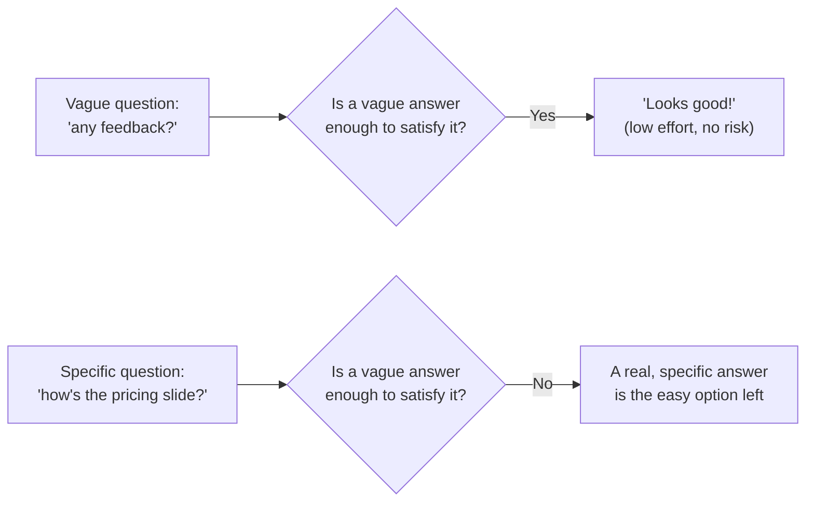
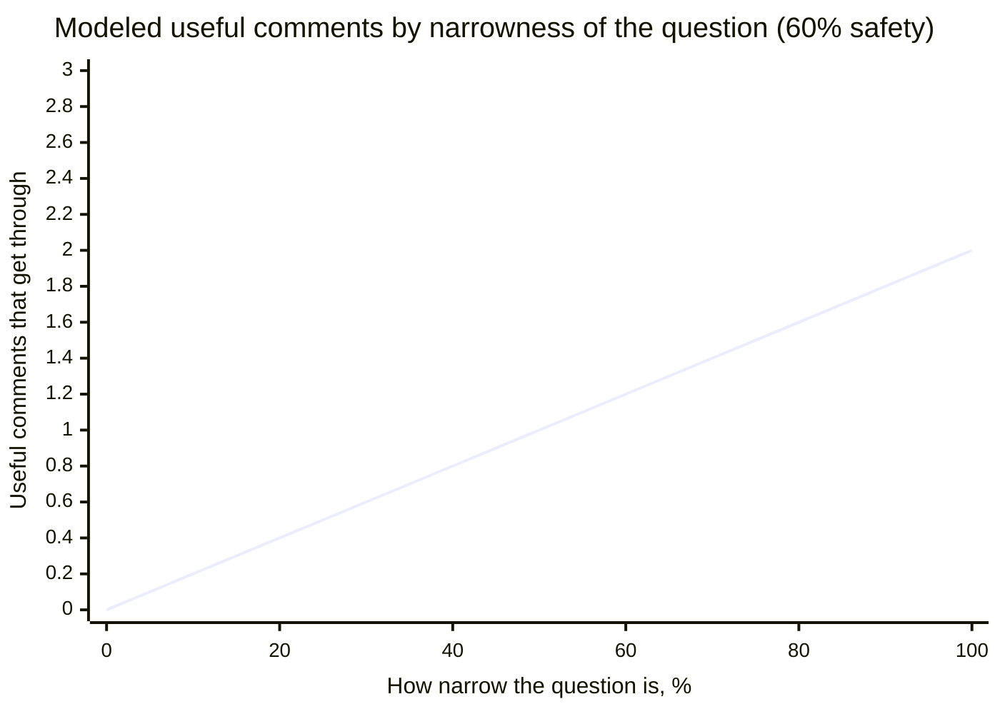
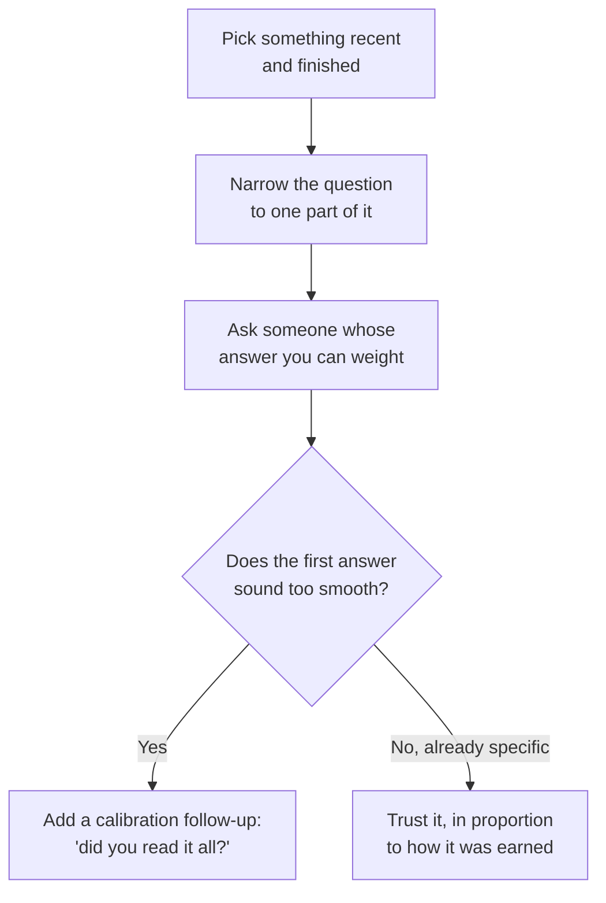

import LevelIntro from "../../../components/LevelIntro.astro";
import Checkpoint from "../../../components/Checkpoint.astro";
import PracticeCheck from "../../../components/PracticeCheck.astro";

export const unit = {
  track: "career-craft",
  unitSlug: "asking-feedback",
};

L1 showed three differently phrased requests producing three very different
answers from the same person about the same deck. L2 works out why: what a
vague question costs to answer honestly, what a specific one costs, and what
has to be true around the question for either to work.

<LevelIntro
  items={[
    "Why vague questions get safe answers",
    "Calibration: weighting an answer, not just reading it",
    "Safety and scope as preconditions",
  ]}
/>

## Why does a vague question get a safe answer?

**If Jordan genuinely thought the pricing slide was confusing, what would it
cost to say "looks great!" instead, and what would it cost to say something
real?**

"Looks good!" is not necessarily a lie. It is where a vague question settles,
because a vague answer to a vague question takes no effort and carries no
social risk. A specific question closes that exit: answering "how's the
pricing slide?" with "looks good" reads as not having looked, which creates a
small social cost for being vague. A real answer becomes the cheaper one.

<Checkpoint question="A coworker answers 'looks good!' to a vague 'any feedback?' Does that tell you they had no real concerns about the work?">

No. "Looks good!" is the cheapest reply whether or not concerns exist, so the
answer is the same either way. The vague question never gave them a reason to
say more, which means the missing concrete comment tells you about the
question, not about the work.

</Checkpoint>

<PracticeCheck
  track={unit.track}
  unitSlug={unit.unitSlug}
  topicId="least-resistance"
/>

## How do I weight an answer once I have it?

**Jordan's "looks great!" and Priya's "looks great!" are the same three words.
What could make one worth much more than the other?**

Reading feedback is not only reading the words. You also ask how much the
person reviewed, what concrete thing they mentioned, and whether they usually
catch real issues in this kind of work. These are clues, not proofs: a fast
answer can still be careful, and a specific answer can still be wrong.

| Signal to watch for                                        | What it suggests about how to weight this feedback                      |
| ---------------------------------------------------------- | ----------------------------------------------------------------------- |
| Specific references to actual content ("the pricing math") | Likely reviewed carefully, so weight it more                            |
| Fast turnaround with generic language                      | Possibly skimmed, so ask a specific follow-up before leaning on it      |
| A track record of catching real issues before              | Higher starting trust in this person's judgment on this kind of work    |
| Feedback that only ever repeats what you already believed  | Check whether they tend to agree by default or reached it independently |

Calibration is not distrust. The same words carry different information
depending on who said them and how they engaged. A manager's silence on a
section can mean "no issues" or "did not get to it", and only a follow-up
question tells you which.

<Checkpoint question="Two reviewers both say 'the deck looks fine.' One cites the pricing math, the other replied in two minutes without naming anything. Which answer do you weight more, and what would you do about the other?">

Weight the one that cites the pricing math more, because it points at content
that can be checked. For the quick, generic reply, do not discard it. Ask one
specific follow-up, such as which slides they read, so you know how much it
covers before relying on it.

</Checkpoint>

<PracticeCheck
  track={unit.track}
  unitSlug={unit.unitSlug}
  topicId="calibration-signals"
/>

## What if the person does not feel safe being candid?

**You ask a perfectly narrow question, but last time this person criticized
your draft you argued with them for ten minutes. Will the narrow phrasing get
you a candid answer?**

Probably not. A good question removes the excuse for a vague answer. It does
not remove the fear of an honest one. If answering candidly is expected to
cost an argument, the person finds a way to stay safely vague however narrow
the question is.

The two halves work together:

1. Ask a better-shaped question.
2. Make candor safe by thanking people for specific criticism, using the useful part, and telling them what you changed.

This unit's interactive demo uses a deliberately simplified model of the
interaction. It says a fully narrow question could surface at most 3 useful
comments, and that safety scales that number between 20% (no safety) and 100%
(full safety). It is a teaching model, not a measurement. Here is what it gives
at 60% safety as the question gets narrower:

| Safety with this person | Useful comments at a fully narrow question |
| ----------------------- | ------------------------------------------ |
| 20%                     | 1.1 of a possible 3                        |
| 60%                     | 2.0 of a possible 3                        |
| 100%                    | 3.0 of a possible 3                        |

Even a perfectly narrow question loses most of its value when safety is low.
That is the cap safety puts on question quality.

<Checkpoint question="Your question is perfectly narrow, and the person's safety with you is low. In the model, can you reach the full 3 useful comments by narrowing the question further?">

No. Narrowing already sits at its maximum, so the only remaining lever is
safety. In the model, low safety (20%) caps a fully narrow question at about
1.1 of 3 comments. Raising safety, by visibly rewarding candid answers over
time, is what lifts the cap.

</Checkpoint>

<PracticeCheck
  track={unit.track}
  unitSlug={unit.unitSlug}
  topicId="safety-precondition"
/>

## Why is "specific and finished" better than "broad and ongoing"?

**"How am I doing overall?" is a friendly, open question. Why does it fail in
the same way as "any feedback?"**

It is too broad to answer from any single memory, so it collapses into a
general impression. "How did the client call go on Tuesday?" is scoped to one
recent, checkable event. The person answering has something real to point to.

| Ask                                   | What it forces the answer to be                                 |
| ------------------------------------- | --------------------------------------------------------------- |
| "How am I doing overall?"             | A general impression, assembled on the spot, easy to keep vague |
| "How did the client call go Tuesday?" | One checkable event, hard to answer without a real memory of it |

The four steps below put the pieces in order. Safety is not a fifth step. It
is the ground all four stand on.

<PracticeCheck
  track={unit.track}
  unitSlug={unit.unitSlug}
  topicId="scope-finished"
/>

L3 replays Maya's three requests in full and counts exactly what each answer
contained.
