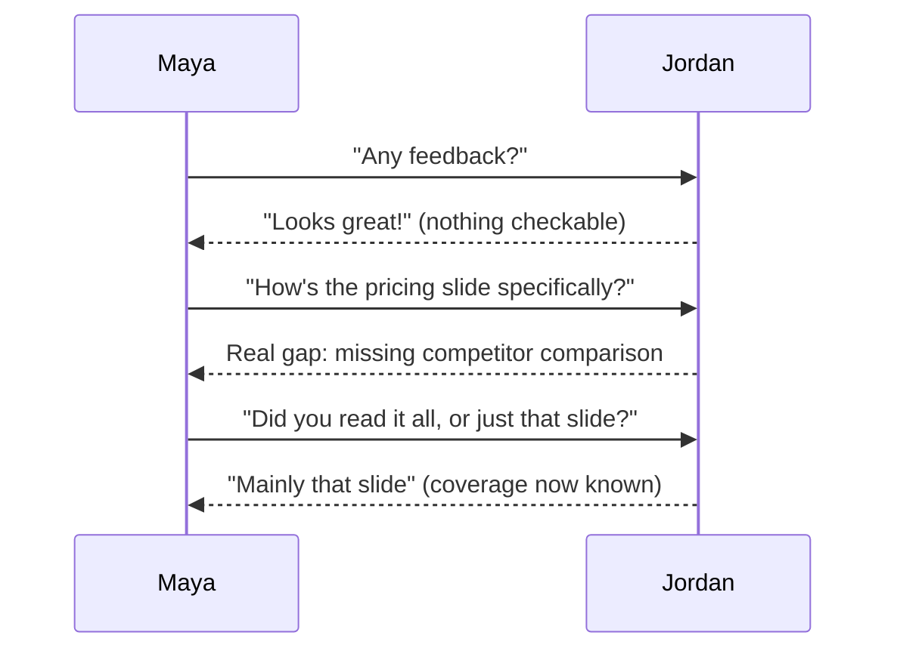
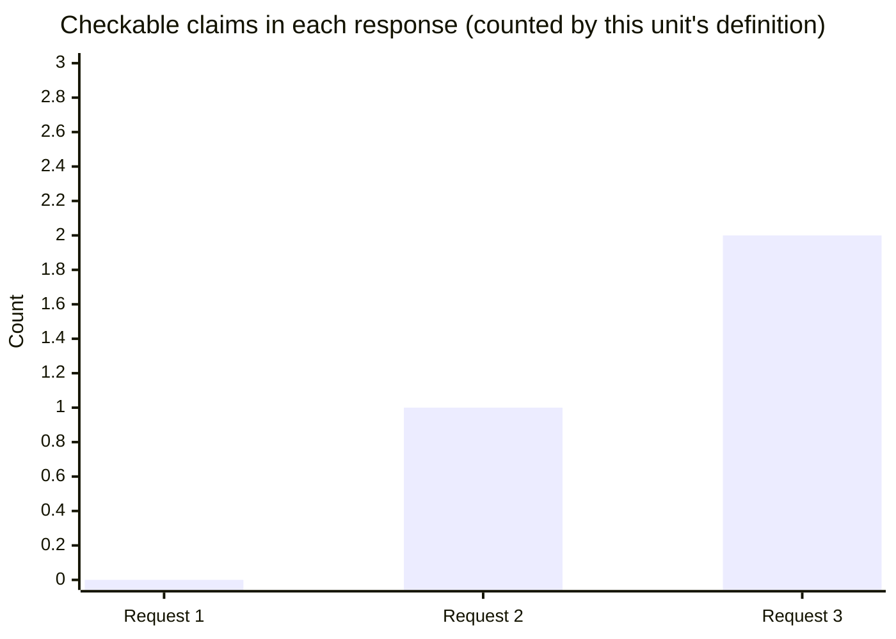

import Scenario from "../../../components/Scenario.astro";
import LevelIntro from "../../../components/LevelIntro.astro";
import Checkpoint from "../../../components/Checkpoint.astro";
import PracticeCheck from "../../../components/PracticeCheck.astro";

export const unit = {
  track: "career-craft",
  unitSlug: "asking-feedback",
};

Quick context for the office words: a **peer** is a coworker at a similar
level, a **client meeting** is a meeting with the people Maya is trying to
convince, a **vendor** is another company the client might pay instead, and a
**background section** is the part of the deck explaining who the client is
and what matters to them.

<Scenario label="Three asks, one reviewer, one Friday deadline">
  <Fragment slot="facts">
    

      
📊 Client pitch deck, due Friday

      
🙋 Reviewer: Jordan, who helped research the deck

      
1️⃣ Ask 1: open ("any feedback?")

      
2️⃣ Ask 2: scoped to the pricing slide

      
3️⃣ Ask 3: a coverage question ("did you read it all?")

    

  </Fragment>

Maya just finished a pitch deck for a client meeting on Friday and wants real
feedback before it goes out. She asks Jordan three times. Same deck, same
person, same opinion available to extract, if she asks for it correctly.

**Before reading on: for each ask, what will Maya know afterward that she did
not know before?**

</Scenario>

<LevelIntro
  items={[
    "Three requests, same person, same deck",
    "Counting checkable claims, not word count",
    "Failure modes and how the model transfers",
  ]}
/>

## Request 1: the default

**Message:** "Hey, could you take a look at this when you get a chance? Any
feedback welcome."

**Response, two days later:** "Looks great, nice work!"

**Does this mean Jordan had no concerns, or that the question gave Jordan no
reason to surface one?** The answer alone cannot tell you. It is a safe, cheap
reply to a question with no target. It does not confirm the deck was read
carefully, and it does not reveal whether anything was wrong. That is not
dishonesty. It is an answer with nothing checkable in it.

## Request 2: scoped to one slide

**Message:** "Could you take another look, specifically at the pricing slide?
I want to make sure the numbers actually make our case."

**Response, next day:** "The pricing itself looks right, but I noticed we
never show how we compare to what they're probably already paying their
current vendor. Is that intentional, or worth adding?"

Jordan's honesty and effort did not change. Scoping to one slide, with one
worry named ("make our case"), gave Jordan a concrete lens, and the answer
included a real gap the open request never surfaced.

<Checkpoint question="Jordan's answer to Request 2 named a real, specific gap. Does Maya yet know how much of the rest of the deck she can trust as fine?">

No. Request 2 tells her about the pricing slide and nothing else. Jordan could
have skimmed the rest in thirty seconds or read it word for word, and the
answer would look identical. Coverage is a separate question that Maya still
has to ask.

</Checkpoint>

<PracticeCheck
  track={unit.track}
  unitSlug={unit.unitSlug}
  topicId="request-sequence"
/>

## Request 3: scoped, and calibration-checked

**Message, after the pricing feedback:** "Good catch, I'll add the comparison.
Quick question: did you look at the whole deck, or mainly the pricing slide? I
want to know if I should expect other gaps elsewhere too."

**Response:** "Mainly the pricing slide, since that's what you asked about. I
skimmed the rest but didn't read the client-background section closely."

This is the calibration step from L2 made concrete. It tells Maya how much to
trust "the rest is fine" (very little, it was skimmed) versus the pricing
feedback (a lot, that slide was read). Without it, Request 1's "looks great"
and a later "the rest looks fine" would be indistinguishable to her, even
though they carry very different signal.

## What changed across the three requests, counted

The improvement can be counted from what each response contained. This unit
counts **checkable claims**: a named gap, a named section reviewed, or an
explicit coverage statement that Maya can verify or act on. Word count does
not measure this. Request 1's reply is 4 words and Request 3's is 21, but the
difference in what Maya can use is far larger than 17 words.

| Response  | Checkable claims | What they are                                                              |
| --------- | ---------------- | -------------------------------------------------------------------------- |
| Request 1 | 0                | "Looks great" cannot be verified or acted on                               |
| Request 2 | 1                | The competitor comparison is missing                                       |
| Request 3 | 2                | Only the pricing slide was read, and the client-background section was not |

<Checkpoint question="Request 3's reply tells Maya the least about the deck's content but the most about coverage. Why is that still the more useful answer for her Friday deadline?">

Because it tells her what to do next. She now knows the pricing slide is
reviewed and the client-background section is not, so she can spend her
remaining time on the unreviewed part. A reply that praised everything would
have left her believing the whole deck had been checked.

</Checkpoint>

<PracticeCheck
  track={unit.track}
  unitSlug={unit.unitSlug}
  topicId="coverage-check"
/>

## What stayed constant across all three requests

  

    ✅
    
      <strong>Jordan's actual opinion never changed.</strong> The same person,
      the same deck, the same attention available each time. Only the question's
      shape changed what got extracted.
    
  

  

    ✅
    
      <strong>No request pressured Jordan into inventing criticism.</strong>
      Requests 2 and 3 did not manufacture a problem. They made it easier for a
      real one to surface.
    
  

## Failure modes

| Failure                                                | What it looks like                                                                     | The fix                                                                                               |
| ------------------------------------------------------ | -------------------------------------------------------------------------------------- | ----------------------------------------------------------------------------------------------------- |
| Treating a specific question as an interrogation       | "Why didn't you catch the pricing gap? Don't you usually review carefully?"            | Keep the ask about the work, not the reviewer's diligence                                             |
| Only asking about finished work, never about direction | Waiting until the deck is fully built, missing a chance to catch a bad structure early | Scope to "specific and answerable", not always "complete". An early direction check can be narrow too |
| Not acting visibly on candid feedback                  | Jordan's gap gets acknowledged but never added to the deck                             | Visibly act on it. That is what makes Jordan's next answer worth the effort                           |
| Asking the coverage question defensively               | "Did you read it all?" said in a tone that means "you should have"                     | Frame it as Maya's own need ("so I know what to expect"), not an audit of Jordan                      |

<PracticeCheck
  track={unit.track}
  unitSlug={unit.unitSlug}
  topicId="failure-modes"
/>

## Beyond this example

Jordan and the pitch deck are one case, not the whole territory. Use these to
test whether the model transfers:

- What changes if the feedback Maya needs is about something more personal than a slide, such as how she comes across presenting in person? Does "specific and finished" work the same way, or does safety start to matter more than phrasing?
- What if Jordan's answer to Request 2 had been bad news, a gap serious enough to threaten the Friday deadline? Would the same three-request sequence still be right, or would the scope or the coverage question need to change?
- Who in your own week plays Jordan: someone close enough to the work to answer a specific question, but who currently only ever gets "any feedback?" from you?

How to think about them: when feedback is personal, safety matters more and the
question should be narrower and kinder. When bad news threatens a deadline, ask
the coverage question early so you know what else might be wrong. When choosing
your own Jordan, look for someone close enough to the work to notice a concrete
gap, not just someone with an impressive title or a friendly manner.
