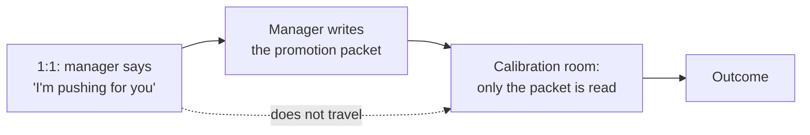

import Scenario from "../../../components/Scenario.astro";
import LevelIntro from "../../../components/LevelIntro.astro";
import PracticeCheck from "../../../components/PracticeCheck.astro";

export const unit = {
  track: "career-craft",
  unitSlug: "calibration-processes",
};

<Scenario label="The problem">
  <Fragment slot="facts">
    

      
🗣️ <strong>The 1:1</strong>: manager says "I'm pushing hard for your promo this cycle"

      
🚪 <strong>The room</strong>: a calibration meeting the engineer is not in

      
😕 <strong>The outcome</strong>: no promotion, and only "it didn't happen this time"

    

  </Fragment>

A manager tells an engineer in a 1:1: "I'm pushing hard for your promo
this cycle." The engineer, reasonably, starts to think of it as close to
settled. Weeks later the cycle ends. No promotion, and no explanation
beyond "it didn't happen this time." The manager was not lying and had
not changed their mind.

**Something happened between that 1:1 and the outcome, in a room the
engineer was never in. What happens in that room, and why is one
manager's genuine support not enough to guarantee the result?**

</Scenario>

<LevelIntro
  items={[
    "What a calibration meeting does",
    "Why one manager's support is not the decision",
    "What a promotion packet is",
  ]}
/>

Words that make the rest easier:

| Term         | Read it as                                                     |
| ------------ | -------------------------------------------------------------- |
| 1:1          | A private recurring meeting between a manager and one employee |
| Report       | A person who works under a manager's responsibility            |
| Case         | The argument and evidence for a decision, such as a promotion  |
| Shared bar   | The same standard everyone is measured against                 |
| Rubber stamp | An automatic approval; calibration is not supposed to be this  |
| Cycle        | One review period                                              |
| Org          | A department or larger group inside the company                |

## What is calibration, and why does it exist?

**If every manager already knows their own reports best, why would a company
bother putting managers in a room together?** Because each manager judging
alone has no way to notice that their own standard drifted. One manager's
"excellent" may be another's "solid." Calibration is the meeting where
several managers compare their reports' cases against each other and
against one shared bar for each level.

It is not a rubber stamp on decisions managers already made. It is a
second check, built in on purpose, so one person's opinion of their own
report is not the only evidence behind a promotion.

<PracticeCheck
  track={unit.track}
  unitSlug={unit.unitSlug}
  topicId="calibration-purpose"
/>

## Is a manager's support the same as the decision?

**The manager in the Scenario said they were pushing hard. Why did that
not finish the job?** Their support is _necessary but not sufficient_. It
is what gets a case made at all, but the case then has to be read and
questioned by managers who have no personal relationship with the person
and no first-hand view of their work.

The dotted line is the point. The spoken sentence stays in the 1:1. What
enters the room is the **promotion packet**: the written case
(accomplishments, scope, impact) the manager submits on the report's behalf.
The packet's evidence is what gets evaluated, not anyone's enthusiasm.

| In the 1:1                   | In the room                        |
| ---------------------------- | ---------------------------------- |
| The manager's spoken intent  | The packet's written evidence      |
| Two people who know the work | Several people who may not know it |
| A promise about effort       | A comparison against a shared bar  |

<PracticeCheck
  track={unit.track}
  unitSlug={unit.unitSlug}
  topicId="support-not-outcome"
/>

## Key terms

- **Calibration**: a cross-manager meeting where promotion and performance
  cases are compared against each other and a shared leveling bar.
- **Promotion packet**: the written case a manager submits on a report's behalf.
- **Leveling bar (rubric)**: the documented expectations for a level that
  the packet's evidence is measured against.
- **Slot or budget constraint**: a cap on how many promotions a cycle can
  approve, separate from whether any single case is strong. L2 explains why
  this can make a good case fail.

## What the next levels cover

L2 follows a packet through the room, who reads it, what it is compared
with, and why a cap on promotions is a second, separate way to lose. L3
stress-tests a draft packet under skeptical questions and works out how to
tell a weak case from a strong one that lost to the cap.
