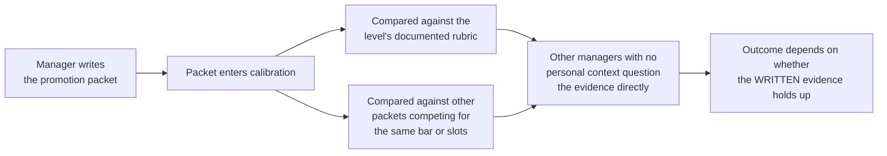

import LevelIntro from "../../../components/LevelIntro.astro";
import Checkpoint from "../../../components/Checkpoint.astro";
import PracticeCheck from "../../../components/PracticeCheck.astro";

export const unit = {
  track: "career-craft",
  unitSlug: "calibration-processes",
};

L1 named the room the Scenario's manager disappeared into and the two things that live there: the calibration meeting and the written packet it runs on. L2 works out what the room does to a packet, and why even a packet that passes can still lose.

<LevelIntro
  items={[
    "How the room reads and compares a packet",
    "Why spoken confidence does not travel",
    "A promotion cap as a second way to lose",
  ]}
/>

## What does the room do to a packet?

**Once a manager writes the case, what does calibration actually do with it?**
Two comparisons happen at once, and then strangers question the result.

**Read cold** means the other managers read the written case without
already knowing the person's day-to-day work. That is why specific evidence
matters more than a manager's private confidence: it is the only thing a
stranger can check.

| Determines the outcome                                                        | Does not determine the outcome                                   |
| ----------------------------------------------------------------------------- | ---------------------------------------------------------------- |
| The packet's written evidence, read cold by managers with no personal context | How enthusiastically the manager spoke about the person in a 1:1 |
| Whether that evidence clears the level's documented rubric                    | How strongly the engineer believes they deserve the promotion    |
| How the case compares with other packets competing for the same bar or slots  | The manager's private intent or good faith, however genuine      |

**Was the manager wrong to say what they said?** Not necessarily. Their
statement described their own intent accurately. The error, if any, is in
what was inferred from it: intent to advocate is not a guaranteed outcome,
because advocacy still has to survive a room the manager does not control.

<Checkpoint question="A manager tells their report in a 1:1, 'I'm pushing hard for your promo.' Does that statement, by itself, tell you whether the promotion will happen?">

No. It tells you the manager intends to advocate, which is where a case
starts, not how it ends. The outcome depends on whether the written packet
built from that advocacy survives being read cold by other managers and
compared with the rubric and with competing cases. A manager can be fully
genuine in the 1:1 and still not control what happens once the packet
leaves their hands.

</Checkpoint>

<PracticeCheck
  track={unit.track}
  unitSlug={unit.unitSlug}
  topicId="packet-room"
/>

## If the packet is strong, is the promotion guaranteed?

**Suppose the packet clears the rubric and survives every question. Does the
promotion happen?** Not always. Some cycles cap how many promotions a level
or org can approve, no matter how many cases clear the bar. Take an
assumed cycle, chosen to match the slider demo on this page: 6 cases clear
the rubric and there are 4 slots.

  

    
      <strong>4 slots</strong> for <strong>6 cases</strong> that cleared the bar
    
    
      assumed numbers, for illustration
    
  

  

    

  

  

    4 of 6 can be approved
    2 strong cases blocked by the cap
  

Those 2 blocked cases did nothing wrong. Drag the slot cap in the demo and
the blocked count rises or falls, while the quality of every case stays the
same. That is the point: "the case was strong but there was no room" and
"the case was not strong enough" are two different outcomes that can look
identical from outside the room.

**What does the engineer do with that?** Not assume failure. Preserve the
packet, ask what would make it stronger, and ask whether it can be
resubmitted next cycle.

<Checkpoint question="A packet clears the rubric, survives every question in calibration, and the promotion still does not happen because of a cap. Does that mean the case was not strong enough?">

No. A cap limits how many promotions a level or org can approve in that
cycle, independent of how many cases clear the bar, so a fully cleared case
can still lose to capacity. From outside the room that outcome can look just
like a weak case, which is exactly why it is worth asking directly which one
happened instead of assuming the case failed.

</Checkpoint>

<PracticeCheck
  track={unit.track}
  unitSlug={unit.unitSlug}
  topicId="slot-constraint"
/>

## Failure modes at this level

- **Treating a manager's verbal support as a calibration outcome.** Advocacy
  starts a case; the room only sees what is written.
- **Accepting a packet full of impressions.** Claims a stranger cannot verify
  tend not to survive questioning.
- **Assuming every missed promotion means a weak case.** A cap produces the
  same outcome for a different reason. L3 covers how to tell them apart.
