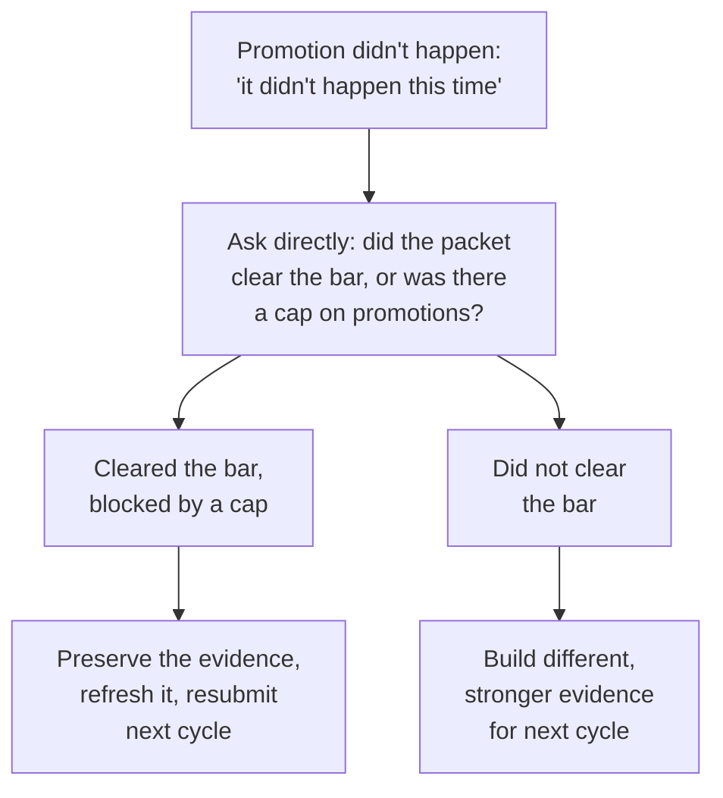

import Scenario from "../../../components/Scenario.astro";
import LevelIntro from "../../../components/LevelIntro.astro";
import Checkpoint from "../../../components/Checkpoint.astro";
import PracticeCheck from "../../../components/PracticeCheck.astro";

export const unit = {
  track: "career-craft",
  unitSlug: "calibration-processes",
};

<Scenario label="The first question in the room">
  <Fragment slot="facts">
    

      
📄 <strong>Draft packet</strong>: "grown a lot", "well-liked", "ready"

      
🧐 <strong>Stranger's question</strong>: "grown compared to what, specifically?"

      
🔎 <strong>What survives</strong>: named projects, before/after numbers, owned scope

    

  </Fragment>

The engineer's manager has written the first draft of the packet. A manager
from another team, who has never met this engineer, reads it in the
calibration room and asks one thing: "Grown compared to what? What did they
actually deliver?" The draft has no answer.

**What does a packet need so that the first question has an answer, and what
does the room conclude when a strong packet still does not turn into a
promotion?**

</Scenario>

<LevelIntro
  items={[
    "Impressions versus checkable evidence",
    "Impact, scope and ownership on paper",
    "Telling a weak case from a capped one",
  ]}
/>

L2 established that calibration runs on the written packet and that specific evidence survives being read cold. L3 tests that claim on a draft, then on the harder question of what a strong packet that still fails means. The numbers in the rewritten packet below are invented for the example.

## Why does the first draft collapse?

**What happens when an unfamiliar manager reads this draft?**

> "Has grown a lot this year. Consistently delivers high-quality work and is
> well-liked by the team. Shows strong potential and is ready for the next level."

Every claim is an **impression**: an opinion not yet backed by proof. "Grown
a lot," "high-quality," "well-liked" and "strong potential" give a stranger
nothing to check, so the packet asks the room to trust the writer. That is
exactly what calibration exists to avoid.

## What does the same case look like with checkable evidence?

> "Led the migration off the legacy billing service (Q2 to Q3): designed the
> phased rollout plan, coordinated with three dependent teams, and cut
> checkout error rates from 2.1% to 0.3% afterward. Took over the on-call
> rotation redesign after the previous owner left, cutting median
> page-to-resolution time from 40 to 12 minutes over two quarters. Mentored
> two engineers who each shipped their first cross-team project
> independently this cycle."

You do not need to know the systems named. The pattern is what matters.

| Draft claim         | Rewritten claim                                     | Why a stranger can check it         |
| ------------------- | --------------------------------------------------- | ----------------------------------- |
| "Grown a lot"       | Took over the on-call redesign after the owner left | A named responsibility, with a date |
| "High-quality work" | Error rate 2.1% to 0.3%                             | A before/after number               |
| "Well-liked"        | Coordinated three dependent teams                   | Those teams can be asked            |
| "Strong potential"  | Two mentees shipped independently                   | A concrete outcome from others      |

**Why does "2.1% to 0.3%" beat "greatly improved reliability"?** The number
is **falsifiable**: someone could check whether it is true. "Greatly
improved" asks to be taken on faith.

<Checkpoint question="Both drafts describe the same engineer's real work. Why does the rewritten version survive questioning while the first does not?">

The drafts differ in whether their claims are checkable, not in whether the
work happened. "Grown a lot" and "high-quality" are impressions a stranger
cannot verify, so the first question exposes them. The rewrite replaces each
with a named project, a before/after number or a concrete responsibility that
another manager could ask about. Calibration does not require the writer to
be more impressive, only to write down evidence a stranger can check.

</Checkpoint>

<PracticeCheck
  track={unit.track}
  unitSlug={unit.unitSlug}
  topicId="checkable-evidence"
/>

## Do numbers alone make the case for the next level?

**The rewrite has real numbers. Is that enough?** Not by itself. A leveling
rubric usually asks about more than impact. Read the rewrite again with four
words in mind:

| Word                   | The question it asks                                 | Where the rewrite shows it                |
| ---------------------- | ---------------------------------------------------- | ----------------------------------------- |
| **Impact**             | What changed because of the work?                    | Error rate down; resolution time down     |
| **Scope**              | How large or complex was the responsibility?         | A migration across three dependent teams  |
| **Ownership**          | Did they carry it without someone driving each step? | Took over the on-call redesign unprompted |
| **Multiplying impact** | Did other people get better output because of them?  | Two mentees shipped independently         |

A packet with strong impact and none of the other three says "did good
individual work." A rubric for a bigger role often asks for the rest too.

<PracticeCheck
  track={unit.track}
  unitSlug={unit.unitSlug}
  topicId="scope-ownership"
/>

## When a strong packet still fails, what does that tell you?

**Suppose the rewrite clears every question and the promotion still does not
happen because of a cap. How does that look from outside the room?** The
same as a weak case: "it didn't happen this time." What separates them is
one direct question to the manager: "Did the packet clear the bar and lose to
a cap on promotions, or was the case not ready yet?"

Both branches start from the identical sentence. The question is what turns
one vague outcome into two different next steps.

<Checkpoint question="A packet cleared the bar but the promotion did not happen, and the manager only says 'it didn't happen this time.' What one follow-up separates a cap from a case that fell short?">

Ask whether the packet cleared the bar but lost to a limit on how many
promotions the cycle could approve, or whether the case was not strong
enough yet. A manager who advocated and lost only to a cap can usually answer
plainly, and the two answers lead to different work: a capped strong case
mostly needs a refresh and a resubmission, while a case that fell short needs
better evidence. Without asking, both sound the same from outside.

</Checkpoint>

<PracticeCheck
  track={unit.track}
  unitSlug={unit.unitSlug}
  topicId="outcome-diagnosis"
/>

## This is a case, not the whole territory

The lesson generalizes to any group judging a case it did not build:
funding requests, project approvals, grant reviews. What is specific here is
the rubric vocabulary (impact, scope, ownership), which reflects a typical
engineering framework. Another function may weight entirely different things.

**Try extending it yourself.** What if this engineer's strongest quarter was
eight months before the cycle and the latest quarter was quiet? Does the
rewritten packet still make as strong a case, or does _when_ the evidence
happened matter as much as _what_ it was? And what changes if the room's
rubric weighted multiplying impact above individual impact?

## Failure modes

| Failure mode                                                        | What it gets wrong                                                                     |
| ------------------------------------------------------------------- | -------------------------------------------------------------------------------------- |
| A packet of impressions ("doing well", "ready") instead of evidence | A stranger cannot verify it, so it collapses under the first direct question           |
| Treating a manager's verbal enthusiasm as the written case          | Only the packet enters the room; the 1:1 sentence stays behind                         |
| Showing impact without scope or ownership                           | Many rubrics also ask for responsibility taken on and impact multiplied through others |
| Assuming any failed promotion means the case was weak               | A cap can produce the same result; only a direct question separates the two            |
