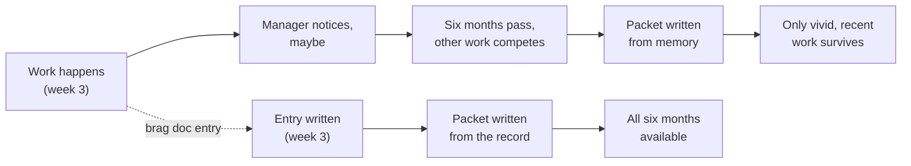

import LevelIntro from "../../../components/LevelIntro.astro";
import Checkpoint from "../../../components/Checkpoint.astro";
import PracticeCheck from "../../../components/PracticeCheck.astro";

export const unit = {
  track: "career-craft",
  unitSlug: "documentation-career-tool",
};

L1 showed that only 1 of 4 contributions survived in the manager's memory
and named the brag doc as the fix. L2 asks what separates an entry that
reads as advocacy from one that reads as analysis, and what keeps the log
usable over months.

<LevelIntro
  items={[
    "Objective framing versus self-assessment",
    "The three parts of a usable entry",
    "Keeping a running log honest and current",
  ]}
/>

## Why does good work not reach the packet on its own?

**If a manager genuinely wants to advocate for their reports, why does
good work not make it in by itself?** Because "speaks for itself" needs
someone listening when it happens and remembering clearly months later.
Here, "reports" means the people a manager is responsible for.

The gap is not dishonesty or bad management. Unaided memory is a poor
archive. A brag doc does not replace the work. It replaces the manager's
memory as the record of the work.

<PracticeCheck
  track={unit.track}
  unitSlug={unit.unitSlug}
  topicId="memory-gap"
/>

## Is the discomfort about the facts or about how they are stated?

**If self-promotion feels uncomfortable, what exactly is uncomfortable?**
Almost always the verdict ("I did a great job"), not the facts. Subjective
means "believe me, I was good." Objective means "this happened, and this
changed."

|                | Subjective self-assessment             | Objective framing                                                         |
| -------------- | -------------------------------------- | ------------------------------------------------------------------------- |
| Example        | "I did a great job leading the move."  | "Led the database move; query latency fell from 400ms to 60ms (example)." |
| What it claims | A judgment of the writer's own quality | A fact about what happened and what changed                               |
| How it reads   | Advocacy: asks the reader to agree     | Analysis: gives the reader something to evaluate                          |
| Why it feels   | It asks for a verdict on yourself      | It should not feel odd; it is a factual report                            |

**Is objective framing just a disguise for the same claim?** No, it is a
different claim. "I did a great job" asks the reader to take the writer's
word. A before-and-after fact can be judged by the reader, who draws the
conclusion alone.

<Checkpoint question="A teammate writes in their log: 'I was a huge asset to the migration project.' Objective or subjective, and what is the one-sentence fix?">

Subjective. "Huge asset" is a verdict on the writer, not something a reader
can check. The fix is to name the concrete piece they owned and what
changed because of it, for example "Owned the cutover step; the maintenance
window went from six hours to forty minutes" (illustrative numbers). The
reader reaches "huge asset" on their own from the facts.

</Checkpoint>

<PracticeCheck
  track={unit.track}
  unitSlug={unit.unitSlug}
  topicId="objective-framing"
/>

## What makes an entry still useful six months later?

**When the writer has forgotten the details themselves, what must the
entry already hold?** Three things, not just a title. A simple shape: "I
did X; before, Y was happening; afterward, Z changed; the hard part was W."

| Part            | Question it answers                               | Weak version           | Strong version                                        |
| --------------- | ------------------------------------------------- | ---------------------- | ----------------------------------------------------- |
| What changed    | What was different before and after?              | "Improved reliability" | A concrete before and after, with a number if real    |
| Why it mattered | Who was affected, what did it prevent or unblock? | (missing)              | The stakes, in one short clause                       |
| What was hard   | What made it worth recording at all?              | "It took a while"      | The judgment call, the ambiguity, the cross-team part |

A **judgment call** is a decision with no obvious answer where the person
had to choose with care. Routine work usually does not need an entry. The
judgment calls usually do.

<Checkpoint question="An entry says only 'Improved the deploy pipeline.' Which of the three parts does it have, and why does that matter six months later?">

None of them. It names a topic, not an entry: no before and after, no
stakes, no sign of what was hard. Six months on, neither the writer nor
the manager can rebuild those from memory, so a bare topic line is
useless in a packet even if the underlying work was substantial.

</Checkpoint>

<PracticeCheck
  track={unit.track}
  unitSlug={unit.unitSlug}
  topicId="entry-anatomy"
/>

## How is a running log kept honest and current?

**If the point is to capture detail while it is fresh, what habits protect
that?** Three failure modes show the answer by contrast.

| Failure mode                         | What goes wrong                                                      | The habit that avoids it                                     |
| ------------------------------------ | -------------------------------------------------------------------- | ------------------------------------------------------------ |
| Writing only at review time          | Numbers and context are already gone; you reconstruct like a manager | Add a short note the week it happens                         |
| Padding with vague superlatives      | "Made a huge impact" is still self-assessment                        | Replace each superlative with a fact                         |
| Logging only dramatic wins           | Quiet, competent work is what memory forgets first                   | Record routine fixes and mentoring in the same factual style |
| Inventing a number to sound rigorous | A made-up figure is worse than an honest "no alert had caught it"    | State only checkable facts; skip the number if none exists   |

<PracticeCheck
  track={unit.track}
  unitSlug={unit.unitSlug}
  topicId="running-log"
/>
