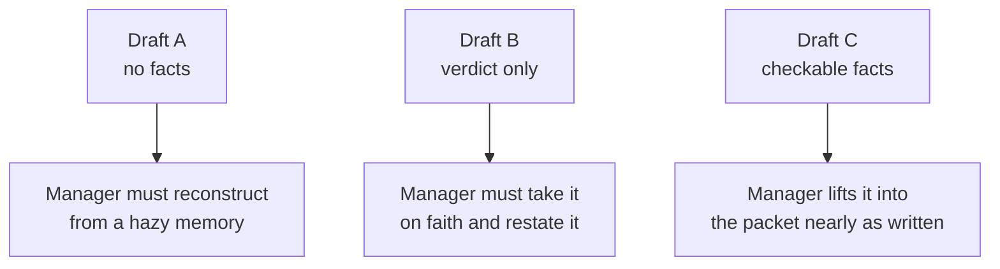

import Scenario from "../../../components/Scenario.astro";
import LevelIntro from "../../../components/LevelIntro.astro";
import Checkpoint from "../../../components/Checkpoint.astro";
import PracticeCheck from "../../../components/PracticeCheck.astro";

export const unit = {
  track: "career-craft",
  unitSlug: "documentation-career-tool",
};

<Scenario label="Same event, three entries. Which one can a manager lift into the packet?">
  <Fragment slot="facts">
    

      
🙈 <strong>Draft A</strong>: under-described, no facts

      
📣 <strong>Draft B</strong>: facts replaced by a verdict

      
✅ <strong>Draft C</strong>: facts a stranger can judge

      
🔢 Numbers in the drafts are illustrative assumptions

    

  </Fragment>

The opening Saturday bug fix is going into the log. The engineer feels
two pulls: say almost nothing, or say how impressive it was. **Neither
pull produces something a manager could paste into a promotion packet
months later. What would?**

</Scenario>

<LevelIntro
  items={[
    "Two weak drafts and why each fails",
    "A rewrite checked against the three parts",
    "Extending the pattern to work without a metric",
  ]}
/>

L2 gave the three parts of a usable entry. L3 applies them to one real
event and then asks where the pattern bends.

## What do the two anxious drafts look like?

**What does an entry look like when the writer is uncomfortable?** Two
opposite failures from the same event.

> **Draft A, under-described:** "Fixed a data issue over the weekend. Wasn't
> a big deal, just needed to look into it."

Six months on, nobody knows what happened, how bad it was, or what skill
it showed. "Wasn't a big deal" undersells silent data damage.

> **Draft B, overcorrected into advocacy:** "I went above and beyond to
> save the company from a major data disaster. This shows I'm ready for
> more responsibility."

"Shows I'm ready" is a verdict the writer cannot issue about themselves. It
has the shape of a report but asks the reader for agreement, which is
exactly what the anxiety was reacting to.

Neither is more honest. Both are miscalibrated: A drops the facts, B adds a
verdict that is not the writer's to give.

<PracticeCheck
  track={unit.track}
  unitSlug={unit.unitSlug}
  topicId="failure-directions"
/>

## What does the rewrite contain?

**What does the same event look like when it states facts and lets the
reader conclude?** A few terms first: **data corruption** means saved data
was wrong; a **race condition** is a timing bug where two actions happen in
an unlucky order; **log correlation** compares system records to find a
pattern; a **backfill** repairs older affected data; an **invariant check**
is an automatic rule that confirms something important stays true.

> **Draft C:** "Diagnosed and fixed a data corruption bug affecting an
> estimated 2% of customer records over 3 weeks (illustrative figures),
> caused by a race condition in the record-merge path. Found it by log
> correlation; no existing alert had caught it. Wrote and ran a backfill to
> repair affected records and added an invariant check to prevent
> recurrence. Fixed over a weekend once the pattern was confirmed, before
> any support tickets arrived."

| Part of an entry | Where Draft C supplies it                                        |
| ---------------- | ---------------------------------------------------------------- |
| What changed     | Records repaired, a new check added, no alert had existed before |
| Why it mattered  | Fixed before support tickets arrived                             |
| What was hard    | Finding a silent bug by log correlation, then a safe backfill    |

Notice what is absent: no "great job" and no "ready for more." A committee
reading "found a silent bug no alert caught" draws its own conclusion,
which carries more weight than the writer's claim would have.

<Checkpoint question="Draft B said 'I went above and beyond' and 'shows I'm ready.' Draft C never says either. Does C communicate less about the writer's readiness?">

No, it communicates more, just without stating it. A committee can judge
"found a silent bug no alert caught, then wrote a safe backfill" for itself.
Draft B told them what to believe. Removing the verdict did not remove the
evidence. It moved the evidence to where the reader can check it.

</Checkpoint>

<PracticeCheck
  track={unit.track}
  unitSlug={unit.unitSlug}
  topicId="failure-directions"
/>

## What if there is no number to report?

**Does objective framing require a metric?** No. It requires that a reader
could check the claim against something real. Compare a mentoring
conversation written two ways:

| Version                             | Text                                                                                                                     | Checkable?                         |
| ----------------------------------- | ------------------------------------------------------------------------------------------------------------------------ | ---------------------------------- |
| Verdict                             | "Helped a newer teammate grow a lot."                                                                                    | No, only a judgment                |
| Observable sign (illustrative case) | "Paired for three sessions on debugging; the teammate then diagnosed the next two similar bugs without a rescue review." | Yes, two events anyone can look up |

A metric can be an observable sign: fewer repeated blockers, a task
finished without help, a decision another team adopted, a handoff others
reused. The same logic covers a design decision with no incident count.

<Checkpoint question="A design decision you made six months ago has no latency number or incident count. Is it disqualified from objective framing?">

No. The claim only has to be checkable: which teams adopted it without
rework, how many follow-up questions it prevented, or whether a later
incident review cited it as the reason a failure did not occur. The
requirement is "checkable," not "numeric."

</Checkpoint>

<PracticeCheck
  track={unit.track}
  unitSlug={unit.unitSlug}
  topicId="checkable-evidence"
/>

## This is a case, not the whole territory

The Saturday bug fix is one shape of work, with clean facts. A decision
that was never implemented, a review that prevented a bad design, or a
quarter of steady support work each need their own checkable specifics.
**Try extending it:** pick one thing you did last month that has no
before-and-after number. What observable sign could you write down today,
and who could verify it? And if the audience were a hiring manager outside
your company instead of your own manager, which facts would you have to
add that your manager already knows?
