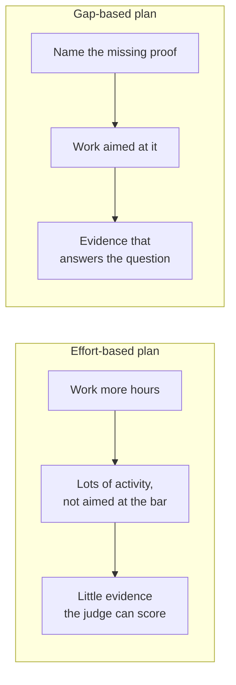

import Scenario from "../../../components/Scenario.astro";
import LevelIntro from "../../../components/LevelIntro.astro";
import PracticeCheck from "../../../components/PracticeCheck.astro";

export const unit = {
  track: "career-craft",
  unitSlug: "goal-setting",
};

<Scenario label="Two runners, one race, six months">
  <Fragment slot="facts">
    

      

        

          <strong>Maya's test run</strong>
          65 min for 10 km (assumed)
        

        

          

        

      

      

        

          <strong>The goal</strong>
          under 55 min for 10 km (assumed)
        

        

          

        

      

      
🎯 The gap is speed: 6:30 per km now, 5:30 per km needed

      
🏃 Ben runs more kilometres; Maya aims at the gap

    

  </Fragment>

Maya and Ben sign up for the same 10 km race, both hoping to finish in
under 55 minutes. (All the numbers here are assumed for illustration.)
Ben's plan is simple: run more. Five days a week, every run at a
comfortable pace, for six months. Maya's first move is different: she
runs one timed 10 km. It takes her 65 minutes, which is 6:30 per
kilometre, and finishing in 55 needs 5:30 per kilometre. Her problem is
not stamina. It is one minute of speed per kilometre. So she keeps two
easy runs and adds one fast interval session a week. **On race day,
Maya beats the target and Ben, who ran more kilometres than she did,
does not. What did Maya do that Ben's hard work never did?**

</Scenario>

Ben's six months were real work. They just were not aimed at the thing
the race measures. The same shape shows up at work whenever the goal is a
promotion, a new responsibility, or a skill someone else will judge.

<LevelIntro
  items={[
    "Effort versus evidence of readiness",
    "Skill gap analysis",
    "Why a named gap beats a vague intention",
  ]}
/>

## Why did Ben's extra kilometres not get him there?

**Ben trained more than Maya. Why did it not count?** Because the race
does not measure how much you trained. It measures one thing, pace, and
Ben spent six months practising a pace he already had.

- **Effort** is an amount: hours, kilometres, tasks. It has no
  direction on its own.
- **Evidence of readiness** is a specific, visible example that shows
  you can already do what the goal requires. A time trial at 5:30 per
  km is evidence. A training log is not.
- At work the judge is a manager or a promotion committee, and the
  question is the same: not "how hard did you work?" but "is there proof
  you can already operate at the next level?"

The workplace version has the same cast. Jordan works overtime for six
months and is turned down; Alex, on the same team, first asks the manager
what is standing in the way, aims at that, and is promoted.

| In the race               | At work                                              |
| ------------------------- | ---------------------------------------------------- |
| Ben: more easy kilometres | Jordan: more hours, more visibility                  |
| Maya: timed 10 km first   | Alex: asks the manager for the one or two gaps first |
| The bar: 5:30 per km      | The bar: what the next level requires                |
| Evidence: a faster time   | Evidence: a visible, checkable example               |
| Judge: the finish line    | Judge: a manager or promotion committee              |

<PracticeCheck
  track={unit.track}
  unitSlug={unit.unitSlug}
  topicId="effort-vs-evidence"
/>

## What did Maya's test run actually do?

**Maya did not train on day one. She measured. Why?** Because you cannot
aim at a gap you have not named.

- **Skill gap analysis** compares what you can currently demonstrate
  with what the goal requires, and names the specific difference.
- A gap is **nameable** ("one minute per km slower than needed"), not a
  mood ("I'm not fast enough yet").
- The comparison is row by row. Some rows have no gap, some a partial
  gap, and usually one or two have a real gap. Only those need work.

| Expectation of the goal           | What you can show now       | Gap     |
| --------------------------------- | --------------------------- | ------- |
| Finish 10 km (distance)           | Done it, comfortably        | None    |
| Hold 5:30 per km (speed)          | 6:30 per km on a test run   | Real    |
| Pace the race sensibly (strategy) | Some experience, no routine | Partial |

| Term                | Read it as                                                                    |
| ------------------- | ----------------------------------------------------------------------------- |
| Promotion committee | The group that decides whether the evidence is strong enough for a next level |
| Bar                 | The standard someone must meet before being trusted at that level             |
| Cross-team decision | A decision that affects more than one group                                   |
| Manager             | The person responsible for guiding and evaluating an employee's work          |

<PracticeCheck
  track={unit.track}
  unitSlug={unit.unitSlug}
  topicId="skill-gap-analysis"
/>
