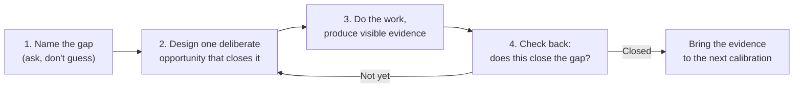

import LevelIntro from "../../../components/LevelIntro.astro";
import Checkpoint from "../../../components/Checkpoint.astro";
import PracticeCheck from "../../../components/PracticeCheck.astro";

export const unit = {
  track: "career-craft",
  unitSlug: "goal-setting",
};

L1 showed Maya and Alex ending up ahead of runners and colleagues who worked at least as hard. This level turns that into a repeatable loop, and then asks a harder question: how do you find the gap in the first place?

<LevelIntro
  items={[
    "The four-step growth-plan loop",
    "Effort-based versus gap-based plans",
    "Asking the judge instead of guessing",
  ]}
/>

## Once the gap is named, what does the plan look like?

**Maya knows she is one minute per km short. Is the plan just "go run faster"?**
No. A named gap still needs a deliberate way of closing it, and a way of
knowing it closed. That is the loop.

1. **Name the gap.** One or two, not a list of every flaw.
2. **Design one deliberate opportunity.** A piece of work chosen because
   doing it well will produce exactly the missing proof.
3. **Do it and keep the evidence.** Something another person can look at.
4. **Check back.** Does this evidence answer the question the judge was
   asking? If not yet, go back to step 2 with a better-aimed opportunity.

|                         | Effort-based plan                       | Gap-based plan                                       |
| ----------------------- | --------------------------------------- | ---------------------------------------------------- |
| Starting point          | A general intention to do more          | A specific gap from a direct conversation            |
| What success looks like | More hours, more visible activity       | Evidence that closes the named gap                   |
| Main risk               | Effort that never touches the bar       | Naming the wrong gap, which step 4 is there to catch |
| What the judge sees     | Busyness that is hard to map to the bar | A direct answer to the question already being asked  |

<Checkpoint question="Maya's plan has a check-back step. What does that step protect her from?">

From drifting. Without the check, weeks of work can pile up that feels productive but does not move the one number that counts. The check asks "did the thing I did close the gap?" in plain terms, and if the answer is no, it sends her back to design a better-aimed opportunity instead of quietly doing more of the same.

</Checkpoint>

<PracticeCheck
  track={unit.track}
  unitSlug={unit.unitSlug}
  topicId="growth-plan-loop"
/>

## Who tells you what the bar actually is?

**A music student is told the exam needs "good musicianship". Should she
guess what that means, or ask the teacher?** Ask: the teacher is the
one holding the marking sheet. The same is true at work.

- **Calibration conversation:** asking whoever judges the goal, directly,
  what proof would show you are ready. For example: "What one or two
  things stand between me and the next level?"
- Expectations at a level are rarely written down in full, and the same
  title can mean different things on different teams.
- Being honest with yourself is not enough. You can list your real
  weaknesses accurately and still guess wrong about which one blocks the
  decision.
- No clear judge? Use the most credible source of the standard: a
  written rubric, a trusted peer already at that level, or the person who
  will approve the next responsibility. The weaker that signal, the more
  important step 4 becomes.

<Checkpoint question="A colleague is brutally honest in a private self-review and still picks the wrong gap. How can that happen?">

Honesty is about accuracy regarding yourself; the bar lives in someone else's head. Your list of weaknesses can be entirely correct and still miss the one the evaluator actually weighs. Asking collapses that uncertainty into one named target, which is why the conversation comes before the plan, not after it.

</Checkpoint>

<PracticeCheck
  track={unit.track}
  unitSlug={unit.unitSlug}
  topicId="ask-dont-guess"
/>

The pattern generalizes beyond promotions: any goal judged by someone else against a bar you do not fully control, such as a new type of project, a new responsibility, or a gap flagged in a review.
