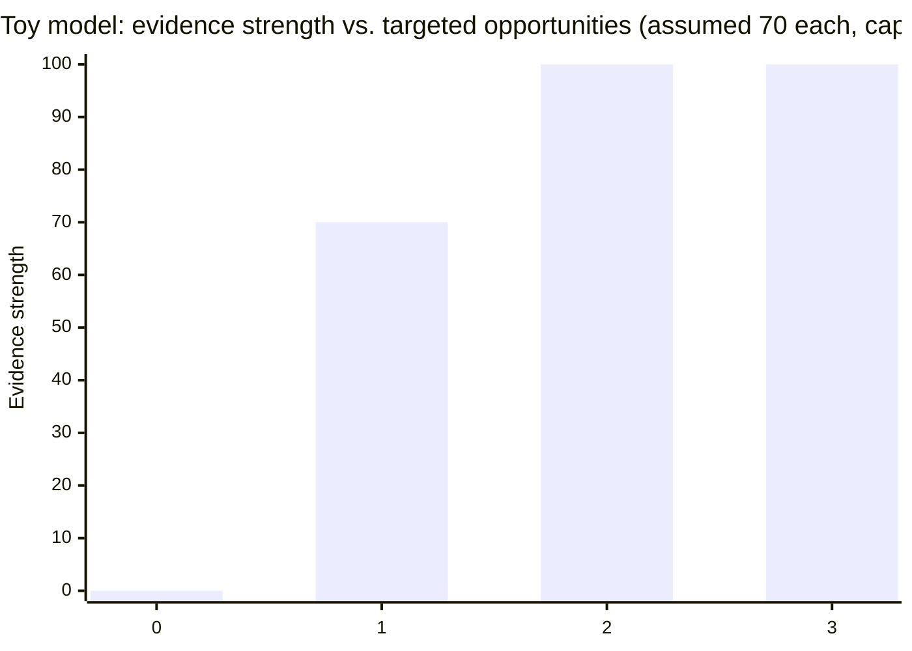

import Scenario from "../../../components/Scenario.astro";
import LevelIntro from "../../../components/LevelIntro.astro";
import Checkpoint from "../../../components/Checkpoint.astro";
import PracticeCheck from "../../../components/PracticeCheck.astro";

export const unit = {
  track: "career-craft",
  unitSlug: "goal-setting",
};

<Scenario label="Alex's growth plan, built backward from one named gap">
  <Fragment slot="facts">
    

      
💬 <strong>The question Alex asked</strong> — "what are the one or two things standing between me and the next level?"

      
🎯 <strong>The gap named</strong> — no evidence yet of leading a technical decision across teams

      
🛠️ <strong>The opportunity chosen</strong> — lead the written proposal and rollout of a two-team library migration

    

  </Fragment>

**Alex's manager has named one gap: leading a technical decision that
spans teams. Before reading further, predict: would volunteering for a
large, high-visibility project on Alex's own team have closed it, and why
or why not?**

</Scenario>

<LevelIntro
  items={[
    "Alex's evidence checked against the bar",
    "Choosing an opportunity that spans the gap",
    "Surfacing the evidence and revisiting the plan",
  ]}
/>

Words used in this worked example:

| Term              | Read it as                                                       |
| ----------------- | ---------------------------------------------------------------- |
| RFC               | A written proposal for a technical decision                      |
| Rollout           | The step-by-step process of putting a change into real use       |
| Library migration | Moving code from an old shared tool to a newer one               |
| Stakeholders      | People or groups affected by the decision                        |
| Partial gap       | Some proof exists, but it is not strong or structured enough yet |

## How does Alex's evidence compare with the bar?

Read the table as a checklist: each row is something the next level
expects, and the middle column asks, "Can Alex already prove this?"

| Expectation at the next level                         | Evidence Alex already has                       | Gap?        |
| ----------------------------------------------------- | ----------------------------------------------- | ----------- |
| Makes sound technical decisions within their own team | Yes, several solid decisions over the past year | No gap      |
| Reliable under on-call and incident pressure          | Yes, consistently strong incident response      | No gap      |
| Leads a technical decision that spans multiple teams  | No prior example                                | **Gap**     |
| Mentors other engineers                               | Some informal help, nothing structured          | Partial gap |

The calibration conversation confirms the cross-team row as the primary
gap. This table is the concrete version of the skill gap analysis from
L1: not a feeling of being unready, but a row-by-row comparison with one
clear miss.

<Checkpoint question="Alex already has no gap in same-team decisions or on-call work. Why doesn't a bigger, more impressive project in either area close the named gap?">

Because the gap is not "not enough impressive work". It is a specific missing capability: leading a decision across teams. Same-team work, however large, never puts Alex in a position where that skill is exercised, so it produces no evidence for that row. The table matters because it pushes the comparison down to the one unproven row.

</Checkpoint>

## Which opportunity closes a gap that spans teams?

Predicted answer: a large project confined to Alex's own team does not
produce evidence of the named gap, because "spans multiple teams" is the
missing part, not "does a big project". Alex instead volunteers to lead
the RFC and rollout for moving two teams off a deprecated internal
library. That work structurally requires a written design, coordination
with another team's tech lead, and alignment between two sets of
stakeholders with different priorities.

| Month | What Alex does                                                          | Evidence produced                                  |
| ----- | ----------------------------------------------------------------------- | -------------------------------------------------- |
| 1     | Writes the migration RFC, circulates it to both teams                   | A written decision visible to both teams           |
| 2     | Runs alignment talks, resolves a disagreement over rollout order        | A recorded example of driving cross-team consensus |
| 3–5   | Leads the phased rollout, coordinates both teams' schedules             | A shipped result both teams can vouch for          |
| 6     | Brings the RFC, the resolved disagreement and the result to calibration | Direct evidence answering the exact gap named      |

The software detail is not the point. The point is that Alex chose work
that naturally creates the proof the manager said was missing.

The interactive demo below is a toy model, not a real promotion formula.
It assumes each deliberately targeted opportunity adds 70 points of
evidence strength, capped at 100. One opportunity gives 70, two give
100, and a third adds nothing more for the same gap, which is when
effort is better spent on a different gap.

<Checkpoint question="Alex's trail has a written RFC, a resolved disagreement and a shipped result. Why not stop once the RFC alone is written?">

Because the gap was leading a decision across teams, not just proposing one. A document shows Alex can write a plan, but not that Alex can carry it through disagreement into a result others confirm. The evidence should cover the whole arc, or the committee has room to doubt the part that is missing.

</Checkpoint>

<PracticeCheck
  track={unit.track}
  unitSlug={unit.unitSlug}
  topicId="targeted-opportunity"
/>

## What happens after the work is done?

**Alex has the RFC, the resolved disagreement and the shipped result. Does
the evidence now speak for itself?** No. Evidence only influences a
decision once the judge sees it.

1. Bring the specific evidence to the calibration conversation, not a
   summary of effort.
2. Ask directly whether it closes the gap.
3. Listen for a new or shifted gap, and treat it as a fresh pass of the
   loop.

| Failure mode                                 | What it gets wrong                                                      |
| -------------------------------------------- | ----------------------------------------------------------------------- |
| Equating hours worked with readiness         | Evaluators check proof against the bar, not total effort                |
| Choosing the gap without confirming it       | A guessed gap may not be the one blocking the decision                  |
| Taking a large project that misses the gap   | Size and visibility are not relevance                                   |
| Closing the gap but never surfacing evidence | Evidence the evaluator never sees cannot influence the next calibration |
| Treating the gap as permanently fixed        | Expectations shift; the plan should be revisited at each calibration    |

<Checkpoint question="Why does Alex ask whether the evidence closes the gap instead of simply presenting it?">

Because the judge's answer is itself information. If the answer is yes, the plan is done for now. If it is "mostly", Alex learns exactly what is still thin, which is a far better starting point for the next pass than silence and a guess.

</Checkpoint>

<PracticeCheck
  track={unit.track}
  unitSlug={unit.unitSlug}
  topicId="surface-and-revisit"
/>

## Extend it: this is a case, not the whole territory

Alex's six months is one worked example. Change the details and the
shape has to be re-derived, not copied.

- **What if the manager had named two gaps, cross-team leadership and
  mentoring?** Two separate half-sized projects may each be less
  convincing. Could the same migration be designed so a newer teammate
  owns a defined piece under Alex's guidance, producing evidence for both?
- **What if the news were worse?** Suppose the manager says the gap is
  large and the next calibration is only three months away. Which part of
  the loop is under pressure, and what would you drop?
- **What if there were no manager?** A student told to show leadership
  and clearer explanations might lead a study group and teach one topic a
  week. One activity, designed around both gaps from the start, can
  produce proof for both.
