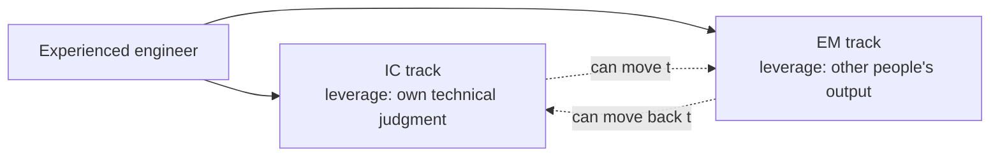

import Scenario from "../../../components/Scenario.astro";
import LevelIntro from "../../../components/LevelIntro.astro";
import PracticeCheck from "../../../components/PracticeCheck.astro";

export const unit = {
  track: "career-craft",
  unitSlug: "ic-em-tracks",
};

<Scenario label="The problem">
  <Fragment slot="facts">
    

      
🎻 Mara: the best violinist in the orchestra, offered the conductor's baton

      
👂 Mara: players already ask her how to fix their passages

      
🪄 Joel: wants the baton because the conductor stands at the front

      
🔇 A conductor produces no sound of their own; the orchestra does

    

  </Fragment>

A community orchestra offers its best violinist, Mara, the conductor's baton. Everyone agrees she plays beautifully, so the offer feels like a promotion. But a conductor does not play a note. Their whole job is to make forty other people sound better than they would alone. Joel, the second-best violinist, wants the baton too, mostly because the conductor stands at the front.

**Is the baton a bigger violin chair, or a different instrument entirely? And is either of them choosing it for the right reason?**

</Scenario>

Conducting and playing are two different crafts that share a starting point: both start with loving music. Software has the same fork. An experienced engineer can keep deepening their own technical work (an individual contributor, or IC), or move into engineering management (EM), where the output is other people's work.

<LevelIntro
  items={[
    "IC and EM as two tracks, not one ladder",
    "Why 'next step' is the wrong reason",
    "Self-assessment: energy, aptitude, org need",
  ]}
/>

## Is management the next rung of the ladder?

**Priya and Sam are both experienced engineers facing the same offer this quarter. Priya reads other people's designs unasked, yet dreads the one weekly meeting she already runs. Sam wants the manager title for the pay band and has never run a 1:1. If this were a ladder, both would simply climb. Why doesn't it work that way?**

Because the two jobs optimize different things.

| Term        | Read it as                                                                                                                |
| ----------- | ------------------------------------------------------------------------------------------------------------------------- |
| IC          | Individual contributor: primary output is their own technical work                                                        |
| EM          | Engineering manager: primary output is other people's work, multiplied                                                    |
| Dual ladder | A leveling system where advanced IC roles pay and rank comparably to manager roles, instead of manager sitting above them |
| Tech lead   | An IC role with some coordination duties but no formal authority over people                                              |

- A well-run organization runs a **dual ladder**: IC and EM are parallel tracks, similar in standing, different in daily work.
- An IC's leverage is their own technical judgment, applied through code, design docs, and review.
- An EM's leverage is other people's output: hiring, coaching, unblocking, and prioritizing.

<PracticeCheck
  track={unit.track}
  unitSlug={unit.unitSlug}
  topicId="parallel-tracks"
/>

## Why is 'it's the natural next step' the most common wrong reason?

**Joel's real reason is the pay band and the title. If the offer were the same job with a smaller title, would he still want it?** If not, the job was never the attraction.

- "Management is the next step" survives mostly because some org charts make management the only way to earn more pay or say. That is a flaw in the ladder, not proof that managing people is a more advanced skill.
- Taking the role for the ladder's sake relocates the ladder's problem onto you, and eventually onto everyone who reports to you.
- A track switch costs months of ramp-up in either direction. It is reversible more often than people fear, but never free.

<PracticeCheck
  track={unit.track}
  unitSlug={unit.unitSlug}
  topicId="wrong-reason"
/>

## What should actually decide it?

A working self-assessment asks three separate questions, not one.

| Axis     | The question                                                 | Mara's version                                                |
| -------- | ------------------------------------------------------------ | ------------------------------------------------------------- |
| Energy   | Does the daily content of the job recharge you or drain you? | Does she enjoy rehearsals more than solo practice?            |
| Aptitude | Is there evidence you are already good at it?                | Do players already seek her out for help?                     |
| Org need | Does this organization actually need you here?               | Does the orchestra lack a conductor, or only a title to give? |

Priya and Sam's stories are not finished. Nothing above says either has the wrong instinct. It says the question each should answer is narrower than "which one is the promotion": which kind of daily work do I want more of, and is there real evidence I would be good at it?
