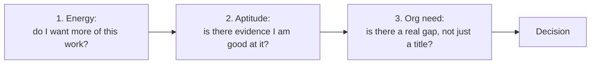
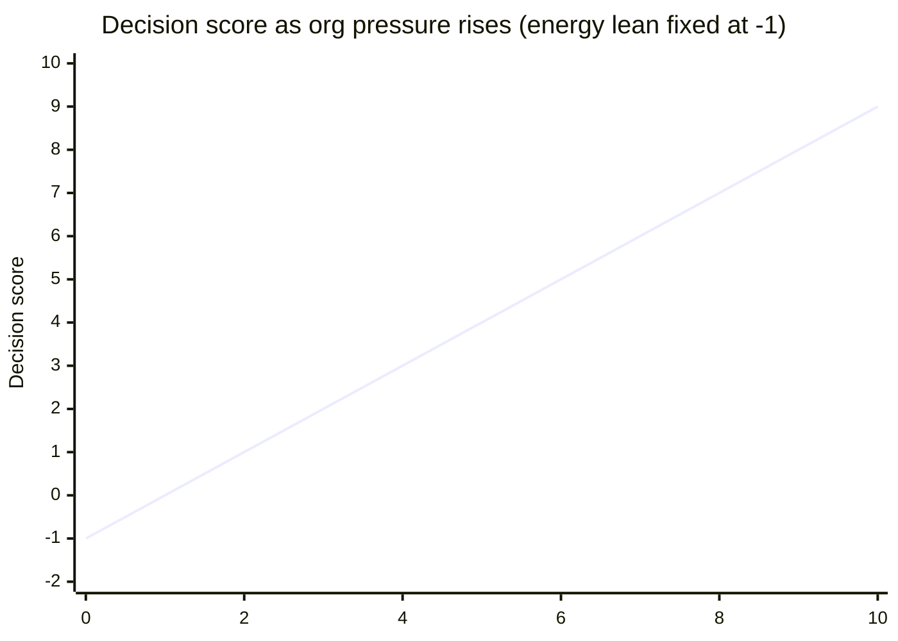

import LevelIntro from "../../../components/LevelIntro.astro";
import Checkpoint from "../../../components/Checkpoint.astro";
import PracticeCheck from "../../../components/PracticeCheck.astro";

export const unit = {
  track: "career-craft",
  unitSlug: "ic-em-tracks",
};

L1 named the trap: treating management as the next rung instead of a different craft, the way a conductor is not just a better violinist. This level makes that concrete. What does each role's week contain, what does a self-assessment look like that cannot be faked by picturing the job wrong, and how can someone gather evidence before committing?

<LevelIntro
  items={[
    "A week of IC work vs. a week of EM work",
    "Three axes, and why org need goes last",
    "Low-cost ways to trial before committing",
  ]}
/>

## What does each job contain, hour by hour?

If someone has never done either job, how would they know which one they would enjoy, not the idea of it but the Tuesday afternoon of it?

| An IC's week                                                    | An EM's week                                                            |
| --------------------------------------------------------------- | ----------------------------------------------------------------------- |
| Deep work block: designing or reviewing a system's architecture | Back-to-back 1:1s with each direct report                               |
| Writes or reviews a design doc and pushes back on trade-offs    | Performance calibration: comparing ratings across the team for fairness |
| Pairs with an engineer stuck on a hard bug                      | Headcount planning: making the case for one more hire                   |
| Is the escalation point when a technical decision is contested  | Is the escalation point when two engineers are in conflict              |
| Mentors by example: the design doc or review is the teaching    | Mentors by conversation: a 1:1 about a specific moment of feedback      |

Notice what is absent from the EM column: being the person who personally solves the hard technical problem. That is not a side effect of being busy, it is the shape of the job. An EM who keeps doing IC work underinvests in what only a manager can do: the headcount case, the calibration, the 1:1 where someone finally says what is wrong.

<Checkpoint question="An EM spends a chunk of each week still writing production code because they miss it and are good at it. What is the likely cost, even if the code is excellent?">

The cost is opportunity cost, not code quality. Time spent coding is time not spent on work that no one else does by default: running calibration fairly, building the headcount case, holding the 1:1 where a struggling teammate speaks up. A missed pull request gets picked up by someone else; these tasks do not, because they belong specifically to the manager. An EM who keeps doing IC work is quietly underinvesting in the actual role.

</Checkpoint>

<PracticeCheck
  track={unit.track}
  unitSlug={unit.unitSlug}
  topicId="job-contents"
/>

## How do three axes beat one gut feeling?

"Which one sounds more appealing" is easy to answer from the idea of a role. What question set resists that?

| Axis     | The real question                                                             | Weak evidence                   | Strong evidence                                                    |
| -------- | ----------------------------------------------------------------------------- | ------------------------------- | ------------------------------------------------------------------ |
| Energy   | Does a week like the EM column sound draining or energizing?                  | "I could probably handle it"    | You already look forward to the parts of your job that resemble it |
| Aptitude | Is there evidence you are good at this?                                       | "I'm smart, I'll figure it out" | Teammates already bring you conflicts and career questions         |
| Org need | Does this organization need you here, or is EM just the only visible path up? | "There's no other way up here"  | A real gap exists that you would fill                              |

**Why does org need go last?** Because it is the loudest and the least about you. The unit's demo makes this concrete with a toy score: Priya rates her energy from people-facing work at 6 and her energy from staying technically deep at 7, so her true lean toward EM is 6 − 7 = −1, a slight lean toward IC. Add "only path up here" pressure and the score moves with it. These are modeled, illustrative ratings, not measurements.

At pressure 0 the score is −1; at pressure 1 it is exactly 0; at pressure 2 it is +1 and the decision has flipped, even though Priya's real preference never changed. A small amount of ladder pressure can outweigh a modest real preference.

<Checkpoint question="Someone says, 'I want to be an EM because there is literally no other way to get promoted at my company.' Using the three axes, what is wrong with that as the deciding reason?">

The statement is entirely about org need, the axis meant to be the last filter. It says nothing about whether the person would find 1:1s, calibration, and conflict energizing, or whether they have aptitude for it. A narrow ladder is a real problem worth raising directly, for example by advocating for a dual ladder, but it is not fixed by putting the wrong person into management.

</Checkpoint>

<PracticeCheck
  track={unit.track}
  unitSlug={unit.unitSlug}
  topicId="three-axes"
/>

## How can someone gather evidence before committing?

Both tracks are real jobs with real costs to switching. Is there a way to learn about energy and aptitude before an irreversible-feeling choice?

| Trial                                 | What it samples                                           | What it cannot show         |
| ------------------------------------- | --------------------------------------------------------- | --------------------------- |
| Tech lead                             | Coordinating others' work without formal people authority | Hiring, firing, and ratings |
| Covering or mentoring one person      | A small slice of 1:1s and career conversations            | The load of a full team     |
| Leading a cross-team initiative       | Getting outcomes without direct authority                 | Owning a team's performance |
| Shadowing an EM's calendar for a week | The real texture of the job, before opting in             | Doing it yourself           |

None of these fully substitutes for the real role: a few weeks does not reproduce a stressful calibration cycle or a layoff conversation. But each yields real evidence on energy and aptitude, which beats guessing from the outside.

<PracticeCheck
  track={unit.track}
  unitSlug={unit.unitSlug}
  topicId="sampling-trials"
/>
