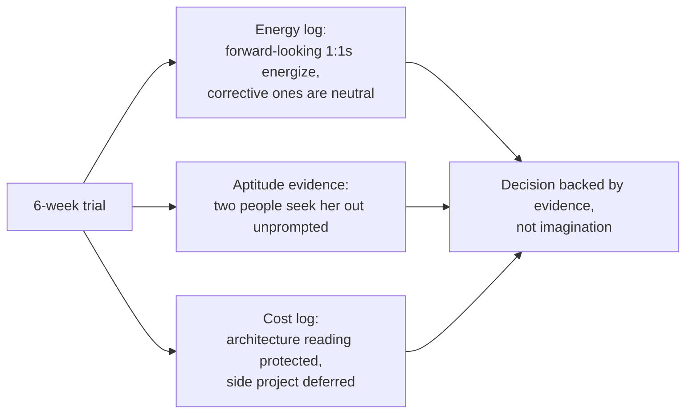

import Scenario from "../../../components/Scenario.astro";
import LevelIntro from "../../../components/LevelIntro.astro";
import Checkpoint from "../../../components/Checkpoint.astro";
import PracticeCheck from "../../../components/PracticeCheck.astro";

export const unit = {
  track: "career-craft",
  unitSlug: "ic-em-tracks",
};

<Scenario label="The trial">
  <Fragment slot="facts">
    

      
🗓️ Priya: six weeks as interim manager for one intern, still mostly an IC

      
🚀 Sam: takes the full EM role with seven reports, no trial

      
🔁 Both revisited later, with very different evidence behind them

    

  </Fragment>

The orchestra story from L1 now has a workplace version. Priya's manager offers a deal instead of an immediate answer: spend six weeks as interim manager for a single intern (career conversations, feedback, unblocking), while staying mostly in her IC role. Sam, on another team, takes the full EM opening directly, seven reports starting next Monday, because the only visible path up at his company is the manager track. Both stories are constructed for teaching, not drawn from real people.

**Before reading on: both are asking "should I manage people," but with very different evidence behind the answer. What do you expect that gap to produce later?**

</Scenario>

<LevelIntro
  items={[
    "Priya's six-week trial, in detail",
    "Sam's unassessed jump, and where it breaks",
    "A decision worksheet, and where it runs out",
  ]}
/>

## What does six weeks of real evidence look like?

A trial helps only if it produces evidence Priya cannot get by imagining the job. What does she actually track?

She keeps three simple records, matched to L2's axes.

- **Energy log.** After each intern 1:1, each piece of feedback, and each "that is not ready yet" moment, she writes one line: energized, neutral, or drained, and why. By week four a pattern appears: forward-looking 1:1s ("here is what to try next") energize her, while corrective ones read as neutral, not draining. That differs from her fear that all people-conversations would feel like the weekly meeting she dreads.
- **Aptitude evidence.** Unprompted signals count more than self-belief. In this constructed case, the intern's peer buddy and an engineer on another team each come to Priya to referee a stalled decision, without being asked to.
- **Cost log.** She notes what she stopped doing. Her architecture reading stayed protected; a side project stayed unstarted. That shows which parts of IC work she would protect even inside a manager role.

Her evidence points toward EM being a plausible fit, not a certainty. A one-intern trial samples the job; it does not reproduce a full-team calibration, a hiring-freeze fight, or a conflict between two reports.

<Checkpoint question="Priya's log shows corrective feedback reads as 'neutral', not 'energizing'. Is that a warning sign to stay IC?">

No. Relative to her starting fear it is a positive signal: she expected every people-conversation to feel like the meeting she dreads, and only one type reads as merely neutral. Neutral is a workable baseline for a recurring part of the job. The real warning sign would be corrective conversations reading as draining, like the meeting she avoids.

</Checkpoint>

<PracticeCheck
  track={unit.track}
  unitSlug={unit.unitSlug}
  topicId="trial-evidence"
/>

## What breaks when the evidence is skipped?

Sam took the role because of the ladder, with no evidence on energy or aptitude. Three months in, does the failure look like what he feared?

It is not dramatic, which is what makes it dangerous. The 1:1s happen and nothing catches fire. What erodes is subtler.

1. **Delegation collapses back through Sam.** When an engineer brings a half-formed design, Sam's IC instinct is to solve it himself. The team stops developing its own judgment, and he becomes a bottleneck exactly where a manager's multiplied output should appear.
2. **Corrective conversations get avoided, not just disliked.** A report's missed deadlines go unaddressed for two cycles longer than they should, because the conversation itself is where Sam has no evidence of skill.
3. **The fatigue gets the wrong label.** Sam calls it "the learning curve of any new role," a plausible explanation that delays the real diagnosis. A low-stakes trial would have surfaced the pattern in weeks.

None of this makes Sam a bad engineer. It is the predictable result of skipping the evidence. The fix is not necessarily going back to IC: name the actual gaps (delegation, corrective feedback) and build them deliberately. Some people grow into the role; others confirm, with real evidence this time, that it is the wrong track.

<Checkpoint question="Sam's team stops developing judgment because he keeps solving half-formed designs himself. In terms of L2's IC vs. EM leverage, what exactly is going wrong?">

L2 defined EM leverage as other people's output, multiplied. By solving designs directly, Sam still runs on the IC model (his own judgment applied directly) while holding an EM role. The team's output is not multiplied; it is routed through his personal bandwidth, which makes him a bottleneck rather than leverage, the failure L2 predicted for an EM who keeps doing IC work.

</Checkpoint>

<PracticeCheck
  track={unit.track}
  unitSlug={unit.unitSlug}
  topicId="skipped-evidence"
/>

## What does the worksheet look like, and where does it run out?

| Question                                                       | Priya                                            | Sam (in hindsight)                               |
| -------------------------------------------------------------- | ------------------------------------------------ | ------------------------------------------------ |
| Do forward-looking people conversations energize me?           | Yes, observed in the trial                       | Unknown at decision time                         |
| Do corrective conversations drain me, or only make me nervous? | Neutral, a workable baseline                     | Unknown; became a real gap under full stakes     |
| Has anyone sought me out for manager-shaped help?              | Yes, unprompted                                  | No prior evidence either way                     |
| Am I choosing this because the ladder has no other path up?    | No, org need came last                           | Yes, close to the whole reason                   |
| What would I give up, and does it feel like a loss?            | Some IC identity; architecture reading protected | Technical depth, which felt like a loss mid-role |

**This worked example is one case, not the whole territory.** A quieter team with no dramatic conflicts would not expose Sam's failure as fast; the same wrong decision could look fine for a year until a real conflict tested it. A hiring freeze might make a trial impossible, and an organization with no dual ladder caps pay for staying IC, leaving less room than Priya had. Extend it yourself: what would you do with the three axes if no trial were possible and the only evidence available were your own reported energy, with no chance to test aptitude against real people first?
