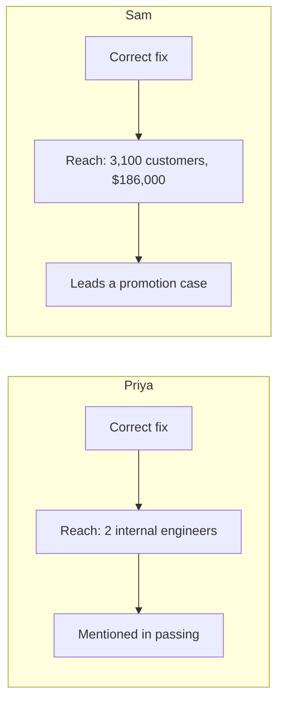

import Scenario from "../../../components/Scenario.astro";
import LevelIntro from "../../../components/LevelIntro.astro";
import PracticeCheck from "../../../components/PracticeCheck.astro";

export const unit = {
  track: "career-craft",
  unitSlug: "impact-scope-over-correctness",
};

<Scenario label="Two correct bug reports, two very different reviews">
  <Fragment slot="facts">
    

      

        3,100 vs. 2
        people the bug would have reached (bar scaled to Sam's)
      

      

        

          

        

        

          

        

      

    

    

      
💰 <strong>Sam</strong>: billing bug, 3,100 customers x $60 = $186,000 at risk

      
🐛 <strong>Priya</strong>: debug-log bug, 2 internal engineers, no revenue at risk

      
📋 Both fixes correct and merged cleanly; only Sam's anchors a promotion case

    

  </Fragment>

Priya and Sam each found and fixed a real bug this quarter. Both diagnoses
were completely correct, with no dispute and no rework. Priya's manager
barely mentions her fix in her performance review. Sam's is the centerpiece
of a promotion case.

**Both engineers were right. Why did only one review read as senior?**

</Scenario>

Correctness cannot be the answer, because it was identical. Something else
differed, and until you can name it, "do excellent work" is advice with no
steering wheel.

<LevelIntro
  items={[
    "Correctness as a baseline, not a differentiator",
    "Scope, impact, and blast radius",
    "How a review turns reach into a story",
  ]}
/>

## What actually differed between the two fixes?

**If correctness was equal, what was not?** The reach of what each bug would
have done if left alone.

- **Correctness** is whether a diagnosis or fix is technically accurate. It
  is expected of anyone whose code ships, so it answers "did you do the task
  right?" and says nothing about "did the task matter?"
- **Scope** is how far the consequences of a piece of work reach: users,
  revenue, other systems, other people's work.
- **Impact** is the realized or prevented consequence: scope adjusted by how
  likely the bad outcome really was.
- **Blast radius** is scope made concrete: if this had gone wrong, exactly
  what would have broken, and how far would it have spread?

| Term             | Read it as                                                         |
| ---------------- | ------------------------------------------------------------------ |
| Off-by-one bug   | A counting mistake where the answer is one too high or one too low |
| Debug log        | A message engineers read to understand what a system did           |
| Production       | The real system customers use, not a practice or test copy         |
| Promotion packet | The written evidence that someone is ready for a higher job level  |
| Incident         | A visible system problem that needs a response                     |

The seniority signal is judgment about which problems are worth solving, not
skill at solving them. A one-line fix that prevents a $186,000 billing error
reads as more senior than a beautiful solution to a problem nobody was going
to hit.

<PracticeCheck
  track={unit.track}
  unitSlug={unit.unitSlug}
  topicId="correctness-baseline"
/>

## What this unit covers next

L2 shows why correctness and scope are independent, and how to estimate scope
before the work is finished. L3 writes up both fixes side by side, does the
arithmetic of exposure, and shows what language makes scope visible on paper.
