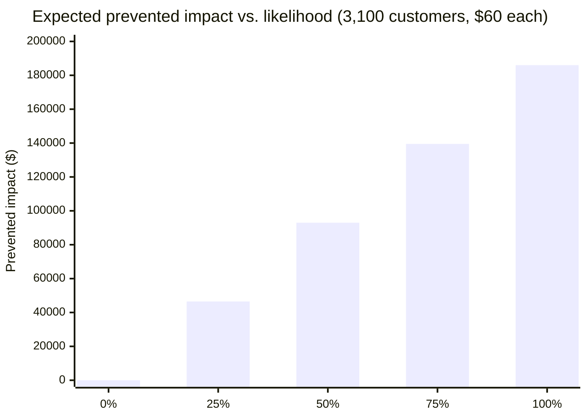

import Scenario from "../../../components/Scenario.astro";
import LevelIntro from "../../../components/LevelIntro.astro";
import Checkpoint from "../../../components/Checkpoint.astro";
import PracticeCheck from "../../../components/PracticeCheck.astro";

export const unit = {
  track: "career-craft",
  unitSlug: "impact-scope-over-correctness",
};

<Scenario label="Same fix, two ways to write it down">
  <Fragment slot="facts">
    

      
🔎 Sam found the bug while reading the billing job for an unrelated task

      
👥 3,100 customers x $60 = $186,000 would have been double-charged

      
📅 Caught 3 weeks before the scheduled run

      
✍️ Draft A hides all of that; Draft B shows it

    

  </Fragment>

L2 established that scope, not difficulty, separates a routine fix from a
senior-reading one, and that scope can often be estimated before anything
breaks. Sam's manager now has to write the review. The facts are fixed; only
the words are open.

**If every sentence in a review can be true and the review still erases the
accomplishment, what exactly has to be on the page?**

</Scenario>

<LevelIntro
  items={[
    "Exposure arithmetic and likelihood",
    "Two drafts of the same fix, compared",
    "What the comparison does and does not prove",
  ]}
/>

## How big is the exposure, and how likely was it?

**Scope says how far a bug could reach. How do you turn that into a number a
reviewer can weigh?** This is a simplified teaching model, not accounting:

1. **Total exposure** = customers affected x charge per customer. For Sam:
   3,100 x $60 = $186,000.
2. **Expected prevented impact** = total exposure x the likelihood that the
   bad charge would really have happened. At 100% likelihood it equals the
   exposure; at 50% it is $93,000; at 0% it is $0.

The interactive demo on this page lets you drag customers, charge, and
likelihood; its defaults reproduce Sam's $186,000. The model counts only the
erroneous charge dollars. It leaves out refunds, support load, and lost trust,
so a real write-up should say what it did and did not count.

<PracticeCheck
  track={unit.track}
  unitSlug={unit.unitSlug}
  topicId="exposure-and-likelihood"
/>

## The raw facts, before anyone writes anything

Technical words in the example: a **batch job** is a scheduled task a
system runs automatically; a **billing cycle** is the period when
customers are charged; **QA** means quality assurance, the people or
process used to check that a change behaves correctly; and **production**
is the real system customers use.

Before either manager wrote a word, here's what actually happened —
identical in structure, wildly different in scope:

|                                  | Priya                                             | Sam                                                                                              |
| -------------------------------- | ------------------------------------------------- | ------------------------------------------------------------------------------------------------ |
| What was found                   | Off-by-one bug in a debug-only logging path       | A batch job that would double-charge customers on their next billing cycle                       |
| Who would be affected if unfixed | 2 internal engineers reading confusing log output | 3,100 customers, at $60 in erroneous charges each                                                |
| Total exposure if unfixed        | Negligible — no revenue or customer impact        | $186,000 in erroneous charges (3,100 × $60)                                                      |
| Difficulty of the actual fix     | Small — one boundary condition corrected          | Small — one conditional check added before the batch job ran                                     |
| When it was caught               | During routine debugging                          | Three weeks before the batch job's scheduled run, while reading through it for an unrelated task |

**Before reading the write-ups below — given this table, what's the
one fact that predicts which write-up will anchor a promotion case?**
It isn't difficulty (both fixes were small). It's the exposure row:
$0 in practical terms versus $186,000 — a difference of scope, not of
skill or effort.

## Draft A: how NOT to write Sam's accomplishment

A manager unfamiliar with translating impact into review language
might write:

> "Sam fixed a bug in the billing batch job this quarter. The fix
> was a one-line change to a conditional check. Sam also helped
> onboard two new team members and kept up with code review load."

Every sentence here is true. But notice what's missing: no mention of
what the bug _would have done_, no dollar figure, no customer count,
no mention that Sam found it proactively rather than reactively. Read
cold, this description sounds identical to Priya's debug-log fix —
"fixed a small bug." **The write-up itself erased the scope that
made this catch matter**, even though the underlying fact pattern was
already there to draw from.

## Draft B: the same facts, scope made explicit

> "While reviewing the billing batch job for an unrelated task, Sam
> identified a bug that would have caused the job to double-charge
> approximately 3,100 customers on their next billing cycle — a
> combined $186,000 in erroneous charges — three weeks before the job
> was scheduled to run. Sam wrote and merged a fix (a single
> conditional check), flagged the finding to the billing team lead
> immediately rather than waiting for the next status update, and
> confirmed with QA that the corrected job produced accurate charges
> for a sample of the affected accounts before it ran in production.
> No customers were charged incorrectly."

Same underlying fix. Same difficulty. What changed is that **scope
and judgment are now visible on the page**: the dollar figure, the
customer count, the fact that Sam found this proactively (not in
response to a complaint), and the fact that Sam verified the fix
before trusting it rather than merging and moving on. This is the
version that reads as senior — not because the code changed, but
because the write-up now shows the reader what would have happened
without Sam's intervention.

Notice the senior signal does not say, "Sam is excellent." It shows
the facts — customer count, dollar amount, timing, and verification —
so the reader can reach that conclusion without being asked to trust a
self-assessment.

<Checkpoint question="Draft A and Draft B describe the exact same fix, made by the same person, with the same difficulty. What's the one thing Draft B adds that Draft A leaves out?">

Not a new fact — a visible one. Every number in Draft B (3,100
customers, $186,000, three weeks of lead time, the QA verification)
was already true when Draft A was written; Draft A just never said
it. Draft B doesn't inflate the accomplishment or add anything that
didn't happen — it makes the existing scope legible to a reader who
wasn't there when it happened. A manager reading Draft A has no way
to tell this apart from a routine bug fix, because the write-up
withheld the exact information that would let them tell the
difference.

</Checkpoint>

<PracticeCheck
  track={unit.track}
  unitSlug={unit.unitSlug}
  topicId="writing-scope-visibly"
/>

## Priya's write-up, for contrast — and why it's _correctly_ modest

> "Priya identified and fixed an off-by-one error in the debug
> logging path used during local development. The fix improves log
> readability for the team during future debugging sessions."

This is not a "bad" write-up — it's an accurate one. Inflating it
with false urgency ("this could have caused serious issues...") would
misrepresent the actual scope, which was genuinely small. **The goal
isn't to make every write-up sound huge — it's to represent scope
accurately, whatever that scope turns out to be.** A manager who
learns to write Draft B for Sam should not start writing Draft-B-style
language for every minor fix; that would just make every review
sound inflated and erase the signal entirely.

<Checkpoint question="Would borrowing Draft B's language — dollar figures, urgency, 'prevented a serious risk' — to describe Priya's debug-log fix make her review stronger?">

No — it would make it less trustworthy, not stronger. Draft B's power
comes from the fact that its scope claims are true and verifiable:
the dollar figure and customer count really were what was at stake.
Priya's fix genuinely had no revenue or customer exposure, so
borrowing that language would be describing a risk that didn't exist.
The first time a reader notices an inflated write-up, they start
discounting every write-up from that source, including the accurate
ones — which is worse for Sam's next real catch than if Priya's
review had simply stayed modest. Accurate scope, in both directions,
is what keeps the signal usable at all.

</Checkpoint>

## What this comparison does and doesn't prove

**Would Sam's catch have read as senior regardless of who wrote it
up?** Not automatically — Draft A shows the same fact pattern can be
written in a way that hides the scope entirely. The lesson generalizes
in two directions at once: as the person doing the work, the habit
worth building is tracing out consequences _before_ something breaks
and making that reasoning visible (to a manager, in a PR description,
in a status update) rather than assuming the scope will be obvious
later; as the person writing about someone else's work, the habit is
translating "what did they do" into "what would have happened without
them," which is what actually carries the scope information.

This connects directly to `career-craft/documentation-career-tool`: a
prevented problem often needs to be documented on purpose, because no
outage or customer complaint exists to remind everyone later.

This worked example is a case, not the whole territory. Sam's catch had clean
numbers and a clean paper trail; real work often has neither.

**Try extending it yourself:** suppose Priya's debug-log fix had
actually been reused six months later by a different team debugging a
production incident, cutting their diagnosis time from two days to
two hours. Does that change how her original write-up should have
been framed at the time it happened, or only how a _later_ write-up
should credit her, once that consequence became visible?

Then push further: what changes if the likelihood had been 5% instead of 100%,
or if the exposure were real but nobody could tell you how many customers it
touched? Hint: do not rewrite the past as if Priya knew the future. Record the
new impact when it becomes visible, and connect it back to the original
work with the evidence that now exists.

## Failure modes

| Failure mode                                                                 | What it gets wrong                                                                                                                                                      |
| ---------------------------------------------------------------------------- | ----------------------------------------------------------------------------------------------------------------------------------------------------------------------- |
| Inflating every fix's write-up to sound high-scope                           | Erases the actual signal — if everything is written as critical, nothing distinguishes the genuinely high-scope work                                                    |
| Assuming scope is only visible after something breaks                        | Sam's scope was visible three weeks _before_ any failure — waiting for an incident to prove impact wastes the chance to get credit for prevention                       |
| Conflating difficulty with scope when writing a review                       | A trivial fix to a high-scope problem deserves more credit in a review than a hard fix to a problem nobody depended on — write-ups should track consequence, not effort |
| Doing high-scope work but never surfacing the "what if"                      | If Sam had fixed the bug silently with no flag to the billing team lead, the prevented-consequence framing wouldn't exist for anyone to write about later               |
| Judging engineers only by what shipped, not what they caught before shipping | A caught bug that never happened produces no visible artifact by default — it has to be actively described, or it disappears from the record entirely                   |
