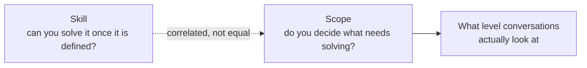

import Scenario from "../../../components/Scenario.astro";
import LevelIntro from "../../../components/LevelIntro.astro";
import PracticeCheck from "../../../components/PracticeCheck.astro";

export const unit = {
  track: "career-craft",
  unitSlug: "leveling-expectations",
};

<Scenario label="Two climbers, one invitation">
  <Fragment slot="facts">
    

      

        Question
        Sam
        Riley
        🧭 Took on something nobody assigned?○ no● yes
        💥 Work reaches many other people?○ no● yes
        📅 Pays off beyond this month?○ no● yes
        📣 Others changed habits because of it?○ no● yes
      

      
🧗 Hardest route cleared: Sam, clearly

    

  </Fragment>

Sam and Riley joined the same climbing gym in the same week. Sam is the
strongest climber there: every hard route that gets set, Sam finishes it
cleanly. Riley climbs a few grades lower. This season the gym asks Riley to
help run the beginner wall, and does not ask Sam. Sam is baffled: "I climb
harder than Riley. How is this not about who is better?"

What Riley did is small and specific. Riley noticed that newcomers kept
giving up on their first visit because nobody explained how the route grades
work. Riley wrote a one-page guide, started a short Tuesday session, and now
two regulars run the same warm-up without being asked.

**Sam has the higher climbing grade and Riley has the invitation. So what is
the gym measuring, if it is not "who climbs harder"?**

</Scenario>

<LevelIntro
  items={[
    "Scope and skill as separate axes",
    "The four dimensions of scope",
    "Why a title trails the real work",
  ]}
/>

The gym is not ranking climbing ability. It is looking at the size of the
problems each person treated as theirs to solve without being told to. Work
has exactly the same shape.

## What does the same story look like at work?

Alex and Jordan started on the same engineering team the same week, two years
ago. Alex is the best debugger anyone has seen: elegant fixes, first try,
every time. Jordan's code works but is unremarkable. This quarter Jordan is
discussed for promotion and Alex is not.

| Dimension           | Alex                                      | Jordan                                                          |
| ------------------- | ----------------------------------------- | --------------------------------------------------------------- |
| Ambiguity tolerance | Waits for a ticket, executes it precisely | Noticed nobody owned a flaky-deploy investigation, picked it up |
| Blast radius        | Fixes stay inside the file they touch     | Mostly changes inside their own team's deploy pipeline          |
| Time horizon        | This week's tickets                       | Set up monitoring that will matter a year from now              |
| Influence radius    | Own pull requests                         | Two teams outside Jordan's own adopted the fix, unprompted      |

Jordan is wide on three of the four rows and still narrow on blast radius.
Alex is narrow on all four, while being the stronger engineer at the narrow
tasks. That is the point of the table: it scores **scope**, not
**skill**.

## Is a level about being better, or about something else?

Plain-language map before the career words start doing too much work:

| Term                | Read it as                                                                              |
| ------------------- | --------------------------------------------------------------------------------------- |
| Tenure              | How long someone has been in the role or company                                        |
| Promotion committee | The group that decides whether someone's level or title changes                         |
| Scope               | The size of problem someone can handle responsibly                                      |
| Ambiguity           | How unclear the problem is before someone has to make sense of it                       |
| Blast radius        | If the decision is wrong, how far the damage spreads: one file, one team, or many teams |
| Influence radius    | Who changes behavior because of your work: only you, your team, or people outside it    |

- A level is not primarily about **skill**. It is about **scope**: how much ambiguity you resolve on your own, how large a blast radius your decisions have, and how far your influence reaches past code you personally wrote.
- **Skill** answers: given a well-defined hard problem, can this person solve it? **Scope** answers: what is the largest piece of ambiguity this person has resolved without being asked?
- The two are correlated, because skill makes wider scope possible, but they are not identical. A brilliant person who only ever receives tightly defined tasks has shown skill, not wide scope. And someone earlier in their skill development can already be resolving ambiguity nobody else touched.

<PracticeCheck
  track={unit.track}
  unitSlug={unit.unitSlug}
  topicId="scope-vs-skill"
/>

## Which parts of scope can be wide or narrow?

Four dimensions tend to widen as a level increases. Each can be checked with
one question:

| Dimension               | The question it answers                                                                       |
| ----------------------- | --------------------------------------------------------------------------------------------- |
| **Ambiguity tolerance** | How undefined can the problem be when it reaches you?                                         |
| **Blast radius**        | What breaks, and how widely, if your decision is wrong?                                       |
| **Time horizon**        | Are you solving this week's problem, this quarter's, or one that will not show up for a year? |
| **Influence radius**    | Do your decisions affect your own code, your team, or teams who have never met you?           |

In the gym, Riley's guide has a wide blast radius in a small way: if it is
wrong, every newcomer who reads it is misled. That is why checking it with
one regular before posting it counts as part of the work, not as fussiness.

<PracticeCheck
  track={unit.track}
  unitSlug={unit.unitSlug}
  topicId="four-dimensions"
/>

## Where does the title fit?

**A title is a lagging indicator, not the definition.** Titles are assigned
after the fact, to reflect scope someone is already operating at. They do not
create that scope by being handed out, and they can be late, early, or
inconsistent across companies.

So instead of asking "am I senior yet?", ask: **what is the largest, most
ambiguous, most consequential problem I have resolved without being told
exactly how?** That answer, not the org chart, is what a leveling
conversation is trying to measure.

Nothing above says Alex is stuck. It says this quarter's conversation scored
an axis Alex assumed was not being scored, and that is a thing Alex can
change.
