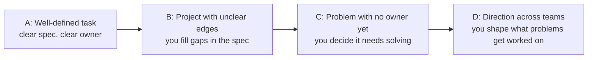
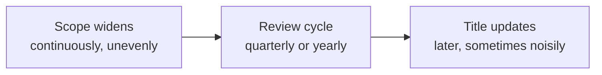

import LevelIntro from "../../../components/LevelIntro.astro";
import Checkpoint from "../../../components/Checkpoint.astro";
import PracticeCheck from "../../../components/PracticeCheck.astro";

export const unit = {
  track: "career-craft",
  unitSlug: "leveling-expectations",
};

L1 claimed that a level measures scope rather than skill, and named four
dimensions: ambiguity tolerance, blast radius, time horizon and influence
radius. L2 works out what widening looks like, stage by stage, why it happens
unevenly, and why a title trails behind it.

<LevelIntro
  items={[
    "Four stages of scope, A through D",
    "Why the profile is uneven",
    "Title as a lagging indicator",
  ]}
/>

## What actually changes between a new climber and the person setting routes?

Think of the gym again. A newcomer follows a route that is already set and
graded. A regular starts helping with a session whose edges are fuzzy. Someone
notices a gap nobody owns and fills it. Eventually someone shapes what the
whole gym teaches. Same person, same hands; the **size of what they treat as
theirs** is what grew.

| Stage | Gym version                                       | Work version                                           |
| ----- | ------------------------------------------------- | ------------------------------------------------------ |
| A     | Climb a route that is already set and graded      | Well-defined task: clear spec, clear owner             |
| B     | Help run a session whose format is still fuzzy    | Project with unclear edges: you fill gaps in the spec  |
| C     | Notice nobody explains grades, and start doing it | Problem with no owner yet: you decide it needs solving |
| D     | Shape what the gym teaches across all its classes | Direction across teams: you shape what gets worked on  |

Each stage does not retire the one before it. Someone at stage D still writes
code and still does well-defined tasks sometimes. What changes is what is
**expected by default**: at stage A someone else has already resolved the
ambiguity before it reaches you; at stage D, resolving ambiguity nobody
assigned is the job.

This is not a moral ladder where task work is bad and cross-team work is
good. A clear task can be exactly the right scope for a real need. The level
question is narrower: what scope does this person reliably handle by default,
across many situations?

<Checkpoint question="Someone fixes exactly the ticket they were assigned, every time, without touching anything outside its stated scope. Which stage are they at by default, and is that a problem on its own?">

Stage A, a well-defined task. And it is not a problem on its own: a clear task
can be the right scope for a real need, and the scale describes what is typical
by default, not a judgment of worth. It only matters in a leveling conversation
if the person is being compared against expectations for a stage they are not
actually operating at.

</Checkpoint>

<PracticeCheck
  track={unit.track}
  unitSlug={unit.unitSlug}
  topicId="scope-stages"
/>

## Does everyone widen on all four dimensions at the same time?

**Why would someone be wide on one dimension and narrow on another?** Because
nobody jumps from the left column to the right column of the table on a single
day. Scope usually expands one dimension at a time.

| Dimension           | Narrow example                                                  | Wide example                                                                     |
| ------------------- | --------------------------------------------------------------- | -------------------------------------------------------------------------------- |
| Ambiguity tolerance | "Fix this failing test": the correct outcome is already defined | "Users are churning and we don't know why": you have to define the problem first |
| Blast radius        | A bug affects one feature, caught in code review                | A design decision affects every team building on this service for years          |
| Time horizon        | This sprint's ticket                                            | A migration that will not fully pay off for 18 months                            |
| Influence radius    | Your own pull requests                                          | Setting a convention three other teams adopt without being told to               |

The interactive demo in this level makes the unevenness concrete. It is
a **teaching model, not a promotion formula**: each dimension runs from 1
(narrow) to 10 (wide), and the demo shows how far influence radius sits above
or below the plain average of the four.

- The starting profile is 3, 3, 3 for the first three dimensions and 2 for influence radius. The average is 2.75, so influence sits 0.75 **below** it.
- Drag influence radius to 10 with the others unchanged: the average only rises to 4.75, yet influence sits 5.25 above it.
- Drag it down to 1: the average is 2.5 and influence sits 1.5 below it.

The takeaway is the shape. One very wide axis barely moves the average, and
one very narrow axis hides inside it. That is why leveling is a **profile of
evidence**, not one magic number.

<Checkpoint question="A colleague says: 'I am clearly more skilled than the senior on my team, so I should already be at their level.' Using the skill and scope distinction, where is the gap in that reasoning?">

Skill and scope are correlated but not the same measurement, and the colleague's
statement only speaks to skill. Being more skilled makes wider scope possible,
but it does not show that the colleague has taken on ambiguity nobody
assigned, decisions with a wide blast radius, or influence beyond their own
output. Leveling asks about scope, and superior skill on well-defined
problems is evidence for a different axis.

</Checkpoint>

<PracticeCheck
  track={unit.track}
  unitSlug={unit.unitSlug}
  topicId="uneven-profile"
/>

## If scope has widened, why has the title not changed yet?

**Why is a title always a little behind?** Titles are assigned through a
process (a performance review, a promotion committee) that runs on a cadence,
quarterly or yearly. Real scope expansion happens continuously and unevenly.
Think of a grade posted after an exam period: the work happened first and the
official label arrives later.

That gap produces the two most common sources of friction:

| Mismatch                        | What it looks like                                                             |
| ------------------------------- | ------------------------------------------------------------------------------ |
| Scope is ahead of the title     | Someone already works wider than their title says; the label has not caught up |
| Title is ahead of current scope | A lateral hire, or a title raised to keep someone, with scope not yet shown    |

Neither case means the framework is wrong. A title, as a lagging indicator, is
expected to disagree with real scope sometimes. And the same label can mean a
slightly different standard at a different company.

<PracticeCheck
  track={unit.track}
  unitSlug={unit.unitSlug}
  topicId="title-lag"
/>

L3 takes one concrete technical problem and shows the same fact handled at all
four stages.
