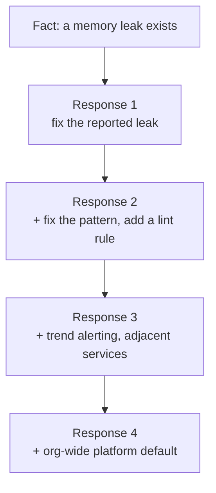

import Scenario from "../../../components/Scenario.astro";
import LevelIntro from "../../../components/LevelIntro.astro";
import Checkpoint from "../../../components/Checkpoint.astro";
import PracticeCheck from "../../../components/PracticeCheck.astro";

export const unit = {
  track: "career-craft",
  unitSlug: "leveling-expectations",
};

Before the scenario, you do not need to master the technical words. Read them
like this:

| Term             | Simple reading                                                 |
| ---------------- | -------------------------------------------------------------- |
| Event listener   | Code that waits for a signal, like "a request arrived"         |
| Memory leak      | The program keeps holding memory it should have released       |
| Out of memory    | The program runs out of memory and dies                        |
| Orchestrator     | A system that restarts services when they crash                |
| Lint rule        | An automatic rule that warns when code matches a risky pattern |
| Platform default | A shared setting adopted by many teams                         |

<Scenario label="The scenario">
  <Fragment slot="facts">
    

      
🐛 Root cause: an event listener added per request, never removed

      
🔁 The orchestrator restarts the service every few days, before it runs out of memory

      
👀 Nobody investigated, because the restart made it a non-emergency

    

    
Four responses to the same fact

    

      
1️⃣ Fix the leak, ship it

      
2️⃣ + fix the same pattern elsewhere, add a lint rule

      
3️⃣ + add trend alerting, across adjacent services too

      
4️⃣ + propose it as an org-wide platform default

    

  </Fragment>

A production service has been slowly leaking memory for months, restarted
automatically every few days before it runs out. Nobody has investigated
because the auto-restart makes it a non-emergency. You are asked to look into
it.

**The technical fact is identical in every version below: a leaked event
listener. If skill were the whole story, shouldn't every competent engineer's
response look basically the same?**

</Scenario>

<LevelIntro
  items={[
    "One bug, four scoped responses",
    "What expands, and what stays constant",
    "Failure modes: scope creep and unearned leaps",
  ]}
/>

Watch how the same underlying fact produces different bodies of work,
depending on the scope each person brings to it. Every detail below is part of
one illustrative story, not data from a real team.

## Response 1: what does a well-defined task look like?

Find the leak, patch it, verify memory stays flat under load, ship. A profiler
shows a listener being added on every request without being removed; the fix
removes it in the cleanup path.

**In scope:** exactly the reported symptom. **Out of scope, by design:** why
nobody noticed for months, whether the same pattern exists elsewhere, whether
this class of bug is preventable. This is complete, correct work for a
defined task. The dimension mostly exercised is task execution.

## Response 2: what does a project with unclear edges add?

Same fix, plus: while investigating, the engineer sees the same subscribe-
without-cleanup pattern in three other files in the same service. They are not
leaking yet only because those paths run less often. All three are fixed, and
a lint rule now flags a subscription with no matching removal, so the pattern
cannot silently return in this service.

The engineer filled an edge the ticket did not state, because evidence in
front of them implied a wider but still bounded problem. The dimension that
grew is **blast radius inside the project**.

## Response 3: what does an unowned problem add?

Same fix and lint rule, plus: the engineer notices the service has no
memory-trend alerting at all. The only reason the leak was caught is that a
human happened to look, and the auto-restart had hidden the growth curve for
months. They add a trend alert (not just a crash alert), check two adjacent
services on the same team, find neither has one, and add it there too.

Nobody had been assigned "we cannot see slow leaks until they crash-loop".
The engineer named it and closed it. The dimensions that grew are
**ambiguity tolerance** and **time horizon**.

<Checkpoint question="Each response keeps the previous one's work and extends it. Following that pattern, what would Response 4 add, and which dimension is it most likely to grow?">

Response 4 keeps the fix, the lint rule and the alerting, and pushes the
insight past this team entirely, toward other teams or the whole organization.
Since Responses 1 through 3 already grew ambiguity tolerance, blast radius and
time horizon, the dimension most likely to grow next is influence radius:
getting people who never asked for input to change how they operate.

</Checkpoint>

## Response 4: what does direction across teams add?

Same investigation, plus: the engineer recognizes that "auto-restart masks the
underlying problem" is not unique to this team; it follows from how the
organization's orchestration platform is configured by default. They write a
short proposal for a platform-level default (alert on the trend, not just the
crash), work with the platform team to get it adopted, and mentor two
engineers on other teams through applying it to their own services.

**In scope now:** a default nobody was individually responsible for, requiring
influence across teams that never asked. The dimension that grew most is
**influence radius**.

| Response | What the engineer treated as theirs                   | Dimension that grew most          |
| -------- | ----------------------------------------------------- | --------------------------------- |
| 1        | The reported leak                                     | Task execution                    |
| 2        | The pattern behind the leak, inside this service      | Blast radius                      |
| 3        | The missing visibility, on this and adjacent services | Ambiguity tolerance, time horizon |
| 4        | The platform default every team inherits              | Influence radius                  |

<Checkpoint question="A manager says Response 4's engineer is 'just a better programmer' than Response 1's. Looking at what stays constant across all four, is that the right read?">

No. The technical fact and the technical skill needed to find and fix the leak
are identical across all four responses, and none of the later ones involves
harder code. What differs is how far each person let the boundary of "my
problem to solve" extend beyond the literal ticket, unprompted. That is a scope
difference, and calling it better programming puts the gap on the wrong axis.

</Checkpoint>

<PracticeCheck
  track={unit.track}
  unitSlug={unit.unitSlug}
  topicId="expansion-vs-creep"
/>

## When does wider work stop being expansion?

Each addition above was **evidenced by what the engineer actually found**: a
pattern in three real files, an alerting gap they could point to, a platform
default that explained the gap. That evidence is what separates real expansion
from scope creep. The failure modes are about its absence:

| Failure                                            | What it looks like                                                                           | Why it fails                                                                                     |
| -------------------------------------------------- | -------------------------------------------------------------------------------------------- | ------------------------------------------------------------------------------------------------ |
| Mistaking scope creep for scope expansion          | Bolting on speculative extra work with no evidence the wider problem is real                 | Response 4 works because each addition is directly evidenced, not guessed                        |
| Staying at Response 1 forever, calling it humility | Declining to flag a pattern you have clearly seen repeat, to "stay in your lane"             | It withholds information that would help the team, and it is a common way skilled people plateau |
| Attempting Response 4 without earned trust         | Proposing an org-wide default with no record of delivering smaller-scoped work               | Cross-team influence rests on credibility from consistent Response 2 and 3 level delivery        |
| Judging level from a single incident               | Treating one Response 3 fix as proof of wide scope, or one Response 1 fix as a permanent cap | Leveling looks at a pattern across many situations, not one data point in either direction       |

<PracticeCheck
  track={unit.track}
  unitSlug={unit.unitSlug}
  topicId="track-record"
/>

## Beyond this example

This leak is one case, not the whole territory. The same four stages apply to
any problem where a defined task, a project, an unowned gap and a shared
default are all possible answers. Test whether the model transferred, not just
the specific bug:

- What would change if the fact were worse, say the leak had already caused a customer-facing outage before anyone looked? Which response would you expect at each stage, and does the evidence rule still hold, or does urgency change what counts as justified expansion?
- Think of a real, unowned rough edge in something you work on. Which of the four responses would you realistically attempt this month, and what one piece of evidence would you need before attempting the next one up?
- If Response 4's engineer had proposed the platform default before ever shipping a Response 2 or 3 level fix, what would the platform team reasonably doubt: the idea, or the proposer's follow-through? How does that change how you sequence building your own track record?
- Replace the memory leak with something outside software, like the gym's beginner wall from L1. What would the four responses be there?
