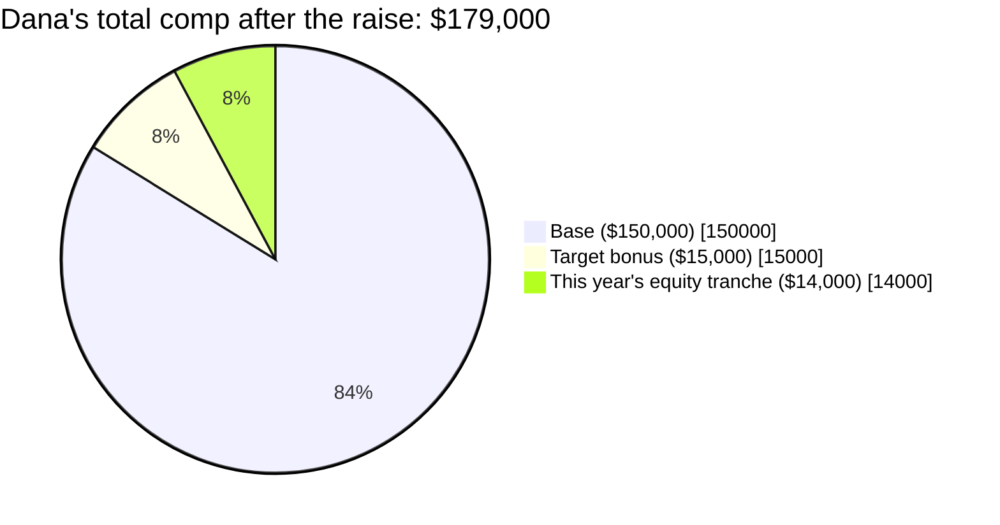
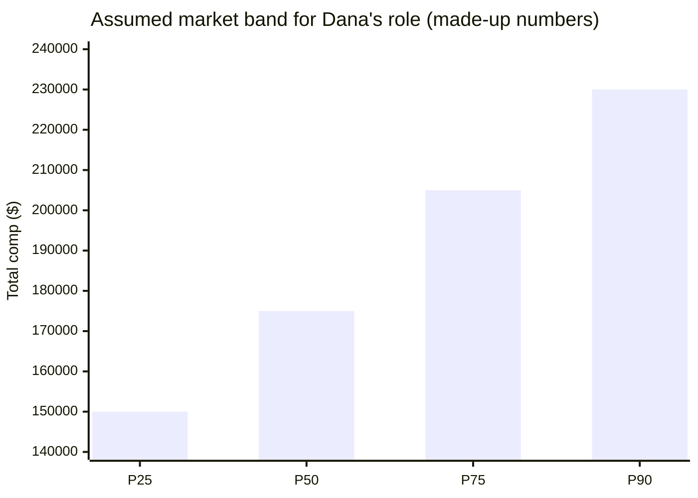

import Scenario from "../../../components/Scenario.astro";
import LevelIntro from "../../../components/LevelIntro.astro";
import PracticeCheck from "../../../components/PracticeCheck.astro";

export const unit = {
  track: "career-craft",
  unitSlug: "market-research",
};

<Scenario label="The problem">
  <Fragment slot="facts">
    

      
💵 Base: $142,000 → $150,000 (+5.6%)

      
🎯 Target bonus: 10% of base, $15,000

      
📈 Equity: $14,000 tranche, the <em>last</em> of the grant

      
⚠️ Next year with no new grant: $165,000 total

    

    

      

        $179,000
        this year's total comp, inside an assumed $150k-$230k band
      

      

        

      

      
(179,000 - 150,000) / (230,000 - 150,000), about 36% of the way across the band

    

  </Fragment>

Dana Okafor is a backend engineer at Fernbank Robotics, a private startup.
Her manager just offered her a raise: base goes from $142,000 to $150,000,
and he calls it "5.6%, one of the bigger bumps on the team this cycle."

The letter says nothing about her equity. Her original grant was 4,000 RSUs
(shares she receives as they vest), released 1,000 per year over four years.
This year is the fourth and last tranche, worth $14,000 at the company's
current internal price of $14 per share. Next year, with no new grant, that
tranche is worth $0.

All dollar figures in this unit are made-up round numbers for teaching, not
real market data.

**Is "5.6%, one of the bigger bumps" the number that tells Dana whether she is
paid fairly, or just the number that is easiest to say out loud?**

</Scenario>

The raise is real. It also sits next to a $14,000 drop that the letter never
mentions, and a percentage on base alone cannot show that.

<LevelIntro
  items={[
    "Total comp as three components",
    "Placing a number inside a market band",
    "Why one year's snapshot can mislead",
  ]}
/>

## What counts as pay besides the base salary?

**If a raise letter quotes one number, how many of Dana's pay components does
it actually describe?** One of three.

- **Total comp** is base plus bonus plus equity, added up for the same
  one-year window. It is the number to compare, not the base alone.
- **Base** is the fixed salary. **Bonus** is usually a target percentage of
  base, paid only if targets are hit. **Equity** is a grant that releases in
  tranches over several years.
- The three do not move together. Dana's base rose while her equity is about
  to fall to zero.

| Year                         | Base     | Bonus (10% of base) | Equity  | Total    |
| ---------------------------- | -------- | ------------------- | ------- | -------- |
| Last year                    | $142,000 | $14,200             | $14,000 | $170,200 |
| This year (with the raise)   | $150,000 | $15,000             | $14,000 | $179,000 |
| Next year (no refresher yet) | $150,000 | $15,000             | $0      | $165,000 |

<PracticeCheck
  track={unit.track}
  unitSlug={unit.unitSlug}
  topicId="total-comp"
/>

## Where does a number sit in the market?

**$179,000 sounds large. How does Dana know whether it is high, middle or low
for her role?** She cannot, until she sees the range other people in a
comparable role actually get paid.

- A **market band** reports a few points on that range: P25, P50 (the median),
  P75 and P90. P50 means half of comparable people earn less and half earn
  more.
- A **percentile** says where a number falls in the band. The raw figure
  alone says nothing.
- In this unit's made-up band for Dana's role, P25 is $150,000, P50 is
  $175,000, P75 is $205,000 and P90 is $230,000. Her $179,000 sits a little
  above the median, not near the top.

<PracticeCheck
  track={unit.track}
  unitSlug={unit.unitSlug}
  topicId="market-band"
/>

Nothing here says the raise is unfair. It says that "fair" cannot be judged
from the raise letter: it needs the full comp picture, a band for the role,
and a look at the year after this one.
