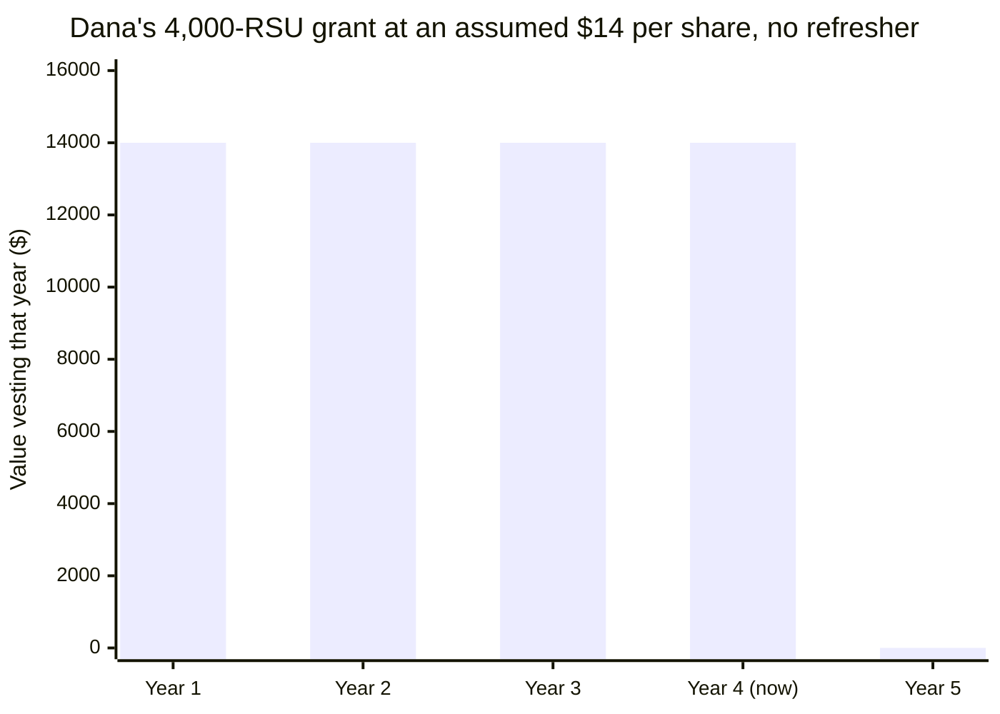
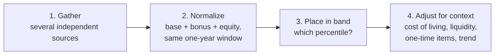

import LevelIntro from "../../../components/LevelIntro.astro";
import Checkpoint from "../../../components/Checkpoint.astro";
import PracticeCheck from "../../../components/PracticeCheck.astro";

export const unit = {
  track: "career-craft",
  unitSlug: "market-research",
};

L1 showed Dana's raise letter quoting a base percentage while her equity is one
year from vesting to $0. L2 builds the two tools that close that gap: how
equity really pays out over time, and a repeatable process for deciding
whether a number is fair. As before, every figure is a made-up teaching number.

<LevelIntro
  items={[
    "Vesting, cliffs and refresher grants",
    "The four-step fairness process",
    "Why several sources beat one",
  ]}
/>

## What does "4,000 RSUs over four years" mean for pay?

**Dana's grant was worth $56,000 on paper at $14 per share. Why is it not
$56,000 of extra pay in any single year?** Because shares only become hers as
they vest.

- **Vesting schedule:** the calendar that releases a grant in tranches.
  Dana's releases 1,000 shares per year. Unvested shares are a promise, not
  current pay.
- **Cliff:** a minimum wait, often one year, before any shares vest. Leave
  before it and the grant is worth $0.
- **Refresher grant:** a new grant issued before the old one runs out, so the
  yearly equity amount does not fall off an edge.

The last bar is the whole problem: the letter is accurate about year 4 and
silent about year 5.

<Checkpoint question="Dana's manager could have quoted '+5.2% on total comp' instead of '+5.6% on base' (about $179,000 against $170,200). Would that single number have shown her the cliff?">

No. It is a better number, because it counts all three components, but it still
compares this year against last year. The drop happens between this year and
next, so only a multi-year view shows it. Total comp fixes the question of which
components count; it does not fix the question of which years are being
compared.

</Checkpoint>

<PracticeCheck
  track={unit.track}
  unitSlug={unit.unitSlug}
  topicId="vesting-refresher"
/>

## What does Dana have to do, in order, to answer "is this fair"?

**A friend says "I make $190,000, you should ask for that." Why is that not
yet an answer?** Because nobody knows whether it is the same kind of number.
Dana needs a process, not a single figure.

| Step         | Question it answers                              | What goes wrong if skipped                          |
| ------------ | ------------------------------------------------ | --------------------------------------------------- |
| 1. Gather    | What does the market look like for this role?    | One biased source sets the whole picture            |
| 2. Normalize | Are all the numbers the same shape?              | Comparing base here against total comp there        |
| 3. Place     | Is this number low, middle or high for the role? | A big-sounding figure that is actually below median |
| 4. Adjust    | What is the number worth to me, given context?   | Treating the same dollars as equal everywhere       |

Sources differ in kind, and each has a typical weakness:

| Kind of source                   | Strength                       | Typical weakness                              |
| -------------------------------- | ------------------------------ | --------------------------------------------- |
| Self-reported public pay data    | Large sample, by role          | Unverified, and level names differ by firm    |
| Paid, employer-submitted surveys | Consistent method              | Costly and often out of an individual's reach |
| A recruiter's stated range       | Current and tied to a real job | One data point, with its own incentive        |

When two or three of these roughly agree, Dana can lean on the band. When
they disagree sharply, the disagreement is itself information: it says the
band is wide or the sources are measuring different levels.

<Checkpoint question="Dana's friend says '$190,000 total comp.' Which of the four steps are missing before she can use that number?">

Steps 2 and 3. She does not know whether her friend's figure counts the same
components over the same one-year window, so it may include a one-time signing
bonus or a different level. She also does not know where $190,000 falls in the
band for her own role. Gathering is the only step the anecdote even partly
supplies, and a single data point is a weak version of it.

</Checkpoint>

<PracticeCheck
  track={unit.track}
  unitSlug={unit.unitSlug}
  topicId="four-step-process"
/>
