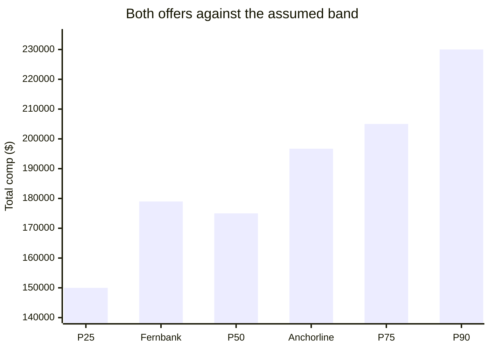

import Scenario from "../../../components/Scenario.astro";
import LevelIntro from "../../../components/LevelIntro.astro";
import Checkpoint from "../../../components/Checkpoint.astro";
import PracticeCheck from "../../../components/PracticeCheck.astro";

export const unit = {
  track: "career-craft",
  unitSlug: "market-research",
};

<Scenario label="The scenario">
  <Fragment slot="facts">
    

      
🏢 Fernbank Robotics: private, raise offer totals $179,000 this year

      
🏙️ Anchorline Systems: public, higher-cost city, steady-state total $196,700

      
📊 Assumed band: P25 $150k · P50 $175k · P75 $205k · P90 $230k

      
🧮 Assumed cost-of-living factor for Anchorline's city: 1.25 times Dana's

    

  </Fragment>

Same Dana as L1 and L2. The raise letter is on her desk, and a public company,
Anchorline Systems, is about to make an offer. All numbers here, the band and
the cost-of-living factor included, are made up for teaching.

Over two weeks Dana gathers data, puts both offers in the same shape, places
them in the band, adjusts for where she would live and how liquid her pay is,
and only then goes back to her manager.

**Before reading on: Dana ends up asking for something that is not "more base
salary." Which single item from the process would you guess it is?**

</Scenario>

<LevelIntro
  items={[
    "Normalizing two offers into one shape",
    "Cost of living, liquidity and one-time items",
    "Turning the analysis into a specific ask",
  ]}
/>

## How do two differently shaped offers become comparable?

**A raise letter and a half-built offer quote different things. What has to be
true before Dana can put them side by side?** Both must be reduced to the
same components over the same one-year window, in steady state.

| Component            | Fernbank (with raise)       | Anchorline (year 2 onward)           |
| -------------------- | --------------------------- | ------------------------------------ |
| Base                 | $150,000                    | $158,000                             |
| Target bonus         | $15,000 (10%)               | $23,700 (15%)                        |
| This year's equity   | $14,000 (last of the grant) | $15,000 ($60,000 grant over 4 years) |
| **Normalized total** | **$179,000**                | **$196,700**                         |

Anchorline's first-year letter totals $211,700, because it adds a one-time
$15,000 signing bonus. Dana leaves it out of the comparison: it pays once, and
the question she is answering is which job pays better year after year.

Placed in the band, Fernbank sits a little above the median and Anchorline sits
about three-quarters of the way from the median to P75. Anchorline is ahead by
$17,700, but neither is near P90, which tells Dana what a realistic ask looks
like.

<Checkpoint question="Why does Dana leave Anchorline's $15,000 signing bonus out of the comparison table?">

The table is meant to compare ongoing pay, and the signing bonus appears in
one year only. Including it would make the gap between the offers look larger
than it will be from year two onward, so the comparison would no longer be
between like and like. The same discipline applies to any one-time item,
such as a relocation payment or a retention award.

</Checkpoint>

## What does the number still not tell her?

**Anchorline is $17,700 ahead on paper. What two adjustments could change
that?** Cost of living and liquidity.

**Cost of living.** Suppose Anchorline's city costs 1.25 times as much as
Dana's current one (an assumption for this example, not a measured index).
Dividing converts the offer into the purchasing power she has today:

$196,700 / 1.25 = $157,360

On that assumption, the larger offer buys less than Fernbank's $179,000. This
is not the last word: a different city may carry career value no index prices.
But it turns "clear winner" into "a trade-off with a number on it."

**Liquidity.** Fernbank's $14,000 is priced from an internal appraisal of a
private company and can only become cash after an exit event that may be years
away or never come. Anchorline's $15,000 trades on a public market the day it
vests.

| Equity feature       | Fernbank (private)                     | Anchorline (public)                          |
| -------------------- | -------------------------------------- | -------------------------------------------- |
| How it is priced     | Periodic internal appraisal            | Live market price                            |
| When it becomes cash | Only at a future exit                  | Soon after vesting                           |
| Plausible outcomes   | From $0 to several times the appraisal | Moves with the market, not to zero overnight |

The unit's interactive demo lets you drag exactly this uncertainty. Put the
refresher at 2,400 RSUs and the eventual value at 0x today's $14: next year's
total is $165,000. At 1x it is $173,400. At 2x it is $181,800. The same grant
produces very different pay depending on a number nobody controls.

<Checkpoint question="If Dana stopped after placing both offers in the band, which two real differences between the jobs would she miss?">

She would miss that the nominally larger Anchorline offer buys less once the
higher cost of living is applied, and that Fernbank's equity is far less certain
than Anchorline's because it is illiquid and exit-dependent. Placing in the band
answers which number is bigger and where it ranks. Adjusting answers what the
number is worth to her, which is the question that actually decides things.

</Checkpoint>

<PracticeCheck
  track={unit.track}
  unitSlug={unit.unitSlug}
  topicId="context-adjustments"
/>

## What does she actually ask for?

**With the analysis done, why not just ask for a bigger base?** Because the
analysis located the problem, and it is specific: next year's total falls to
$165,000 when the last tranche ends, which is below the median.

At the assumed $14 price, a refresher of about 2,900 RSUs (2,857 when rounded, about
714 per year) would bring next year's total back to P50. Dana asks for 3,200,
which is 800 per year, or $11,200: next year's total becomes $176,200, a little
above the median. She brings the band chart, the vesting chart from L2, and
one sentence: "The raise is fair for this year. Without a refresher, next year
is not."

| What Dana did not do                | What she did instead                                      |
| ----------------------------------- | --------------------------------------------------------- |
| Demand a dollar match to Anchorline | Sized the ask against the band, not a rival's raw number  |
| Threaten to leave                   | Named a specific, dated problem with a chart              |
| Accept because "it is a raise"      | Treated total comp, across years, as the thing negotiated |

Her manager returns a week later with 2,400 RSUs. That produces $173,400 next
year at today's price, just under the median and short of her ask, but a
dated commitment that removes the cliff. Dana stays, because after the
adjustments the two jobs are close enough that team and scope decide it.

<PracticeCheck
  track={unit.track}
  unitSlug={unit.unitSlug}
  topicId="specific-ask"
/>

## Extend it: what changes in a different case?

**This is one worked case, not the whole territory.** It had two offers of
similar shape and sources that roughly agreed. Try changing the facts.

- **What if the three sources disagreed sharply**, with one public source
  showing a median near $160,000 and a recruiter's range starting at $190,000?
  Which would Dana trust more, and what could explain the gap?
- **What if there were no competing offer?** Which parts of the process still
  apply, and where does Dana's leverage change?
- **What if the equity were an option grant with a strike price** instead of
  RSUs? Which of the arithmetic here would no longer hold?

None of these has one clean answer. The four steps are a starting shape for
judging a number, not a script that reproduces Dana's two weeks.
