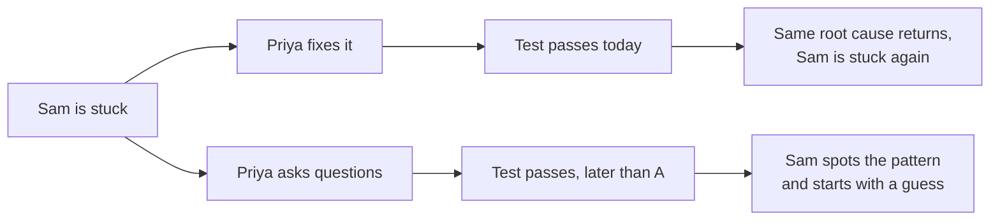

import Scenario from "../../../components/Scenario.astro";
import LevelIntro from "../../../components/LevelIntro.astro";
import PracticeCheck from "../../../components/PracticeCheck.astro";

export const unit = {
  track: "career-craft",
  unitSlug: "mentoring-fundamentals",
};

<Scenario label="Teaching a child to ride a bike">
  <Fragment slot="facts">
    

      
🚲 <strong>Goal</strong>: the child rides without anyone beside them

      
🧑‍🦱 <strong>Shortcut</strong>: ride it for them around the block, the child watches

      
🤝 <strong>Slower path</strong>: hold the seat, let them wobble, loosen your grip

    

    

      

        
Ride it for them

        The bike gets around the block. The child cannot ride tomorrow.
      

      

        
Steady, then let go

        Slower today. The child can ride alone soon.
      

    

  </Fragment>

A child wants to ride a bike. You could pedal it around the block while they
watch, and it would get there faster and with no scraped knees. Or you could
hold the seat, let them wobble, and let go a little at a time. **Which one is
actually helping the child learn to ride?**

Only the second one. Riding it for them gets the bike around the block today
and leaves the child exactly as unable to ride as before. Holding the seat
costs patience now and ends with a child who no longer needs you.

</Scenario>

Helping a teammate who is newer to the work has the same shape. Priya sits
next to Sam, who has been stuck for 40 minutes on a failing automatic check
in the code. Priya can see the cause at once: a fake stand-in used by the
test still holds leftover information from an earlier test, and was never
cleaned. One line fixes it in five minutes. Or Priya can ask questions and
let Sam find it, which the model used in this unit puts at 25 minutes in
total. **Is typing the fix the helpful thing to do?**

<LevelIntro
  items={[
    "Transferring capability, not answers",
    "Productive struggle vs. wasted struggle",
    "Why the fast fix has a hidden bill",
  ]}
/>

## What does a fast fix actually hand over?

**Priya types the fix and Sam says thanks. What did Sam walk away with?**

| Path                     | Time today | What transfers                                 | What happens next month                       |
| ------------------------ | ---------- | ---------------------------------------------- | --------------------------------------------- |
| Priya fixes it           | 5 min      | A passing test                                 | A related bug looks brand new to Sam          |
| Priya asks, Sam finds it | 25 min     | A passing test and the reasoning that found it | Sam starts with a hypothesis on a related bug |

- **Mentoring is a skill separate from technical strength and from
  generosity with time.** It is the skill of transferring capability, not
  just answers.
- **The fast fix always looks like the kind choice.** Its cost lands later,
  on a bug that looks unrelated, so nobody connects the two.
- The numbers here (5 minutes to fix, 25 to teach) are a teaching model for
  this unit, not measurements of any real team.

<PracticeCheck
  track={unit.track}
  unitSlug={unit.unitSlug}
  topicId="transfer-capability"
/>

## Is all struggle worth protecting?

**If struggling teaches, should Priya simply never help?** No. Sam staring at
the same three lines for the fifteenth time is not learning anything. The
judgment call is telling struggle that is working from struggle that has
stopped working.

| What you see                                         | What it usually means | Mentor move                               |
| ---------------------------------------------------- | --------------------- | ----------------------------------------- |
| Each attempt tests a new idea built on the last one  | Productive struggle   | Hold back                                 |
| The same attempt repeated with different wording     | Wasted struggle       | Step in with a nudge                      |
| A fact is missing that nobody could work out unaided | Missing prerequisite  | Give the fact, then hand the problem back |

- **The signal is whether new ideas are still being tried, not how many
  minutes have passed.** Forty minutes of narrowing down is fine. Five
  minutes of the same loop is not.
- **The ratio in the middle.** Always fixing optimizes today and starves the
  skill. Always watching feels like learning and burns trust. The skill is
  the smallest nudge that keeps the struggle productive.
- The nudge also depends on the person and the skill, through a gradient of
  how much the mentor carries. L2 builds it.

<PracticeCheck
  track={unit.track}
  unitSlug={unit.unitSlug}
  topicId="productive-struggle"
/>
