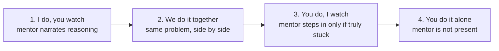
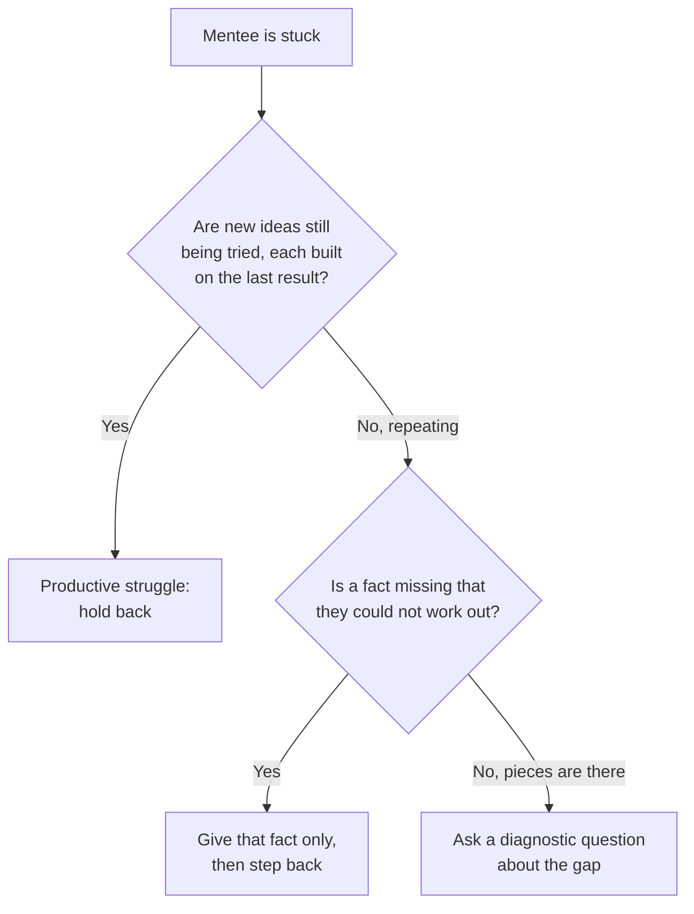

import LevelIntro from "../../../components/LevelIntro.astro";
import Checkpoint from "../../../components/Checkpoint.astro";
import PracticeCheck from "../../../components/PracticeCheck.astro";

export const unit = {
  track: "career-craft",
  unitSlug: "mentoring-fundamentals",
};

L1 said that mentoring means moving capability, not answers, and that the
mentor's judgment is the smallest nudge that keeps struggle productive. L2
turns that into two tools: a gradient for how much the mentor carries, and a
way to read which kind of stuck the mentee is in.

<LevelIntro
  items={[
    "The gradual-release gradient, four stages",
    "Stage per skill, not per person",
    "Three kinds of stuck, three different moves",
  ]}
/>

## How much should the mentor carry?

**Holding the seat and pedaling the bike are both help. How do you pick
between them, and everything in between?** Think of it as who holds the
responsibility, shifting step by step from the mentor to the mentee.

Priya asking a question and waiting sits at stage 3: Sam drives, Priya
watches for a real dead end. If Sam had never met test fakes at all, stage 3
would waste both people's time, and showing one first (stage 1 or 2) would
make the next bug a stage-3 bug.

The same gradient fits a math teacher: solve one aloud, solve one together,
watch the student solve one, then let the student solve the next alone. The
point is never "hide the answer". It is moving responsibility as fast as the
learner can carry it.

<Checkpoint question="A mentee has done this exact kind of task alone several times. The mentor still narrates the whole solution aloud at stage 1. What is the mismatch, and what does it cost?">

The stage sits below the mentee's demonstrated readiness. Stage 1 is for
someone missing the concept, not someone who has already shown they can do
the task unassisted. It costs time nobody needed to spend, and it signals a
lack of trust in a skill the mentee has already shown. The fix is not a
better technique but choosing the stage from what this person can carry for
this kind of problem.

</Checkpoint>

## Is the stage a trait of the person?

**Can you say "Sam is a stage-3 person"?** No. The stage follows the
specific skill. Someone who works at stage 4 on writing tests can still need
stage 2 on a deployment tool they have never touched.

| Signal                                                 | Suggested stage              |
| ------------------------------------------------------ | ---------------------------- |
| Has done this exact kind of task before, successfully  | 3 or 4                       |
| Has the general skill, but this tool or pattern is new | 2                            |
| Is missing a foundational concept entirely             | 1, briefly, then move up     |
| Is repeating the same failed approach with no new idea | Drop back one stage, for now |

A fixed stage for everything either babies a ready person or strands one in
unfamiliar territory.

<PracticeCheck
  track={unit.track}
  unitSlug={unit.unitSlug}
  topicId="gradual-release"
/>

## What kind of stuck is it?

**The stage says how much to carry. But first, how do you know what is
wrong?** A mentor asks one question about the attempts and one about the
knowledge.

Two details matter. "New idea" means different from the last one and
informed by what the last attempt showed. Five unrelated guesses that ignore
the results are not the same as five steps narrowing in. And a question
cannot reveal a fact the person has never met. Asking Sam to reason about a
test fake Sam has never heard of just burns time that a ten-second
explanation would save.

<Checkpoint question="Sam tries three different approaches in a row, each built on what the last one showed, and has not found the bug yet. Productive or wasted, and what should Priya do?">

Productive, even without a result. The signal is whether each attempt
carries new information into the next, and Sam's do. Priya holds back,
because stepping in would remove the process that builds Sam's ability to do
this alone. She acts only once the attempts stop changing.

</Checkpoint>

**Is "ask questions instead of giving answers" the rule, then?** Not quite.
Questions fit the case where the pieces exist but are not connected. For a
missing fact, a short answer is the better help. The skill is diagnosing
which of the three cases is in front of you, rather than committing in
advance to always-teach or always-tell.

<PracticeCheck
  track={unit.track}
  unitSlug={unit.unitSlug}
  topicId="right-nudge"
/>
