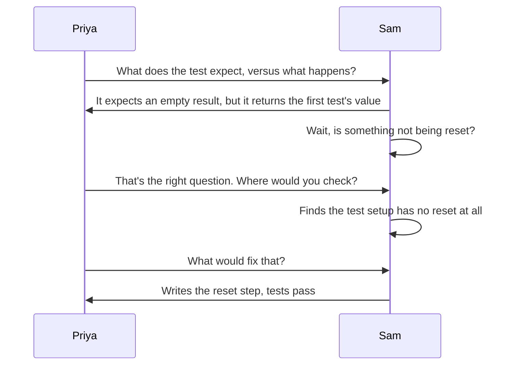
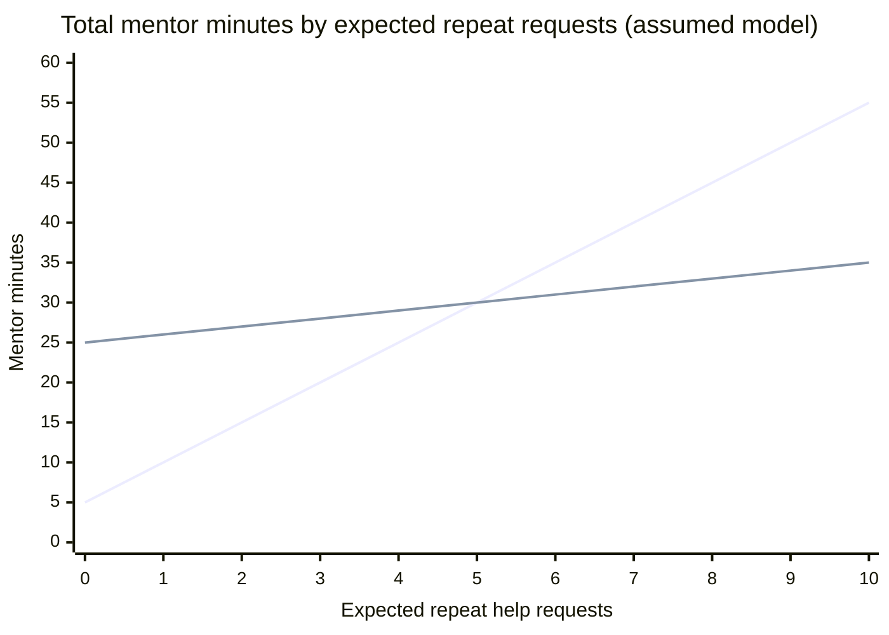

import Scenario from "../../../components/Scenario.astro";
import LevelIntro from "../../../components/LevelIntro.astro";
import Checkpoint from "../../../components/Checkpoint.astro";
import PracticeCheck from "../../../components/PracticeCheck.astro";

export const unit = {
  track: "career-craft",
  unitSlug: "mentoring-fundamentals",
};

<Scenario label="Same bug, two conversations">
  <Fragment slot="facts">
    

      
🐛 <strong>The bug</strong>: a test fake keeps leftover information from one test into the next

      
🧑‍💻 <strong>Sam</strong>: has tried three variations of "add another check"

      
🕐 <strong>Path A</strong>: about 5 min. <strong>Path B</strong>: about 25 min this time.

    

    

      

        
Path A

        Priya states the cause and the fix.
      

      

        
Path B

        Priya asks, Sam finds the cause and writes the fix.
      

    

  </Fragment>

If you have never written tests, read the bug like this: a practice tool was
not cleaned after the first practice run, so the second run saw leftovers.
The exact syntax matters less than one question: **after each conversation,
what can Sam do alone the next time leftovers cause a failure?**

</Scenario>

<LevelIntro
  items={[
    "Both conversations, side by side",
    "What makes a question diagnostic",
    "When urgency or repetition changes the plan",
  ]}
/>

## What does each conversation actually say?

**Path A.** Priya: "I see it. The fake isn't reset between tests, so test two
picks up what test one left. Add a reset step before each test." Sam: "Got
it, thanks." Five minutes, test passes. The whole diagnosis happened inside
Priya's head, and only the conclusion crossed over.

**Path B**, as a sequence:

Twenty-five minutes. Sam re-derived the chain "expected vs. actual, then
leftover state, then check the setup, then no reset", which finds a whole
class of bugs, not just this one. Priya never said "it's the reset".

## What makes her first question a good one?

**"Have you checked if the fake is reset?" is also a question. So what is
different?** The answer is already inside it.

| Priya says                                                  | What it makes Sam do           | What it avoids                             |
| ----------------------------------------------------------- | ------------------------------ | ------------------------------------------ |
| "What does the test expect, versus what happens?"           | State the gap precisely        | Pointing at the fake at all                |
| "Right question. Where would you check?"                    | Choose where to look           | Saying "check the setup file"              |
| "What would fix that?"                                      | Write the fix                  | Writing the reset for Sam                  |
| "Have you checked if the fake is reset?" (hint in disguise) | Confirm a location Priya named | Nothing: it is Path A with a question mark |

<Checkpoint question="Both 'Have you checked the reset?' and 'What does the test expect versus what happens?' are questions. What is actually different?">

The first already contains the answer, so responding to it just confirms a
location Priya named, the same transfer as Path A. The second names nothing.
It forces Sam to state the gap between expected and actual, which is the
actual diagnostic step. It also generalizes: it works on the next bug
whatever the cause, while the first is only useful if the next bug is another
reset bug.

</Checkpoint>

<PracticeCheck
  track={unit.track}
  unitSlug={unit.unitSlug}
  topicId="diagnostic-question"
/>

## When should the plan change?

**All of this assumes Priya has time to spend. What if she does not, or if
Sam keeps hitting the same wall?** Two different signals move the response
along the gradient.

**Urgency.** In a live outage or with a demo about to start, moving toward "I
do, you watch" is legitimate even for someone who normally works at stage 3.
What changes is how: narrate the reasoning while doing it ("I'm checking the
setup because this looks like leftover state") rather than fixing it
silently, as Path A did. The distinction that matters is not who did the
work. It is whether any reasoning crossed over, or only the conclusion.

**Recurrence.** If this exact kind of bug is Sam's third in a month, it is a
different signal from one stuck moment. The gap is probably not "hasn't
derived this fix yet" but "has no general model of test isolation". The right
move shifts to a short direct conversation about the concept, closer to stage
1 or 2 on purpose.

**Does the time cost really justify the slow path?** Using the unit's
assumed model: a direct fix takes 5 minutes each time, teaching adds 20
minutes once, and after teaching only 20% of the repeats still need help
(assumed values, matching this unit's interactive demo). If Sam would
otherwise need help a number of times, total mentor minutes are:

The rising line is always fixing it directly (5 + 5 per repeat). The flat
one is teaching once (25 + 1 per repeat). They cross at 5 expected repeats,
30 minutes each. At 10 repeats it is 55 against 35. Below five, the direct
fix is cheaper on the clock, which is exactly why the habit feels right.
This compares only mentor minutes. It ignores Sam's time and confidence.

<Checkpoint question="Sam hits the same missing-reset bug for the third time this month. Priya asks the same diagnostic question and waits, as before. Is that still right?">

No. A third recurrence points to a missing general model, and the same
one-question nudge just re-teaches the same narrow fix. Priya should drop back
deliberately to a short, direct conversation about test isolation, so the next
bug in this family does not need a fourth repeat of the same intervention.

</Checkpoint>

<PracticeCheck
  track={unit.track}
  unitSlug={unit.unitSlug}
  topicId="urgency-and-recurrence"
/>

## Failure modes

| Failure mode                                                | What it gets wrong                                                 |
| ----------------------------------------------------------- | ------------------------------------------------------------------ |
| Always fixing it directly, even when there is time to teach | Optimizes today's task while the same question keeps coming back   |
| Asking questions that are the answer in disguise            | Feels like teaching but transfers the conclusion as directly as A  |
| Treating 40 minutes of struggle as automatically too long   | The signal is new hypotheses still forming, not elapsed time       |
| Using one stage for every mentee on every kind of problem   | Readiness varies by skill, not as a fixed trait of the person      |
| Continuing "ask and wait" on the third or fourth recurrence | A repeating gap is a missing model, which needs a more direct move |

## This is one case, not the whole territory

Priya and Sam are one path through these ideas. Change the facts and the
right move changes too. **What if Sam were a close friend who bristles at
being questioned? What if the bug were in code Priya also does not
understand? What if teaching only cut repeats to 60% instead of 20%, so the
two lines in the chart cross much later, or never?** Work out your own
answers before assuming the sequence above is the only one that works.

The same pattern appears outside code. If Sam keeps opening presentations
unclearly, Path A is Priya rewriting the first slide. Path B is asking "What
should the audience understand in the first thirty seconds, and which
sentence says it?" If Sam answers and rewrites, the slide improves and Sam
keeps a reusable diagnosis.
