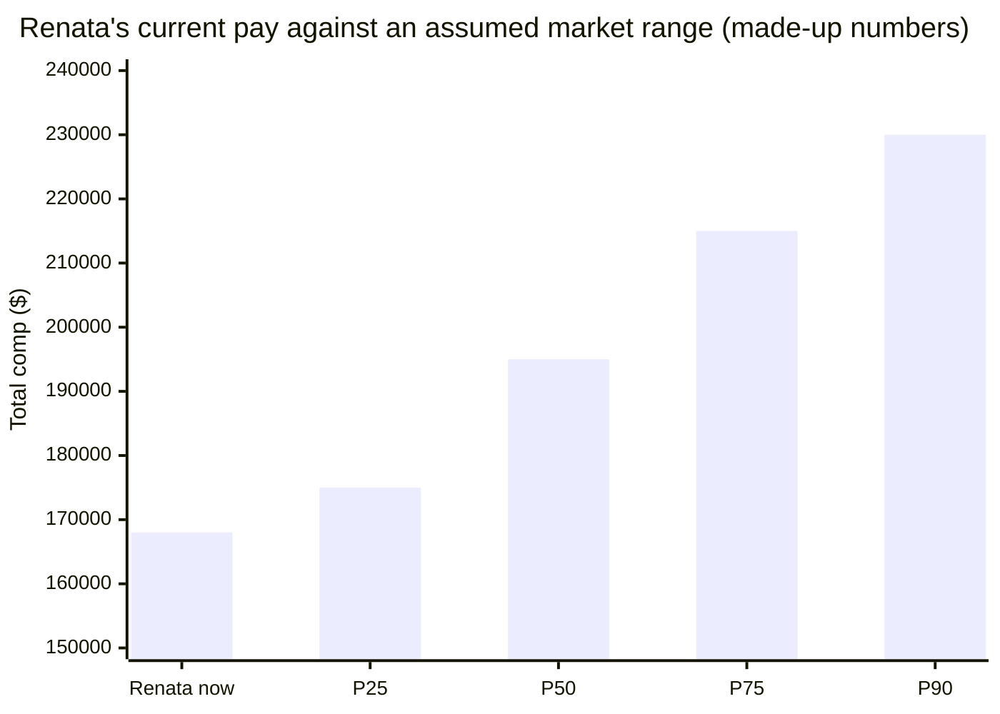
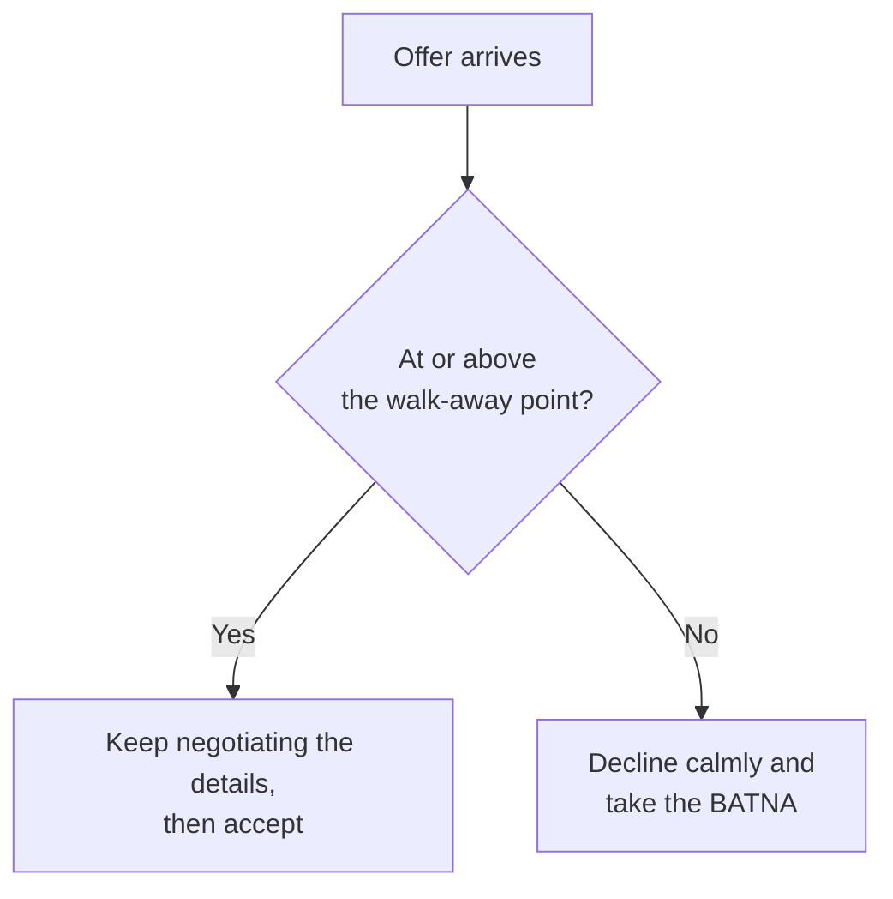

import Scenario from "../../../components/Scenario.astro";
import LevelIntro from "../../../components/LevelIntro.astro";
import PracticeCheck from "../../../components/PracticeCheck.astro";

export const unit = {
  track: "career-craft",
  unitSlug: "negotiation-tactics",
};

<Scenario label="The problem">
  <Fragment slot="facts">
    

      
🫖 A teapot with no price tag at a market stall

      
👀 Neighbouring stalls sell similar ones for $35-$50 (made-up)

      
🗣️ The seller asks first: "What would you pay?"

      
💬 Mara's honest instinct: "$25"

    

    

      

        $25
        Mara's first answer, on a $0-$60 scale
      

      

        

      

      
25 / 60 is about 42% of the scale, and it sits below the whole $35-$50 range

    

  </Fragment>

Mara likes a hand-glazed teapot at a market stall. There is no price on it. The
seller smiles and asks, before saying any number of his own, "What would you
pay for it?"

Mara has not looked at the stalls next door. She does not know that similar
teapots go for $35 to $50 (made-up numbers for this example). Her honest
first thought is "$25, maybe?"

**Whatever number Mara says next, the haggling that follows will be built
around it. Why would a number she picked in two seconds, with no research,
matter that much?**

</Scenario>

The question is not whether the seller is fair. It is which number the rest of
the conversation gets built around, and Mara is about to hand over that
choice for free.

Pay negotiations at work have exactly this shape, with more at stake.

<LevelIntro
  items={[
    "Anchoring: the first number pulls",
    "A BATNA and a walk-away point",
    "Asking without turning it into a fight",
  ]}
/>

## Why does the first number matter so much?

**If Mara says "$25" and the seller would have asked $50, who just did the seller
a favour?** Neither of them has to be dishonest for the number to work. The
first figure said out loud becomes the reference point that later figures are
measured against.

- **Anchor:** the first number put on the table. Later offers and counteroffers
  tend to land closer to it than they would have without it.
- **Anchors are sticky even when they are weak.** A figure with no research
  behind it still pulls, which is why "what are your expectations?" asked
  before any range is shared is a real move and not small talk.
- **A good anchor is specific and defensible.** It is tied to something the
  other side can check, such as a market range, not to a hope.

| Moment               | Market stall                                 | Job offer                                                    |
| -------------------- | -------------------------------------------- | ------------------------------------------------------------ |
| Who is asked first   | Mara: "What would you pay?"                  | Renata: "What are your expectations?"                        |
| Unprepared answer    | "$25", below every similar teapot            | Her current pay plus "a solid bump"                          |
| What the answer does | Pulls the whole haggle toward the low end    | Pulls every offer toward the low end of the role's range     |
| Prepared alternative | Check the neighbours, then ask for the price | Learn the role's market range, then name a defensible figure |

The workplace version, with made-up round numbers. Renata is a data engineer
earning $168,000 in total compensation at Bellcrest Systems. A recruiter at
Ashgrove Analytics asks what she expects, before naming a figure. In the
assumed market range for the role, the 25th percentile is $175,000, the median
is $195,000, the 75th is $215,000 and the 90th is $230,000. "$168k, plus a solid
bump" lands near the bottom of that range, or below it.

<PracticeCheck
  track={unit.track}
  unitSlug={unit.unitSlug}
  topicId="anchoring"
/>

## What makes it safe to say no?

**Suppose Mara adores the teapot and there is only one stall in town. What does
her "that is too much" count for?** Nothing, because she has no alternative
and everyone at the stall can tell.

- **BATNA** means Best Alternative To a Negotiated Agreement: what you will
  actually do if this deal falls through.
- **Walk-away point:** the lowest deal you would still accept, decided
  against your BATNA. Below it, you take the alternative.
- **A BATNA only counts if it is real.** Renata's is staying at Bellcrest,
  which she likes well enough. A bluff about an alternative that does not exist
  gets tested, and then the real position shows.
- **Set the walk-away point early.** Decided calmly before any offer exists,
  it stays honest. Decided under the pull of an offer on the table, it drifts
  down.

In the assumed numbers, Renata's walk-away point is $185,000 in ongoing total
compensation. That is $17,000 above her $168,000 today, which is the premium
she wants for the risk and disruption of switching.

<PracticeCheck
  track={unit.track}
  unitSlug={unit.unitSlug}
  topicId="batna-walk-away"
/>

Neither idea says to treat every conversation as a fight. They say who sets the
number, and what you will do if you cannot agree. L2 covers how to ask in a way
that keeps the other side working with you.
