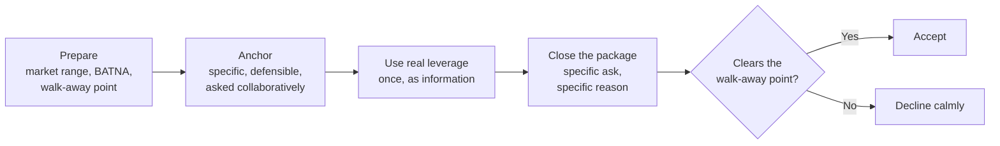

import LevelIntro from "../../../components/LevelIntro.astro";
import Checkpoint from "../../../components/Checkpoint.astro";
import PracticeCheck from "../../../components/PracticeCheck.astro";

export const unit = {
  track: "career-craft",
  unitSlug: "negotiation-tactics",
};

L1 showed that the first number pulls and that a real alternative makes "no"
safe. L2 covers the other half: how to say the number, and what to negotiate
besides it, so the other side stays a partner. Every figure is a made-up
teaching number.

<LevelIntro
  items={[
    "Collaborative against adversarial asks",
    "A competing offer as information",
    "Negotiating the whole package",
  ]}
/>

## How do you ask for more without starting a fight?

**Mara and the seller want the same thing, a sale. Why does "I won't pay a cent
over $40" feel so different from "Help me see how we get to $40"?** The first
turns a shared problem into a contest. The second keeps both people on the
same side of the table.

- **Collaborative framing** treats the other side as someone solving a shared
  problem: close this deal at a number that works for both.
- **Adversarial framing** treats the other side as an opponent to beat. It
  forces them to defend a position, and a defended position rarely moves.
- Both can contain the same number. The difference is whether the number
  arrives with a reason and an invitation, or with a demand.

| Situation                | Adversarial version                         | Collaborative version                                                                                |
| ------------------------ | ------------------------------------------- | ---------------------------------------------------------------------------------------------------- |
| Naming a figure          | "I won't consider anything under $205,000." | "From the market range I found, I'm looking at $205,000 to $215,000. How does that fit your budget?" |
| Using a competing offer  | "Match $182,000 or I walk."                 | "I have a written offer at $182,000, and I'd rather join you. Is there room to close the gap?"       |
| Pushing back on a number | "That's insulting."                         | "Help me understand how that figure was set."                                                        |

A competing offer is information, not a threat. Stated once, honestly, with no
deadline attached, it tells the other side what the market is doing and lets
them decide how to respond. It must also be real. An invented offer is a
bluff, and a bluff that gets checked ends the conversation.

<Checkpoint question="Renata says 'I have a written offer at $182,000, and I'd rather join you. Is there room to close the gap?' What makes this information rather than an ultimatum?">

It states a real fact once, expresses a genuine preference, and asks a
question instead of setting a condition. There is no deadline and no "or
else", so the recruiter keeps the freedom to take it to whoever approves the
number on their normal timeline. The same $182,000 said as "match it or I
walk" would hand the other side a threat to resist, and the relationship
becomes the thing being negotiated.

</Checkpoint>

<PracticeCheck
  track={unit.track}
  unitSlug={unit.unitSlug}
  topicId="collaborative-framing"
/>

## Is base salary the only thing worth asking about?

**An employer says "I really can't go higher on base." Is the conversation over?**
Only if base is the only lever. An offer is a package, and the pieces have
different flexibility for the company and different value for you.

| Lever                     | Pays                       | Why it can move when base cannot                                |
| ------------------------- | -------------------------- | --------------------------------------------------------------- |
| Base salary               | Every year                 | Often tied to a fixed pay range for the role                    |
| Target bonus              | Every year, if targets hit | Percentage may flex independently of the base                   |
| Equity grant or refresher | Over several years         | Size and timing can change without touching the pay range       |
| Sign-on bonus             | Once                       | Can bridge a specific loss, such as unvested shares left behind |
| Start date, title         | Not a payment              | Cost the company little and can matter a lot to you             |

Two cautions follow from the table. A one-time item such as a sign-on bonus
does not count toward ongoing pay, so it cannot be used to meet a walk-away
point stated in ongoing total compensation. And every ask should come with a
specific reason, since "I'd like a bit more" gives the other side nothing to
act on.

<Checkpoint question="An offer is $181,000 in ongoing pay plus a $12,000 sign-on bonus, which adds to $193,000 in the first year. Renata's walk-away point is $185,000 in ongoing total compensation. Does this offer clear it?">

No. Her floor is stated in ongoing pay, and the sign-on bonus arrives once.
From the second year the offer is $181,000, which is $4,000 under her
floor. The $193,000 figure only looks like a pass because it mixes a one-time
payment into a yearly comparison. It is the same discipline as keeping a
signing bonus out of a steady-state comparison of two offers.

</Checkpoint>

<PracticeCheck
  track={unit.track}
  unitSlug={unit.unitSlug}
  topicId="package-levers"
/>
