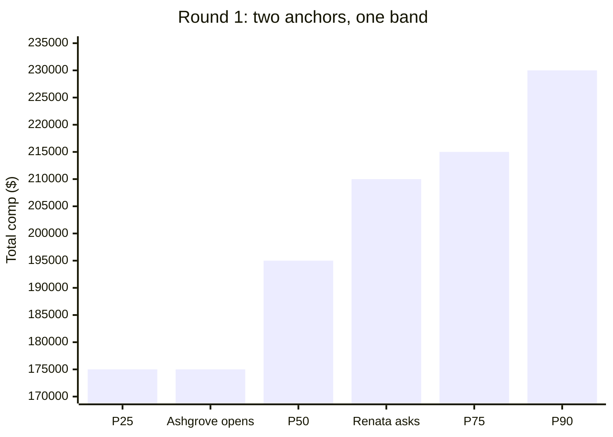
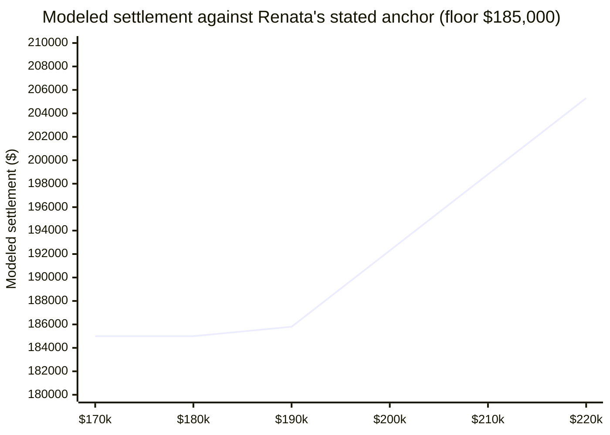

import Scenario from "../../../components/Scenario.astro";
import LevelIntro from "../../../components/LevelIntro.astro";
import Checkpoint from "../../../components/Checkpoint.astro";
import PracticeCheck from "../../../components/PracticeCheck.astro";

export const unit = {
  track: "career-craft",
  unitSlug: "negotiation-tactics",
};

<Scenario label="The scenario">
  <Fragment slot="facts">
    

      
💼 Renata: data engineer at Bellcrest Systems, $168,000 total comp

      
🎯 Walk-away point: $185,000 ongoing, set before any offer existed

      
📊 Assumed band: P25 $175k · P50 $195k · P75 $215k · P90 $230k

      
📝 Written offer from Brightline Data: $182,000

    

    

      

        $185,000
        walk-away point, inside the assumed $175k-$230k band
      

      

        

      

      
(185,000 - 175,000) / (230,000 - 175,000), about 18% of the way across the band

    

  </Fragment>

Same Renata as L1 and L2. Ashgrove Analytics wants to hire her, and over three
weeks she goes from a recruiter's open question to a signed offer. All
numbers, the band included, are made up for teaching.

Renata answers the recruiter's "what are your expectations?" with a polite
question about the budgeted range, and spends the next few days on research
before a figure leaves her mouth. That is round zero.

**Before reading on: the second offer clears her walk-away point, and she
still does not simply accept. What do you think she asks for instead?**

</Scenario>

<LevelIntro
  items={[
    "Preparing before any number is spoken",
    "The anchor exchange and real leverage",
    "Closing the package, or walking away",
  ]}
/>

## Round 0 and round 1: what does she have in hand before the first number?

**Why does Renata set her floor before Ashgrove names a single figure, and how
does that change what she says in round 1?** A floor chosen with no offer on
the table is chosen calmly. A floor chosen with an offer in front of you gets
nudged down by momentum and the time already invested.

| Prepared before any offer   | Value                                                |
| --------------------------- | ---------------------------------------------------- |
| Market range for the role   | P25 $175k, P50 $195k, P75 $215k, P90 $230k (assumed) |
| BATNA, the best alternative | Stay at Bellcrest, $168,000                          |
| Walk-away point             | $185,000 ongoing total comp, $17,000 above her BATNA |

In round 1 the recruiter opens at $175,000 in total: a $155,000 base, a 10%
target bonus of $15,500, and $4,500 a year in equity. That is the 25th
percentile, a real offer anchored low. Renata counters with $205,000 to
$215,000, tied to the range she found and framed as a question: "What range
does Ashgrove have budgeted for this role?" Her ask is the upper half of
the band between the median and P75.

Neither anchor is wrong. One is a budget and the other is a market-backed ask.
The gap suggests the real room is somewhere between the median and P75.

<Checkpoint question="Why does Renata end round 1 by asking for Ashgrove's budgeted range instead of only stating her own number?">

A number stated alone is a position. A number stated alongside a question
becomes an exchange, and the answer tells her where the other side's anchor
sits. It also keeps the tone collaborative: she is working out a figure that
fits both sides rather than defending one. Had she only named $210,000, the
recruiter would have had a figure to resist and no invitation to share a range.

</Checkpoint>

The unit's interactive demo models how much the stated anchor matters, using
a simplified rule: the settlement is 35% of the company's own
counter-midpoint of $178,000 plus 65% of Renata's stated anchor, never lower
than her floor. Each extra $5,000 on the anchor adds $3,250 to the result. At
her $210,000 ask the model lands at $198,800. Below an anchor of about
$188,800, the model's raw result falls under her floor, and the floor decides.

The flat left side of the chart is the floor at work: a low anchor does not
make her accept less than $185,000, it just stops her from gaining from the
negotiation. The rising right side is the anchor at work.

<PracticeCheck
  track={unit.track}
  unitSlug={unit.unitSlug}
  topicId="anchor-exchange"
/>

## Rounds 2 and 3, and the round that goes the other way

**The revised offer clears her floor. What is left to gain, and what would she
have done if it had not cleared?**

Her Brightline written offer of $182,000 arrives. It is below her $185,000
floor, so it is not a deal she would take. It is information. She tells the
recruiter once, with a preference and a question: "I'd genuinely rather join
Ashgrove. Is there room to close the gap?" No deadline, no "or else".

Ashgrove comes back at $196,000 in total: a $170,000 base, a 12% bonus of
$20,400 and $5,600 a year in equity. That is $1,000 above the median, which
is 5% of the way from P50 to P75, and $11,000 above her floor.

She does not reopen base, which she suspects is near Ashgrove's ceiling for
the role. She asks for a $10,000 sign-on bonus, with a reason: unvested
shares at Bellcrest that she would leave behind. Ashgrove offers $8,000.

| Round | What happened                                     | Where it sits                                  |
| ----- | ------------------------------------------------- | ---------------------------------------------- |
| 1     | Ashgrove opens at $175,000; Renata asks $205-215k | P25 against the upper half of median to P75    |
| 2     | Real $182,000 offer shared once, collaboratively  | Information, below her floor on its own        |
| 2     | Ashgrove revises to $196,000 ongoing              | $1,000 over the median, $11,000 over her floor |
| 3     | $10,000 sign-on asked, tied to unvested shares    | A package lever, not base                      |
| 3     | $8,000 sign-on agreed                             | $196,000 ongoing plus $8,000 once              |

<Checkpoint question="The $196,000 offer already clears her $185,000 floor by $11,000. Why does she still ask for the sign-on bonus?">

A floor is a minimum, not a target. Clearing it makes the offer acceptable, not
the best available outcome. Asking once more, with a specific reason, costs
little because the floor is already met and an acceptable offer is in hand.
She also asks for something other than base, since the whole package has
room that a base-only ask leaves behind.

</Checkpoint>

Now the other branch. Suppose round 2 had come back at $178,000. That is
$7,000 under her floor and $10,000 above her Bellcrest pay, and it is a serious
offer. Renata declines calmly, names her alternative, and leaves the door open.
Because the number was fixed before the offer existed, "no" is an easy call
instead of an agonizing one. The floor works in both directions: it makes "yes"
clear when the offer clears it and "no" clear when it does not.

| If the final ongoing number is | The floor makes the next step               |
| ------------------------------ | ------------------------------------------- |
| At or above $185,000           | Negotiate the package, then accept          |
| Below $185,000                 | Decline calmly, citing the real alternative |

<PracticeCheck
  track={unit.track}
  unitSlug={unit.unitSlug}
  topicId="close-or-walk"
/>

## Extend it: what changes in a different case?

**This is one worked case, not the whole territory.** The company bargained in
good faith, the gap closed in two rounds, and the floor was never truly tested
in the sense of a firm "no". Change the facts and test your own reasoning.

- **What if Renata disliked Bellcrest and had no other offer?** Is her floor
  still $185,000, and what could she do before treating any floor as
  enforceable?
- **What if Ashgrove would not move at all after the first counter?** Which of
  her options are left, and which of the package levers might still be open?
- **What if the recruiter asked for her current pay and she was uncomfortable
  sharing it?** How might she answer while keeping the exchange collaborative?

None of these has one clean answer. The structure here, prepare, anchor with a
reason, share real leverage once, close the package, apply the floor, is a
starting shape and not a script that reproduces Renata's three weeks.
