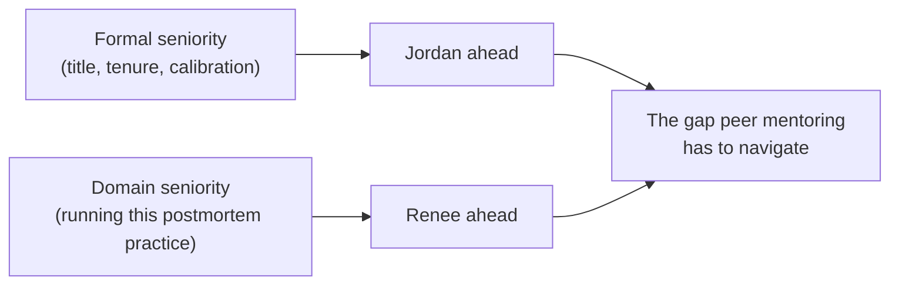

import Scenario from "../../../components/Scenario.astro";
import LevelIntro from "../../../components/LevelIntro.astro";
import PracticeCheck from "../../../components/PracticeCheck.astro";

export const unit = {
  track: "career-craft",
  unitSlug: "peer-mentoring",
};

<Scenario label="The problem">
  <Fragment slot="facts">
    

      

        
Jordan leads on paper

        

          
🏷️ Title two levels above Renee's

          
📆 10 years of experience overall

          
📝 Writes Renee's calibration input

        

      

      

        
Renee leads on one skill

        

          
🛠️ Built the postmortem practice

          
🏢 3 years at this company

          
❓ Jordan has never run one here

        

      

    

  </Fragment>

Renee has spent three years at her company and built her team's blameless-postmortem practice from scratch. Jordan just joined the team with ten years of experience and a title two levels above hers. Jordan will also write Renee's calibration input this cycle. The next incident is Jordan's to run, and Jordan has never facilitated one of these postmortems.

**Renee clearly knows something Jordan doesn't. So why does it feel so much riskier for her to say so than it would if their titles were reversed?**

</Scenario>

Staying quiet wastes the one thing Renee knows. Speaking up clumsily can read as a challenge from someone whose review Jordan is about to influence. Both costs are real, and the way out is not "be braver."

<LevelIntro
  items={[
    "Two kinds of seniority that can point opposite ways",
    "What each way of getting it wrong costs",
    "Peer versus skip-level mentoring",
  ]}
/>

## Is "who is senior" one question or two?

**Who is more senior, Renee or Jordan?** It depends on what you ask. On the org chart, tenure and calibration, Jordan. On running a postmortem here, Renee. One number cannot hold both answers.

| Term                    | Read it as                                                                         |
| ----------------------- | ---------------------------------------------------------------------------------- |
| Formal seniority        | Title, pay band, tenure, org-chart position: what shows up on paper                |
| Domain seniority        | Who actually knows a specific skill, tool or system better, whatever their title   |
| Peer mentoring          | Teaching an equal, or a formal superior, something you understand better than them |
| Skip-level relationship | A mentoring link that crosses reporting lines: not your manager, not your report   |

- Traditional mentoring quietly assumes both kinds of seniority point the same way. Peer and skip-level mentoring are what you do when they do not.
- Domain seniority is narrow. Renee's edge covers postmortems and nothing else about how Jordan works.

<PracticeCheck
  track={unit.track}
  unitSlug={unit.unitSlug}
  topicId="two-seniorities"
/>

## What does it cost to get this wrong?

**If Renee knows the answer, why not simply say it?** Because correcting someone ahead of you on paper does not cost what correcting someone behind you costs. A new hire told they are wrong by a veteran loses almost nothing. A veteran told they are wrong by a newer colleague can hear a challenge to their standing, even when the correction is accurate and kindly meant.

| Choice                     | What happens                                                                       | What it costs                                      |
| -------------------------- | ---------------------------------------------------------------------------------- | -------------------------------------------------- |
| Stay silent                | Jordan runs the postmortem without the format; the team misses what Renee knows    | Renee's expertise goes unused                      |
| Correct clumsily in public | Jordan hears "let me show you how it's done" from the person he is about to review | Jordan may read it as disrespect for the org chart |
| Offer it in a scoped way   | Renee names one narrow practice and leaves the decision with Jordan                | Little: this is the path L2 develops               |

- The two failure modes are mirror images. Silence protects Renee's comfort at the team's expense; a blunt correction protects the team's information at Renee's expense.
- Standing means how a person is seen and respected by those around them. A misjudged correction spends some of it, and Renee has less to spend.

<PracticeCheck
  track={unit.track}
  unitSlug={unit.unitSlug}
  topicId="two-failure-modes"
/>

## Where does skip-level mentoring fit?

**What if the person you are helping is not on your team at all?** That is a skip-level relationship, and the problem is the same one in a different shape: you offer real help to someone the org chart did not hand you any standing over.

- **Peer mentoring** usually rests on a narrow skill you hold and they lack, such as Renee and the postmortem.
- **Skip-level mentoring** usually rests on distance and perspective: you are outside their reporting line, so you can speak plainly about things their own manager may find hard to say.
- Renee will meet both shapes in this unit: Jordan (a peer-level relationship) and Kai (an engineer from another team, paired with her through a mentoring program).

Nothing above says Renee is wrong to worry, or that she should stay quiet. It says the two kinds of seniority point in opposite directions, and the rest of the unit is about what to do with a gap like that.

<PracticeCheck
  track={unit.track}
  unitSlug={unit.unitSlug}
  topicId="skip-level-shape"
/>
