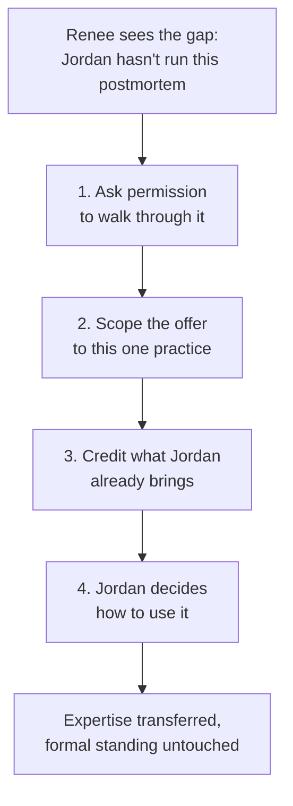

import LevelIntro from "../../../components/LevelIntro.astro";
import Checkpoint from "../../../components/Checkpoint.astro";
import PracticeCheck from "../../../components/PracticeCheck.astro";

export const unit = {
  track: "career-craft",
  unitSlug: "peer-mentoring",
};

L1 showed the gap: Renee has domain seniority over Jordan on postmortems, and Jordan has formal seniority over Renee on everything else, including this cycle's calibration input. L2 covers the mechanics of an offer that lands as help instead of a challenge, how directive it should be, and what changes when the person is outside your reporting line.

<LevelIntro
  items={[
    "Four moves that separate expertise from standing",
    "Directive versus facilitative mentoring",
    "Triangulation in skip-level relationships",
  ]}
/>

## Why isn't "just be humble about it" enough?

Renee could soften her tone and hedge every sentence and still land badly. **What is it about the framing, not just the delivery, that decides whether Jordan hears help or a challenge?**

Humility treats this as a tone problem. The bigger issue is scope. An unscoped correction ("you're doing this wrong") implicitly claims authority over how Jordan works, which Renee neither has nor wants. A scoped one ("here's the one thing about our postmortem format that's easy to miss") claims authority over exactly one narrow thing, which she genuinely has. The difference is precision about what is being asserted, not softness.

| Move                          | What it does                                                                    | What it avoids                                               |
| ----------------------------- | ------------------------------------------------------------------------------- | ------------------------------------------------------------ |
| 1. Ask, don't announce        | "Want me to walk you through how we run these?" before explaining anything      | An explanation that arrives as something imposed             |
| 2. Scope it narrowly          | Names one practice ("our postmortem format"), not a general claim               | Implying more authority than the knowledge gap supports      |
| 3. Credit what they bring     | Names something specific Jordan's experience adds, such as reading a room       | A message that sounds like "you are behind," full stop       |
| 4. Let them keep the decision | Renee explains the practice; Jordan decides whether and how to use it this time | Removing the real authority Jordan has over his own incident |

This sequence never requires Jordan to agree that Renee knows more, never asks Renee to defer outside the narrow scope, and never forces a conversation about who outranks whom. The framing does the work an explicit status negotiation would otherwise do badly.

<Checkpoint question="Renee instead says, warmly, 'I've noticed you're still getting used to how things work here, so let me show you the ropes.' Using the four-move table, what is wrong with that sentence?">

The problem is scope, not warmth. "How things work here" reaches into everything Jordan does on the team, while Renee's real edge covers one practice. Even said kindly, it asserts broader authority than she has, which is exactly the kind of claim that reads as a challenge to a colleague ahead of her on paper.

</Checkpoint>

<PracticeCheck
  track={unit.track}
  unitSlug={unit.unitSlug}
  topicId="four-moves"
/>

## When should Renee tell, and when should she ask questions?

Once Jordan says yes, **how much should Renee decide for him, and how much should she draw out of him?**

| Mode         | What it sounds like                                                  | Fits when                                                          |
| ------------ | -------------------------------------------------------------------- | ------------------------------------------------------------------ |
| Directive    | "Do it this way: here is the format, the order, what to say."        | The mentee asked for exactly that, or the stakes make speed matter |
| Facilitative | "What do you want the room to walk away understanding at this step?" | The mentee has standing to protect, real judgment, and some time   |

Telling a brand-new colleague what to do rarely costs anything socially. Telling a colleague ahead of you on paper can feel like being managed by someone who is not your manager. So with Jordan the safer opening is facilitative: draw out what he already does well (running a hard meeting, reading a room) and layer the specific format on top, instead of scripting the whole thing.

This is not a fixed rule. It moves with trust and stakes. The interactive demo on this page makes that visible: with the unit's default numbers (a status-gap rating of 7, trust of 2, directiveness of 3, all on a 0 to 10 scale and all illustrative) the modeled reception score is 65 out of 100, and pushing directiveness to 8 drops it to about 7. Raising trust to 8 first brings the same directive approach back up to about 69.

<Checkpoint question="Jordan's incident starts in twenty minutes and he says, 'Just tell me the format, I don't have time to figure it out.' Should Renee stay facilitative because that is the safer default with a status gap?">

No. The default is for the ambiguous, lower-stakes case where Renee is choosing the approach herself. Once Jordan explicitly asks for directive help and the incident is live, speed is the right priority, and following his request respects his judgment about what he needs right now.

</Checkpoint>

<PracticeCheck
  track={unit.track}
  unitSlug={unit.unitSlug}
  topicId="directive-facilitative"
/>

## What is new about skip-level mentoring?

Renee and Jordan share a team and a manager. **What changes when the person is outside your reporting line entirely, such as an engineer paired with you through a mentoring program?**

- **Standing comes from distance and perspective, not a shared skill.** A skip-level mentor is often the person who can say plainly what a promotion packet usually needs, because they are not the mentee's manager and have less to lose by being candid.
- **There is no shared work to fall back on.** The relationship and the credibility of what is said are all there is.
- **Triangulation is the new failure mode.** Triangulation means passing along something the mentee's own manager should say directly, or giving advice that the mentee hears as a verdict from above instead of one person's opinion. It can undermine the manager's relationship with their report.

The added move is to name the boundary of what you can speak to: "This is how it has looked from where I sit; your manager may see it differently, and that is worth checking directly." The four moves still apply. This fifth sentence keeps an outside opinion from being mistaken for an official read.

<PracticeCheck
  track={unit.track}
  unitSlug={unit.unitSlug}
  topicId="triangulation"
/>
