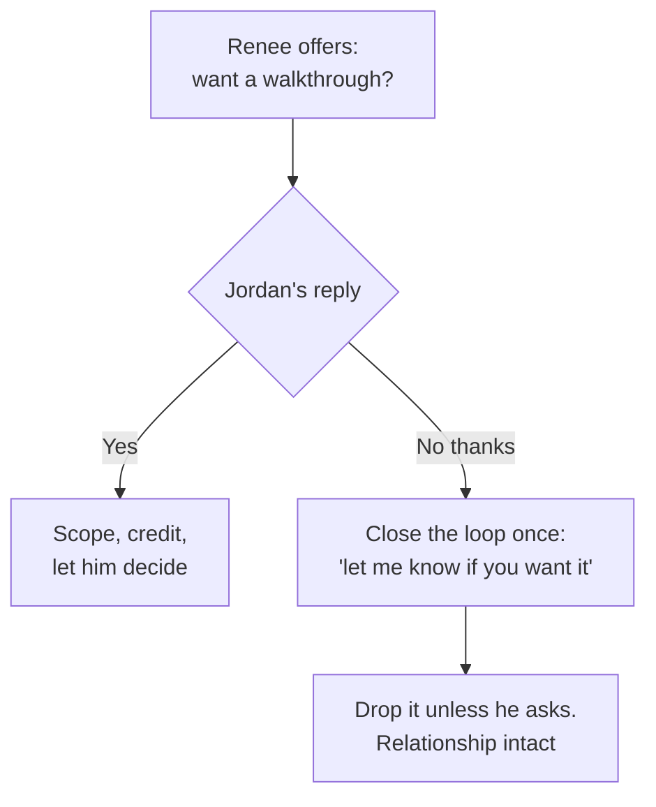

import Scenario from "../../../components/Scenario.astro";
import LevelIntro from "../../../components/LevelIntro.astro";
import Checkpoint from "../../../components/Checkpoint.astro";
import PracticeCheck from "../../../components/PracticeCheck.astro";

export const unit = {
  track: "career-craft",
  unitSlug: "peer-mentoring",
};

<Scenario label="The postmortem conversation">
  <Fragment slot="facts">
    

      
⏱️ Jordan's incident starts in 3 days: a prep chat, not the live moment

      
🗣️ Renee opens by asking, not announcing

      
📋 Scope: the postmortem format only, nothing else about how Jordan runs meetings

    

  </Fragment>

Three days before Jordan is due to run his first postmortem on the team, Renee catches him in the hallway. She does not know whether Jordan already has a system of his own from earlier jobs, or whether he will hear an offer to walk him through hers as help or as her stepping outside her lane.

**Before reading on: what would you say in Renee's position, in the first sentence, before you know how Jordan will take it?**

</Scenario>

L1 introduced Renee and Jordan. L2 gave the four moves and the directive-versus-facilitative spectrum. This level walks Renee's actual conversation closely enough to hear what "scope it narrowly" sounds like, then follows her into a second relationship: a skip-level pairing with Kai.

<LevelIntro
  items={[
    "Renee's talk with Jordan, move by move",
    "What to do when the offer is declined",
    "Kai's pairing and the boundary sentence",
  ]}
/>

## Renee and Jordan: what do the four moves sound like?

L2 described four moves in the abstract. **What does each one sound like out loud, and what does Jordan's reply tell her at each step?**

1. **Ask.** Renee: "I know you've run plenty of incidents. Want me to walk you through the format we use for postmortems here? It's a little different from what I've seen elsewhere." Jordan: "Sure, go ahead." She has claimed nothing yet, and Jordan has granted permission.
2. **Scope.** "We start with a timeline everyone agrees on before anyone discusses causes, and the writeup uses role titles, never names. Those two trip up most people coming from other teams." Both sentences are about the format, not Jordan's competence.
3. **Credit.** "You've done a lot of incident command, so you'll probably read the room and pace it better than I did my first few times." It names something specific and true.
4. **Let them decide.** "That's the format. Totally your call how closely you follow it the first time." Renee wanted the information transferred, not a promise to follow it.

| Step               | What Renee said                                      | What it deliberately avoided claiming                      |
| ------------------ | ---------------------------------------------------- | ---------------------------------------------------------- |
| 1. Ask             | "Want me to walk you through the format?"            | That Jordan needs correcting before he has asked for input |
| 2. Scope           | Names the timeline-first and role-titles conventions | That Jordan runs meetings badly in general                 |
| 3. Credit          | Names Jordan's incident-command experience           | That her own shorter experience does not matter at all     |
| 4. Let them decide | "Totally your call how closely you follow it"        | That Jordan owes her compliance in return for the tip      |

<Checkpoint question="Suppose Jordan answers the opening question with 'I've got it, thanks.' Given what move 1 is for, what should Renee do?">

Move 1 turns an unscoped correction into something explicitly requested, and "no" is a complete answer to that request. She offered narrowly and let him decide, which was move 4's point anyway. Pushing past a clear decline would turn the offer back into something imposed. The cost she accepts is that Jordan might run the first one imperfectly, which is smaller than the damage to the relationship.

</Checkpoint>

## What if the offer lands badly even after the careful opening?

Suppose Jordan says, at move 1, "I've run incidents for ten years, I think I can handle a postmortem." **Does the framework still hold up?**

That reply is a real signal: the offer landed as a challenge despite the careful opening. The right response is not to push the script anyway. It is to close the loop cleanly: "Totally fair. Let me know if you ever want the format doc, no pressure either way," and then actually drop it unless he asks. Two things are true at once. Renee's read (Jordan has not run this specific practice) was probably accurate, and pursuing it past a clear "no" would cost more than the tip is worth. The four moves lower the odds of a defensive reaction without removing them, and the fallback is the same principle taken further: let go of the outcome, not just the delivery.

<PracticeCheck
  track={unit.track}
  unitSlug={unit.unitSlug}
  topicId="declined-offer"
/>

## Kai: what changes with a skip-level pairing?

Six weeks later the company's mentoring program pairs Renee with Kai, an engineer on a different team who reports to a manager Renee has never worked with. In their first session Kai asks: "My manager keeps saying I need to 'show more scope' to get promoted, but I don't know what that means in practice. Can you just tell me what to do?"

**What does Renee actually have standing to offer?** With Jordan, her standing came from a narrow skill gap. With Kai she has no such edge: she does not see Kai's work and has never sat with Kai's manager. What she has is distance. She is not grading Kai's next review, and she has seen enough promotion packets to recognize patterns a manager may not have put into words.

Her answer uses the same four moves, adapted:

1. **Ask, and name the boundary.** "I can tell you what 'scope' has usually meant on packets I've seen. I don't work with your manager, so I don't know exactly what she means. Want to hear the general pattern and check it against her?"
2. **Scope narrowly.** "A lot of 'more scope' feedback means 'you solve the problem you're handed well, but nobody has seen you find the problem before it was assigned.' It's one common meaning, not necessarily hers."
3. **Credit.** "She is giving you concrete, if vague, feedback instead of nothing, which suggests she is invested in you making this jump."
4. **Let them decide, and keep the boundary.** "I would bring that framing back to her and ask if it's close. I could be off."

<Checkpoint question="Renee could skip the boundary sentence and simply tell Kai what 'scope' means from her own pattern-matching. What specific risk does that introduce, given she has no shared work with Kai?">

Triangulation. Without the boundary, Kai may take Renee's outside guess as an authoritative read on what Kai's own manager meant and act on it as if it were a verdict. Because Renee has never spoken with that manager, her view is valuable as one experienced perspective and risky as the answer, especially if it conflicts with what the manager actually meant.

</Checkpoint>

<PracticeCheck
  track={unit.track}
  unitSlug={unit.unitSlug}
  topicId="kai-conversation"
/>

## What carries across, and what is left for you to extend?

| Question                                        | With Jordan (peer mentoring)                        | With Kai (skip-level mentoring)                           |
| ----------------------------------------------- | --------------------------------------------------- | --------------------------------------------------------- |
| Where does Renee's standing to speak come from? | A real, narrow skill gap: she built the practice    | Distance and outside pattern-matching, not shared work    |
| What goes wrong if she gets it wrong?           | It reads as a challenge to Jordan's formal standing | It is mistaken for an authoritative read she lacks        |
| What is added beyond the four moves?            | Nothing; the four were enough                       | Naming the boundary of what she can speak to              |
| What does "let them decide" mean?               | Jordan chooses how closely to follow the format     | Kai chooses whether to check Renee's read against reality |

**This worked example is one case, not the whole territory.** Both of Renee's conversations went reasonably well because both people were receptive once given room to say no, and that is not guaranteed. Try extending it yourself. What would you do differently if Jordan were not merely new to the practice but openly doubtful that a colleague three years in had anything to teach him? And what changes about the boundary sentence if Kai's manager resents skip-level programs as an end-run around her authority: does Renee still owe Kai the same offer, and does she owe anyone a conversation before continuing?
