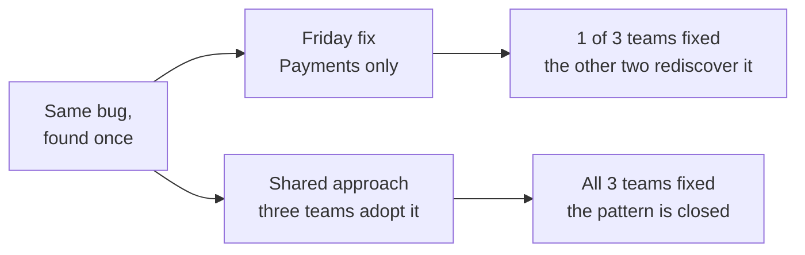

import Scenario from "../../../components/Scenario.astro";
import LevelIntro from "../../../components/LevelIntro.astro";
import PracticeCheck from "../../../components/PracticeCheck.astro";

export const unit = {
  track: "career-craft",
  unitSlug: "staff-scope",
};

<Scenario label="The Friday fix">
  <Fragment slot="facts">
    

      

        

          Share of the problem Marcus's own team can fix
          1 of 3 teams
        

        

          

        

        
about $13,300 of $40,000 per quarter

      

      
🔁 <strong>3 teams</strong> (Payments, Fulfillment, Search), 3 separate hand-rolled retry versions

      
💸 <strong>$40,000</strong> lost last quarter to duplicate-charge refunds

      
⏱️ The Friday fix is real, correct, and finished in days

    

  </Fragment>

Marcus Chen is an engineer on the Payments team at Northwind Commerce, and
a promotion to staff engineer is on the table this cycle. While chasing a
routine bug, he notices that Payments retries failed calls to Meridian Pay,
the payment vendor. So do Fulfillment's shipping-cost calculator and
Search's pricing service. Three teams wrote three separate retry
implementations, and none of them is safe to repeat. When Meridian times
out and a retry fires anyway, the customer is charged twice. Last quarter
that cost the company $40,000 in refunds.

Marcus could ship a clean, correct fix for Payments by Friday. Nobody
would question it in review.

**If he does, has he done the most valuable thing available to him, or only
the fastest thing within his own team's walls?**

</Scenario>

An even three-way split of the $40,000 (an assumption, since the real split
is something Marcus would have to measure) puts his own team's share at
about $13,300 a quarter. The Friday fix would leave the other two-thirds
bleeding until each team rediscovers the bug on its own.

<LevelIntro
  items={[
    "Scope as the number of teams you shape",
    "Why the correct fix can be the wrong move",
    "What changes about the job's output",
  ]}
/>

## What does "scope" actually measure?

**Is the retry bug hard?** Not especially. Marcus could fix it alone in days.
So what separates this bug from the ones he fixes every week?

|                      | Owning your team's outcomes    | Owning outcomes across teams                                  |
| -------------------- | ------------------------------ | ------------------------------------------------------------- |
| The problem lives in | One team's code and roadmap    | Several teams' code, none of whose roadmaps will fix it alone |
| Who has to act       | You and your teammates         | Engineers on teams that do not report to you                  |
| Your main tool       | Your own implementation skill  | Technical direction: steering decisions others will carry out |
| Bounded by           | Your own hours                 | How many teams adopt the approach                             |
| Retry bug, seen as   | Three separate team-sized bugs | One pattern with one shared cause                             |

- **Scope** is how many teams' decisions your judgment is expected to
  shape. It does not measure how hard the work is.
- **Technical direction** means steering a decision that other people will
  implement, instead of implementing it yourself.
- Being the best engineer on your own team does not by itself produce either
  one. It is a different shape of ownership, not a higher grade of the same
  one.

<PracticeCheck
  track={unit.track}
  unitSlug={unit.unitSlug}
  topicId="scope-shape"
/>

## Why can the correct fix still be the wrong move?

**Nothing is wrong with Marcus's Friday fix.** So why hesitate?

The question a cross-team decision turns on is narrower than "what is the
correct fix". It is "whose problem is this at the scope I am responsible
for, and what is the highest-leverage way to close it there?"

- **Org-level leverage** means multiplying an outcome across teams instead
  of producing it once, yourself, for one team.
- A fix can be technically excellent and still aimed at a third of the
  problem.
- That does not make quick fixes bad. A narrow, urgent problem with no
  owner still deserves the keyboard (L2 covers when).

<PracticeCheck
  track={unit.track}
  unitSlug={unit.unitSlug}
  topicId="fix-vs-leverage"
/>

## What is the job's real output?

Two further consequences get their own levels. **Saying no** to legitimate
work that does not move the needle at your scope is how attention stays
pointed at the large problems. **Sponsoring** someone else, by handing them
a visible, growth-shaped piece of the work, multiplies output without
adding hours. L2 builds the model behind both, and L3 walks one quarter of
Marcus's case move by move.
