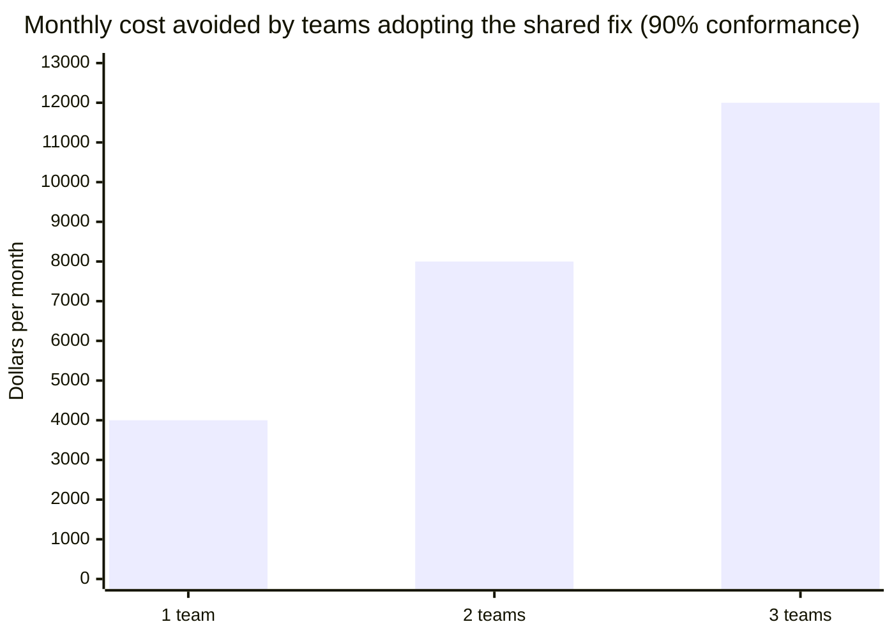
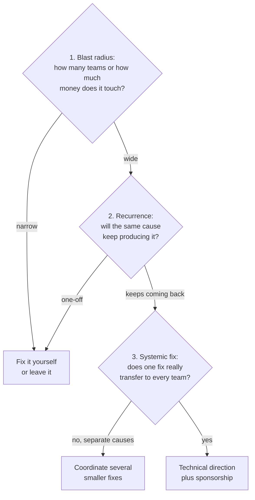

import LevelIntro from "../../../components/LevelIntro.astro";
import Checkpoint from "../../../components/Checkpoint.astro";
import PracticeCheck from "../../../components/PracticeCheck.astro";

export const unit = {
  track: "career-craft",
  unitSlug: "staff-scope",
};

L1 named the gap: Marcus's Friday fix is correct engineering aimed at a third
of the problem. This level builds the model behind that gap, and the
decision rules for when to close it.

<LevelIntro
  items={[
    "Three sources of leverage",
    "Three questions that pick the lever",
    "Saying no as attention defense",
  ]}
/>

## If Marcus manages nobody, where does his leverage come from?

**He has no direct reports and no authority over Fulfillment or Search.**
Yet a design doc that two other teams adopt is worth more than anything he
could type himself. What is that leverage made of?

| Source               | How it is produced                                                              | What it scales with                       |
| -------------------- | ------------------------------------------------------------------------------- | ----------------------------------------- |
| Individual execution | Marcus writes, reviews, or ships the fix himself                                | His own hours                             |
| Technical direction  | Marcus writes the proposal and gets the other teams' leads to agree to one path | How many teams adopt it                   |
| Sponsored delegation | Someone Marcus backs builds the shared piece and presents it to the other teams | How many people can operate at that scope |

Individual execution has a hard ceiling no matter how skilled the person
is. None of Marcus's hours are transferable to Fulfillment's backlog. The
other two rows do not carry that ceiling.

The adoption numbers make this concrete. Take the $40,000 a quarter,
which is about $13,333 a month, and assume it splits evenly across the three
teams: about $4,444 a month each. If teams implement the shared fix
faithfully 90% of the time (an assumption, the demo below lets you change
it), the monthly cost avoided grows with every team that adopts it.

One team is the ceiling Marcus reaches alone. Three teams is three times
that, with no extra hours from him, as long as the others actually adopt it.

<Checkpoint question="Marcus personally writes the shared retry fix into all three teams' codebases himself, over a long sprint. Is that technical direction, or still individual execution?">

Still individual execution. The source of leverage is determined by whose
judgment and whose hours do the producing, not by how many codebases the
work touches. If Marcus writes all three fixes, the outcome is still
bounded by his own calendar; he has only taken longer to hit the ceiling.
Technical direction means the other teams' engineers adopt an approach and
build toward it themselves, which is what removes the one-person limit.

</Checkpoint>

<PracticeCheck
  track={unit.track}
  unitSlug={unit.unitSlug}
  topicId="leverage-currencies"
/>

## How does he decide which lever to pull?

**Not every cross-team annoyance deserves a design doc.** Some deserve a
quick fix, some deserve nothing. What decides?

The retry bug answers all three the same way. It touches three teams and
real customer money. The vendor's timeouts are not going away, so the
pattern recurs. And all three implementations share one cause, so one
idempotent approach would fix every one. That combination is what makes
technical direction outrank personal execution.

The framework chooses a lever, it does not ban one. A narrow, urgent problem
with no clear owner, such as a production incident at 2am or a security
patch that cannot wait for consensus, is still best served by picking up
the keyboard, because the coordination cost of direction would be slower
than the fix itself.

<Checkpoint question="A typo in an internal admin tool used only by Marcus's own team crosses his desk. It will never come back once fixed. Should he write a design doc and seek cross-team buy-in?">

No, he should just fix it. It fails the first two questions outright:
the blast radius is one team's internal tool, and the recurrence is zero.
Technical direction is the right lever for wide, recurring, systemically
fixable problems. Applying it here would be slower than doing the fix, for
no added leverage.

</Checkpoint>

<PracticeCheck
  track={unit.track}
  unitSlug={unit.unitSlug}
  topicId="attention-framework"
/>

## Why does saying yes to everything defend nothing?

**If every request that lands on Marcus's desk is reasonable, what is the
cost of agreeing to all of them?** Each yes spends the same limited hours,
and it spends them on whichever request arrived most recently, not on the
largest problem available.

| The request                                             | What saying yes actually costs                                            |
| ------------------------------------------------------- | ------------------------------------------------------------------------- |
| A sprint of prototyping on a flashy, unrelated feature  | The sprint he would have spent closing a $40,000-a-quarter leak           |
| Reviewing every pull request in another team's codebase | Hours that cannot also go to the one fix worth three teams' outcome       |
| An unscoped "just take a look" at a peer's design       | Time that never shows up as direction, since it targets no scored problem |

None of these is a bad request, which is exactly why each is easy to accept.
Saying no on purpose, with a stated reason, is a skill and not a
personality trait. It is the framework above applied out loud.

<PracticeCheck
  track={unit.track}
  unitSlug={unit.unitSlug}
  topicId="scope-defense"
/>
