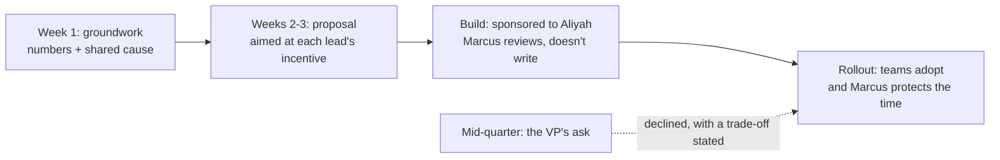

import Scenario from "../../../components/Scenario.astro";
import LevelIntro from "../../../components/LevelIntro.astro";
import Checkpoint from "../../../components/Checkpoint.astro";
import PracticeCheck from "../../../components/PracticeCheck.astro";

export const unit = {
  track: "career-craft",
  unitSlug: "staff-scope",
};

<Scenario label="The quarter">
  <Fragment slot="facts">
    

      
🧑‍💻 Aliyah Osman: engineer on Payments, already cataloging Meridian failure modes unasked

      
🧑‍🔧 Devon Ruiz: tech lead, Fulfillment; owns a second retry version

      
🧑‍💼 Sana Patel: tech lead, Search; owns a third

      
📋 Greg Whitfield: VP of Engineering; asks for an unrelated demo sprint mid-quarter

    

  </Fragment>

Marcus does not ship the Friday fix. Over one quarter he gathers the real
numbers, writes a proposal for one shared, safe-to-repeat retry library
owned by the Platform team, gets the other two tech leads to commit to
adopting it, hands the build to Aliyah, and turns down a VP's request for a
sprint of unrelated prototyping.

**None of those four moves is Marcus writing the fix. What does a
promotion committee see at the end of the quarter that a fast Friday fix
would never have shown them?**

</Scenario>

This level walks the whole quarter, including the parts that had nothing to
do with code.

<LevelIntro
  items={[
    "Four moves, in the order they depend on each other",
    "Declining a VP without saying it is not your job",
    "A filled-in worksheet and where it stops fitting",
  ]}
/>

## What has to be true before the proposal gets written?

**Why does Marcus spend week one not writing a design doc?** Because a doc
that says "let's fix retries" cannot survive Devon asking, "how do you know
our bug is really the same as yours?"

In this scenario he establishes three things first.

| Question the groundwork had to answer         | Answer in this scenario                                                      |
| --------------------------------------------- | ---------------------------------------------------------------------------- |
| How much of the $40,000 belongs to each team? | Roughly even: about $13,300 per team per quarter (assumed for this case)     |
| Is Meridian's flakiness a spike or ongoing?   | Ongoing: timeouts of about 2% of calls, steady across two quarters (assumed) |
| Do the three teams share one root cause?      | Yes: none of the three retry versions is safe to repeat                      |

That week turns "I noticed a bug" into a scoped problem: quantified,
spanning three teams, with one cause. L2's three questions all have
answers before anyone is asked to commit.

<PracticeCheck
  track={unit.track}
  unitSlug={unit.unitSlug}
  topicId="groundwork-buyin"
/>

## How do you persuade leads who do not answer to you?

**Devon and Sana have their own roadmaps and owe Marcus nothing. What does
the proposal have to do that a normal team design doc does not?** It has to
be written around their incentives. It opens with each team's own dollar
figure, and it proposes that Platform owns the library long term, so
adopting it moves a maintenance burden off their teams.

Both leads push back. Sana wants a flag so Search can roll out gradually.
Devon points out that Fulfillment's retry logic also handles a shipping-rate
lock the library does not cover yet. Marcus folds the flag into the design
and schedules the rate-lock case as a fast follow instead of a blocker.
Both teams commit a slice of next quarter's roadmap.

<Checkpoint question="Both objections were folded into the design instead of argued down. Why does that strengthen a proposal aimed at teams that do not report to Marcus?">

A proposal that has to win voluntary roadmap time from two independent
teams must survive their actual constraints, not just Marcus's reasoning.
If the doc ignored the objections, the realistic outcome is not adoption
anyway; it is quiet non-adoption, leaving Marcus with an elegant plan that
fixes only his own third. Folding in real constraints is what makes the
document something the others can build their own commitments around.

</Checkpoint>

## Why hand the build to Aliyah?

**Marcus has the design, the buy-in, and the skill. Why not build it?**
Aliyah had been tracking Meridian's failure modes in a personal document for
weeks without being asked, the kind of unprompted signal that shows
readiness instead of aspiration. Two things change when she leads.

1. The organization gains a second person who can operate across teams,
   not just a library. Presenting design trade-offs to Devon's and Sana's
   teams herself is the technical-direction skill L2 described, and she
   would not practise it if Marcus did the talking.
2. Marcus's attention is free for the next problem that scores high,
   instead of being consumed by this one's implementation.

By quarter's end Aliyah has shipped the library, presented it at the
engineering-wide design review herself, and is the person Devon's team now
emails with questions. Her growth is visible to a committee independent of
Marcus.

<PracticeCheck
  track={unit.track}
  unitSlug={unit.unitSlug}
  topicId="sponsorship"
/>

## What does Marcus say to the VP?

**Greg asks for a sprint on a "smart checkout recommendations" demo:
real work, from someone senior, genuinely interesting.** Marcus does not say
"that is not my job", since he could build a good prototype. He does three
things, in order: names the trade-off in terms Greg already cares about,
offers a smaller real version of the ask, and suggests another owner.

| What Marcus avoided                            | What he did instead                                                                  |
| ---------------------------------------------- | ------------------------------------------------------------------------------------ |
| Refusing without explanation                   | Named the trade-off: a sprint here is a sprint not spent on a $40,000-a-quarter leak |
| Dropping the rollout quietly to avoid conflict | Protected the commitment he had already made to Devon and Sana                       |
| Saying yes and falling behind on both          | Offered a half-day feasibility spike plus a named alternative owner                  |

<Checkpoint question="Why would simply saying yes and attempting both the rollout and the prototype have cost more than the extra work involved?">

Attention is the scarce resource, so saying yes to both does not add hours;
it splits them between a scored three-team problem and an unscored demo.
The most likely casualty is the rollout, at the moment two other teams are
relying on Marcus's follow-through to justify the roadmap slices they
already committed. Saying yes to everything spends leverage on whichever
request is loudest, not on what matters most.

</Checkpoint>

<PracticeCheck track={unit.track} unitSlug={unit.unitSlug} topicId="vp-no" />

## Putting the quarter on one page

Marcus's specifics will not match anyone else's. The same worksheet, filled
in for his case:

| Question                                                 | Marcus's answer                                                   |
| -------------------------------------------------------- | ----------------------------------------------------------------- |
| Blast radius: how many teams, how much money?            | 3 teams, $40,000 a quarter, confirmed by a week of groundwork     |
| Recurrence: one-off or ongoing?                          | Ongoing: steady timeouts for two quarters                         |
| Systemic fix: does one fix transfer to all teams?        | Yes: same cause, confirmed before proposing anything              |
| Who executes, and what does that produce beyond the fix? | Aliyah leads; the organization gains a second cross-team engineer |
| What was declined, and on what stated basis?             | The demo sprint, traded for a half-day spike and another owner    |

**This worked example is one case, not the whole territory.** Try bending it.
Suppose the groundwork had shown three genuinely unrelated causes: what
would the right form of direction be then? Suppose the competing request had
come from a peer Marcus wanted to help, with no dollar figure to point to on
either side: how would he decide, and what would he say? Suppose Devon had
simply refused to adopt it: what has Marcus actually lost, and what options
remain? The framework does not hand you answers to these; it tells you which
questions to ask first.
