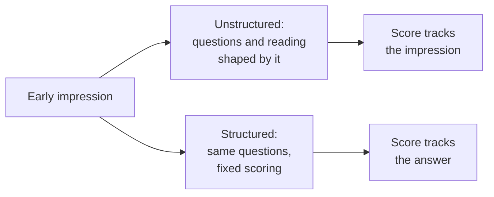

import Scenario from "../../../components/Scenario.astro";
import LevelIntro from "../../../components/LevelIntro.astro";
import PracticeCheck from "../../../components/PracticeCheck.astro";

export const unit = {
  track: "career-craft",
  unitSlug: "structured-interviewing",
};

<Scenario label="A decision made in the first 90 seconds">
  <Fragment slot="facts">
    

      

        90 s of 45 min
        assumed illustration, about 3% of the interview
      

      

        

      

    

    

      
⏱️ First 90 seconds: a gut impression forms

      
❓ Remaining time: whatever questions come to mind

      
📝 Written feedback: echoes the first impression

    

  </Fragment>

An interviewer meets a candidate for a team role. Assume, for illustration,
a 45-minute interview. Within the first 90 seconds, before any real question
has been asked, the interviewer has already decided "I like this person." The
remaining time goes to whatever questions come to mind, and the written
feedback at the end matches that first impression almost exactly.

**Did the other 43 and a half minutes change anything, or did they only
confirm a decision that was already made?**

</Scenario>

An early impression does not feel like a decision. It feels like noticing. That
is exactly why it does so much damage: the interviewer never sees themselves
choosing to be generous with one candidate and strict with the next.

<LevelIntro
  items={[
    "The halo effect in interviews",
    "Structured vs. unstructured interviews",
    "What a rubric anchor is",
  ]}
/>

## What is the halo effect, and where does it show up?

**If two candidates give equally good answers, why might they still get
different scores?** Because of what the interviewer already felt before the
answer started.

- A **candidate** is the person being evaluated. An **interviewer** is the
  person asking the questions and writing the feedback.
- The **halo effect** is an early impression (good or bad) coloring how
  everything after it gets read, including evidence unrelated to the
  impression.
- An **ambiguous answer** can be read generously ("confident") or harshly
  ("evasive"). The first impression quietly decides which reading wins.

The same thing happens outside hiring. If a teacher already thinks a student
is brilliant, a vague oral-exam answer sounds deep. If the teacher expects
little, the identical answer sounds confused.

<PracticeCheck
  track={unit.track}
  unitSlug={unit.unitSlug}
  topicId="halo-effect"
/>

## What changes when the interview has structure?

**If every candidate takes a different interview, what exactly is being
compared?** Not much. Two scores from two different interviews are two
opinions, not two measurements.

|                          | Unstructured                                  | Structured                              |
| ------------------------ | --------------------------------------------- | --------------------------------------- |
| Questions                | Improvised, different per candidate           | Same core questions for every candidate |
| "Good answer" defined    | After hearing the answer, shaped by gut feel  | Before any candidate is interviewed     |
| Ambiguous answer         | Read generously or harshly by the halo effect | Scored against a fixed anchor           |
| Comparing two candidates | Hard: each took a different interview         | Possible: same questions, same standard |

<PracticeCheck
  track={unit.track}
  unitSlug={unit.unitSlug}
  topicId="structured-vs-unstructured"
/>

## What is a rubric anchor?

**"Rate this answer from 1 to 5" sounds objective. Is it?** Only if each number
has been given a concrete meaning in advance.

- A **scoring rubric** is a written description of what each score looks like
  for one question, decided before any candidate is interviewed.
- An **anchor** is one concrete line in that description: "a 5 names at least
  one trade-off and a way to check the result," not just "a 5 is excellent."
- Anchors written after hearing an answer are not anchors. They are
  justifications for a score that was already forming.

| Term                 | Simple meaning                                                    |
| -------------------- | ----------------------------------------------------------------- |
| Halo effect          | An early impression coloring everything after it                  |
| Structured interview | Same questions for all, scored against a rubric fixed in advance  |
| Anchor               | A concrete, observable description of what a given score requires |

<PracticeCheck
  track={unit.track}
  unitSlug={unit.unitSlug}
  topicId="rubric-anchors"
/>

## What this unit covers

L2 explains why fixed questions and a written rubric counter the halo effect
when good intentions alone cannot, and what a real anchor needs to say. L3
scores the same two candidates both ways to show exactly where the outcomes
split, then asks what happens when the rubric itself is flawed.
