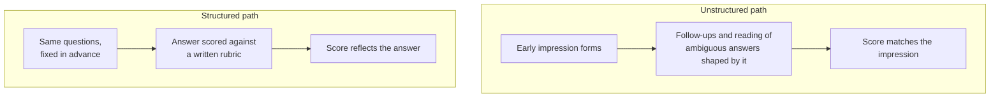
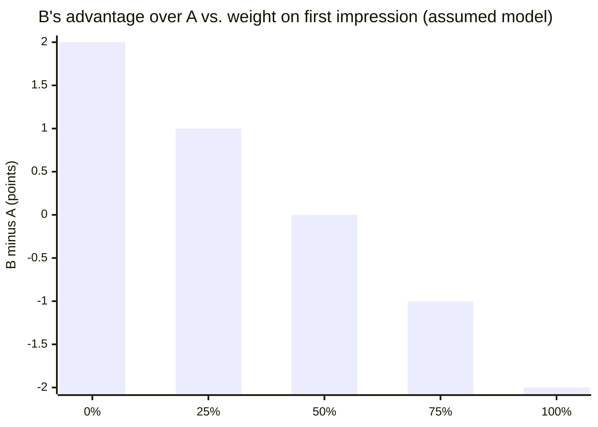

import LevelIntro from "../../../components/LevelIntro.astro";
import Checkpoint from "../../../components/Checkpoint.astro";
import PracticeCheck from "../../../components/PracticeCheck.astro";

export const unit = {
  track: "career-craft",
  unitSlug: "structured-interviewing",
};

L1 named the halo effect and set unstructured interviews against structured
ones. This level works out why fixed questions and a written rubric are the
specific things that break the halo effect's grip, and why "just try to be
fair" is not.

<LevelIntro
  items={[
    "Why good intentions do not stop the halo effect",
    "What a usable anchor requires",
    "Why fixed questions matter as much as the rubric",
  ]}
/>

## Why does trying harder not fix it?

**An interviewer sincerely wants to be fair. Why are their scores still
tilted?** Because the halo effect does not run through a decision to be
unfair. It runs through small choices the interviewer does not notice making:
which follow-up feels natural, which pause feels like hesitation, which vague
phrase sounds confident.

If you already like Candidate A, you ask a warmer follow-up and accept "I'd
narrow it down" as competence. If you are unsure about Candidate B, you ask a
harder follow-up and read the same hesitation as weakness. Sincerity only
makes the interviewer more confident in a judgment nobody re-examined.

<Checkpoint question="An interviewer says 'I'm very careful to be objective.' Does that statement tell you the halo effect is not affecting their scores?">

No. The halo effect works below conscious intent, so the interviewer's report
of their own care is not evidence either way. They would feel exactly as
objective whether it was operating or not. That is why the remedy has to be
structural, something built into the process that does not depend on the
interviewer noticing their own bias, rather than a request to try harder.

</Checkpoint>

<PracticeCheck
  track={unit.track}
  unitSlug={unit.unitSlug}
  topicId="good-intent-not-enough"
/>

## What does a usable anchor look like?

**"Rate problem-solving from 1 to 5" has numbers in it. Why is it still
vague?** Because without a description of what each number requires, a "5" is
whatever the interviewer's gut says a 5 is, and the halo effect has come back
in through the scoring sheet.

A usable anchor describes what must be **observable in the answer**. Here is
one for a single question, an assumed example written before anyone is
interviewed:

| Score | What the answer must contain                                                                    |
| ----- | ----------------------------------------------------------------------------------------------- |
| 1     | No structured approach; jumps to a fix without identifying the problem                          |
| 3     | Names the core problem and a reasonable approach, but no trade-offs or edge cases               |
| 5     | Names the core problem, states at least one trade-off, and says how the result would be checked |

Three terms in the 5-row: a **trade-off** is a choice with a cost ("targeted
logging instead of repeated redeploys, because redeploys add noise"); an **edge
case** is a rarer situation the approach must still survive; to **validate** is
to check with evidence rather than a feeling that the answer sounds right.

<Checkpoint question="A candidate gives a fluent, confident answer with no trade-off and no way to check the result. Against the table above, where does it land, and why does the table matter here?">

Around a 3 at best: it may name a reasonable approach, but the 5-row needs a
stated trade-off and a way to check the result, and neither is there. The
table matters because the confident delivery is exactly what would push an
unanchored "1 to 5" upward. With the anchors written in advance, the evaluator
has to find specific content in the answer before awarding the higher number,
and delivery alone cannot supply it.

</Checkpoint>

## Why do the questions need to be the same too?

**If the rubric is excellent, does it matter that Candidate A got an easier
question?** Yes. A rubric can only compare answers to the same question. If
the interviewer, without meaning to, gives the candidate they like a gentler
version, a "5" for A and a "5" for B no longer mean the same thing, however
identical the rubric wording.

- Fixed questions remove the interviewer's chance to quietly set one candidate
  up to shine and another to struggle.
- A fixed **core** does not ban follow-ups. It means every candidate gets the
  same required questions first, and follow-ups probe what was said rather than
  what the interviewer hoped to hear.

<PracticeCheck
  track={unit.track}
  unitSlug={unit.unitSlug}
  topicId="fixed-questions"
/>

## Does structure make the interviewer's impressions vanish?

**If the rubric decides the score, what happens to the feeling that one
candidate was simply easier to talk to?** It stays. Structure does not erase
impressions; it stops them from silently becoming the competency score.

- A competency score answers "what did this answer contain?" against fixed
  anchors.
- A separate, labeled note can capture other things ("communicated warmly"),
  with its weight, if any, decided in advance.
- "Team fit" must not mean "I enjoyed talking to them." If it is evaluated at
  all, it needs its own observable criteria, such as explaining a trade-off
  respectfully or working through a disagreement.

To feel why this matters, take this unit's interactive demo. It uses an
assumed teaching model: Candidate A has rubric score 3 and a stronger first
impression (5); Candidate B has rubric score 5 and a weaker one (3). Blend the
two with a weight on the first impression, and B's advantage over A is
$$2 - 4w$$ where $$w$$ is that weight as a fraction.

At 50% the candidates tie; past it the better-rubric candidate loses. Nothing
about the candidates changed, only how much the impression was allowed to count.

<Checkpoint question="A company bans anyone from writing down any impression of a candidate other than the rubric score. Does that make the process more structured?">

Not necessarily. Banning the note does not stop the impression forming; it
only removes the one place it was visible and could be audited. A clearly
separate note, with an agreed weight (possibly zero), is more structured
because the impression can no longer hide inside a competency score. The
point is to keep each kind of evidence in its own labeled place.

</Checkpoint>

<PracticeCheck
  track={unit.track}
  unitSlug={unit.unitSlug}
  topicId="impressions-stay"
/>

## Is this only about hiring?

**What is the general move?** Decide the criteria before seeing the thing being
judged. The same idea applies to code review checklists, performance
calibration, and judging a competition: wherever a first impression could
steer what evidence you look for and how you read it, fixing the standard in
advance breaks the loop.
