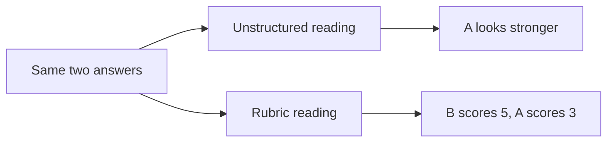

import Scenario from "../../../components/Scenario.astro";
import LevelIntro from "../../../components/LevelIntro.astro";
import Checkpoint from "../../../components/Checkpoint.astro";
import PracticeCheck from "../../../components/PracticeCheck.astro";

export const unit = {
  track: "career-craft",
  unitSlug: "structured-interviewing",
};

<Scenario label="Two candidates, same role, same question">
  <Fragment slot="facts">
    

      
👤 <strong>Candidate A</strong>: confident, personable, likable within a minute

      
👤 <strong>Candidate B</strong>: quieter, slower to warm up

      
🎯 <strong>Same question</strong>: walk me through finding the cause of a live problem with no clear error message

      
⚖️ <strong>Rubric</strong>: 1, 3 or 5, anchors fixed before either interview

    

  </Fragment>

Two candidates are interviewed for a software role. The interviewer warms to
Candidate A almost at once. Candidate B takes longer to settle. Both are asked
the same question about tracking down the cause of a live problem that gives no
clear error message.

**Before reading on, predict: if the two answers are of genuinely different
quality, with the quieter candidate's answer the stronger, which one does an
unstructured interview tend to reward?**

</Scenario>

<LevelIntro
  items={[
    "The same answers scored two ways",
    "What changes in the written record",
    "How a flawed rubric still biases outcomes",
  ]}
/>

A few terms for the example: **bisecting deploys** means narrowing down which
release introduced a problem by testing between a known-good and a known-bad
one; **targeted logging** means adding focused records around the suspected
area instead of guessing broadly.

## What does the unstructured version produce?

Candidate A's answer is fluent but generic: "I'd check the logs, look at recent
deploys, and narrow it down." Already warm toward A, the interviewer hears
confidence and does not ask for specifics.

Candidate B's answer is halting but specific: check whether the problem lines
up with a traffic pattern or time window, bisect recent deploys against that
window, and if nothing shows up, add targeted logging around the suspect code
path instead of redeploying repeatedly. Less warmed up, the interviewer hears
hesitation and misses that the content is more rigorous.

Written feedback: A is a "strong communicator, clearly experienced"; B's answer
"was a bit unclear, some hesitation."

<Checkpoint question="From those two feedback lines alone, could you tell which candidate proposed the more rigorous approach?">

No, and that is the point. The feedback describes delivery, not content.
Candidate B's correlation by traffic window, deploy bisection, and a stated
preference for targeted logging over repeated redeploys never made it into the
record. The early impression did not only tilt the score; it filtered which
parts of the answer were remembered and written down at all.

</Checkpoint>

<PracticeCheck
  track={unit.track}
  unitSlug={unit.unitSlug}
  topicId="same-answers-two-ways"
/>

## What does the structured version produce?

Apply the L2 anchors to the same two answers: 1 = no structured approach; 3 =
reasonable approach, no trade-offs; 5 = structured approach plus an explicit
trade-off plus a way to check the result.

| Element                   | Unstructured                                    | Structured                                                                                                             |
| ------------------------- | ----------------------------------------------- | ---------------------------------------------------------------------------------------------------------------------- |
| Basis for A               | Delivery confidence, formed in the first minute | Content: reasonable but generic, no trade-off. **Score 3**                                                             |
| Basis for B               | Hesitant delivery                               | Content: names a trade-off (targeted logging over repeated redeploys), and the logging doubles as a check. **Score 5** |
| Where the score came from | The early impression, unnoticed                 | A rubric fixed before either interview                                                                                 |
| What the record shows     | "Strong communicator" / "a bit unclear"         | Which anchor each answer met, and why                                                                                  |

These are the same numbers the demo on this unit uses. With no weight on first
impression, B leads by 2 points (5 against 3). Every extra point of weight on
the impression shaves that lead until, at an even 50% blend, they tie, and
beyond it A wins on the strength of a minute-one feeling.

<Checkpoint question="Did introducing the rubric make the interviewer stop preferring Candidate A's style?">

No. The interviewer probably still enjoyed A's company more. What changed is
that this preference no longer decided the competency score. If the company
wants communication style recorded, it belongs in a separate, labeled note
with a weight agreed in advance, not folded silently into the technical
number.

</Checkpoint>

## What if the rubric itself is flawed?

**The anchors above rewarded correlation, bisection and targeted logging. What
if those are the wrong things to reward for this role, or favor someone who
happened to see a similar incident before?** Then the process stays perfectly
consistent and comparable and is still biased, now by the rubric rather than
by any one interviewer's gut. Structure removes the interviewer's private
variation; it does not remove the need to design the content well.

| Rubric check                                             | Why it matters                                           |
| -------------------------------------------------------- | -------------------------------------------------------- |
| Does it measure something the job actually needs?        | Otherwise it is consistent but irrelevant                |
| Can an interviewer observe it in an answer?              | Otherwise scoring becomes guesswork again                |
| Does it reward general skill, not one familiar incident? | Otherwise it favors lucky exposure over ability          |
| Would two interviewers read the anchor the same way?     | Otherwise the "same rubric" produces different standards |

<PracticeCheck
  track={unit.track}
  unitSlug={unit.unitSlug}
  topicId="rubric-design"
/>

## Failure modes

| Failure mode                                        | What it gets wrong                                                   |
| --------------------------------------------------- | -------------------------------------------------------------------- |
| Scale labels with no anchors ("rate 1 to 5")        | Brings back the subjective judgment the rubric was meant to remove   |
| Rubric used, but candidates get different questions | Scores are not comparable even if each was scored fairly             |
| Believing structure eliminates impressions          | It only stops impressions from silently setting the competency score |
| Treating rubric design as a formality               | A flawed rubric yields consistent, comparable, still-biased results  |
| Writing anchors after hearing an answer             | Defeats the purpose: anchors must exist before any candidate is seen |

## Extend it: what else could change?

This was one worked case, not the whole territory. Try pushing it before moving on.

**What if the two interviewers disagree on the same answer, with the same rubric
in hand?** Is the problem the interviewers, or the anchor wording, and how would
you tell?

**What if the quiet candidate's answer had been weaker, not stronger?** Does the
rubric still help, or did it only look useful because it favored the "surprising"
winner?

**What if the role needed collaboration under disagreement more than debugging?**
Which anchors would you write, and what would be observable in an answer?

None of these has one clean answer. The structure is a method for keeping
evidence and impressions apart, not a script that fits every hire.
