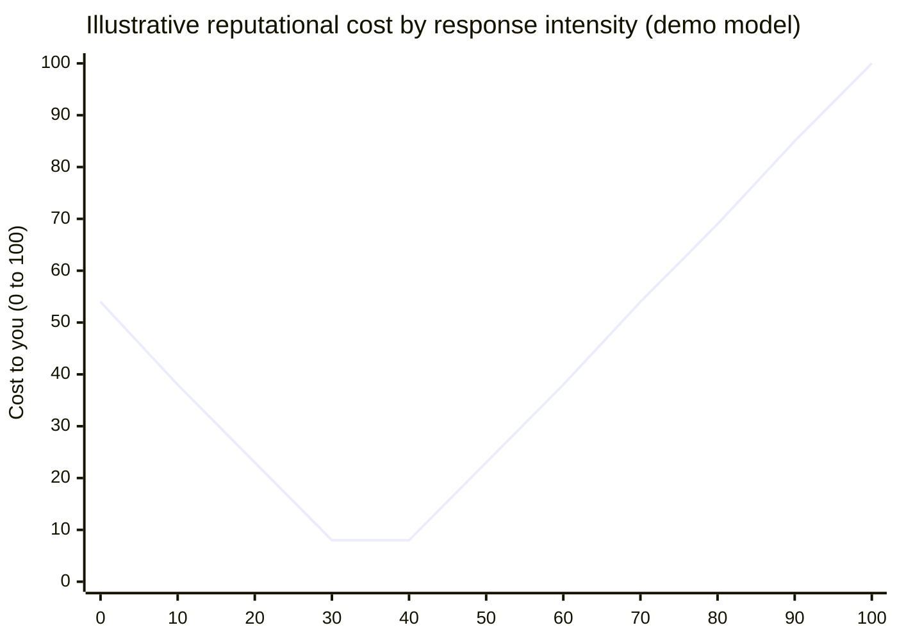
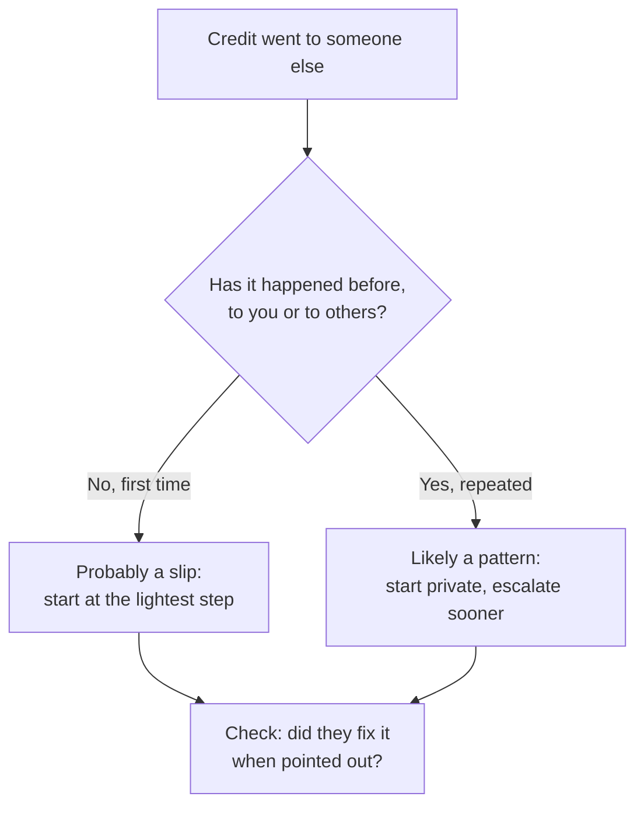

import Scenario from "../../../components/Scenario.astro";
import LevelIntro from "../../../components/LevelIntro.astro";
import PracticeCheck from "../../../components/PracticeCheck.astro";

export const unit = {
  track: "corporate-politics",
  unitSlug: "calibrated-confrontation",
};

<Scenario label="Mia's dragon drawing">
  <Fragment slot="facts">
    

      

        
🐉 Mia drew the dragon over a whole weekend

        
🧒 Theo holds it up: "I drew this"

        
👩‍🏫 The teacher smiles and pins it on the wall

        
⏱️ Mia has a few seconds to choose a reaction

      

      

        
Cost of each reaction (the unit's demo model, 0 to 100)

        

          

            
🤐 Say nothing54

            

          

          

            
🗣️ Calm word with Theo, then the teacher0

            

          

          

            
📢 Shout that Theo is a cheat100

            

          

        

      

    

  </Fragment>

Mia spent a whole weekend drawing a dragon for the class wall. On Monday
her classmate Theo holds it up and says, "Look what I drew." The teacher
smiles and pins it up with his name on it.

Mia has a few seconds. She could say nothing and hope it blows over. She
could shout across the room that Theo is a liar. Or she could do
something in between. **Which of the three actually gets her dragon
credited to her, and which ones quietly make things worse?**

</Scenario>

The three-way choice Mia faces is the same one an engineer faces when a
teammate presents her fix as his own. Only the audience changes, not the
shape of the decision.

<LevelIntro
  items={[
    "Underreacting, overreacting, matched",
    "One slip versus a pattern",
    "The ladder: lightest step first",
  ]}
/>

## What are the two wrong answers, and what is the right one?

**If Mia's goal is to have the dragon credited to her, why do silence and
shouting both fail?** Silence tells Theo it worked. Shouting makes Mia the
person who caused the scene, even if she is right.

- **Underreacting:** saying nothing. It feels safe, and it teaches the other
  person that the behaviour is free.
- **Overreacting:** a loud or public response bigger than what happened. It
  can cost you more credibility than it costs them.
- **Calibrated confrontation:** a response whose size is matched to the
  incident's severity and to what is at stake, usually private and factual
  first.

The unit's demo uses an illustrative model: the cost of a reaction is lowest
at a calibrated intensity of 35 on a 0 to 100 scale and grows toward both
ends. The numbers are a teaching model, not measured data.

| Reaction                     | What it signals                         | Typical result                          |
| ---------------------------- | --------------------------------------- | --------------------------------------- |
| Say nothing                  | "This is free"                          | Repeats if it was deliberate            |
| Calm private word, then more | "I noticed, and I will say so politely" | Often fixed with no damage              |
| Public blowup                | "I am the problem here"                 | You look disproportionate, right or not |

<PracticeCheck
  track={unit.track}
  unitSlug={unit.unitSlug}
  topicId="proportion-matters"
/>

## Is this one slip or a pattern?

**Two kids each present Mia's work as theirs. One does it once while
rushing; the other does it every week. Should Mia respond the same way to
both?** No. How often it has happened changes where she should start.

- A **one-time slip** is a single, plausibly careless event. Start at the
  lightest workable step.
- A **pattern** is repeated behaviour, especially toward several people.
  Still start privately, but move up faster if it repeats.
- The same two checks used in [warning-signs](/corporate-politics/warning-signs/)
  apply: multiplicity (how many times) and duration (over how long).

<PracticeCheck
  track={unit.track}
  unitSlug={unit.unitSlug}
  topicId="slip-vs-pattern"
/>

## What is the escalation ladder?

An **escalation ladder** is an ordered list of responses from lightest to
heaviest. You start on the lowest rung that is plausible and move up only
when a rung has genuinely been tried and failed. Silence is rung 1, a
private conversation is rung 2, a written record added to it is rung 3, a
manager is rung 4, and formal channels are rung 5.

The skill is not choosing the loudest rung or the safest one. It is
choosing the **matched** one, then having a reason for each move up.

L2 builds the model: how to read the situation, the five rungs in detail,
and how to word the private conversation so it gets a correction instead of
a fight. L3 follows one engineer, Dana, through a real version of this
problem at work, including the part where the private conversation does not
hold.
